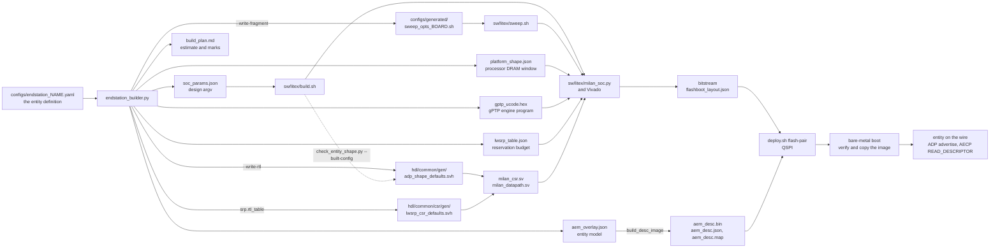
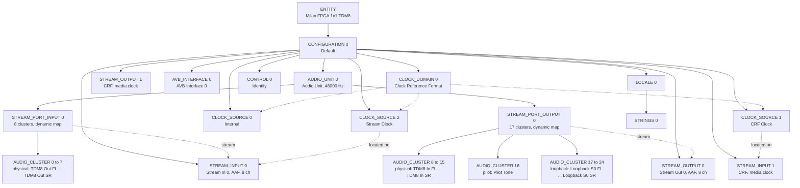
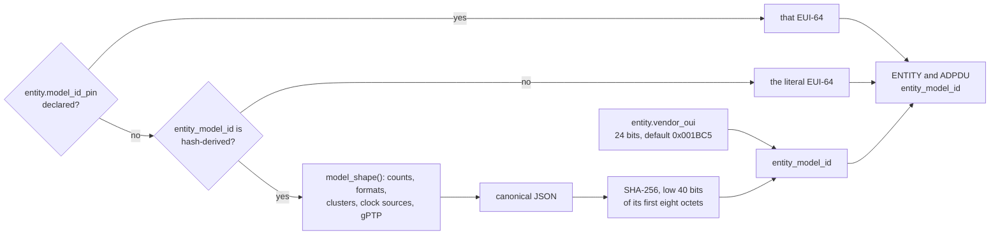

# Defining the end station

One YAML file defines the whole end station.

The builder turns it into everything the FPGA build reads.

This page follows it to the entity on the wire.

## Contents

- **[The model](#the-model)** -- What the YAML declares, and where.
- **[What the builder generates](#what-the-builder-generates)** -- Artifacts and their readers.
- **[When the model ID moves](#when-the-model-id-moves)** -- Shape changes re-identify.
- **[Resources](#resources)** -- The estimate, the route, and what fits.
- **[Worked example](#worked-example)** -- 2x2, a change that fits, then back.
- **[Workflow](#workflow)** -- From an edit to the controller.

## The model

The end-station YAML is the single definition of the entity.

Each tracked shape is one file under `configs/`.

| Section | What it declares |
|---|---|
| `schema`, `schema_version` | Which schema the file follows |
| `entity` | Names, serial number and the identity rules |
| `board` | The board, its clocks and the optional fabric blocks |
| `clocking` | Media clock rate, clock sources and the CRF pair |
| `audio_interface` | The physical interface, routed channels and cluster policy |
| `streams` | Every listener and talker, its channels, formats and map mode |
| `srp` | The stream reservation profile and its legacy registers |
| `platform` | Station MAC and the processor memory window |
| `soc` | The bare-metal CPU profile |
| `gptp` | Announce priority and the measured timestamp corrections |
| `names` | Optional object names of the singleton descriptors |
| `model_lint_waivers` | Processor model-lint waivers, passed through unread |

### Where each key is specified

The [key reference](../../sw/builder/README-parameters.md#key-reference) lists every key.

It gives meaning, need, default, limits and clause.

It also names the check that refuses a bad value.

The table is generated from the builder, never by hand.

Its home is the builder's parameter reference beside the builder.

[`gen_key_reference.py`](../../sw/builder/gen_key_reference.py) probes each key against the builder.

It loads the shipping configuration with each key broken.

Its `--check` mode fails when the table goes stale.

The clause column comes from the per-key contract table.

That table is [section 3 of the builder design](../ENDSTATION_BUILDER.md#3-config-schema--aem-descriptor-mapping).

### Misspelt keys

Some sections drop an unknown key without a word.

A misspelt optional key there silently keeps its default.

The [unknown-key table](../../sw/builder/README-parameters.md#unknown-keys) lists those sections.

Check spelling against the key reference after every edit.

## What the builder generates

The builder reads one YAML file and writes per-configuration artifacts.

The build reads them; the board boots the result.

<!-- generated:flow:start (docs/diagrams/endstation_definition.gen.py; do not edit) -->

<!-- generated:flow:end -->

Each artifact name above is one the builder returns.

Each consumer is checked to name the file it reads.

### Tracked files and build outputs

Most artifacts are build outputs under `sw/builder/out/`.

A few land in the tree, and only on request.

<!-- generated:artifacts:start (docs/diagrams/endstation_definition.gen.py; do not edit) -->
| Artifact | Lands in | Tracked copy | Written | Read by |
|---|---|---|---|---|
| `soc_params.json` | `sw/builder/out/<config>/` | no | every run | `sw/litex/build.sh`, then `milan_soc.py` |
| `aem_overlay.json` | `sw/builder/out/<config>/` | no | every run | `milan_soc.py` `build_desc_image`, which writes `aem_desc.bin` |
| `platform_shape.json` | `sw/builder/out/<config>/` | no | every run | `milan_soc.py` |
| `gptp_ucode.hex` | `sw/builder/out/<config>/` | no | every run | `milan_soc.py` |
| `lwsrp_table.json` | `sw/builder/out/<config>/` | no | every run | `milan_soc.py` |
| `lwsrp_table.svh` | `sw/builder/out/<config>/` | no | every run | no build step |
| `aecp_aem_rom.svh` | `sw/builder/out/<config>/` | no | every run | no build step |
| `build_plan.md` | `sw/builder/out/<config>/` | no | every run | a person |
| `adp_shape_defaults.svh` | `configs/generated/<config>/gen/` | yes | every run of a config under `configs/` | simulation suites, by include path |
| `adp_shape_defaults.svh` | `hdl/common/gen/adp_shape_defaults.svh` | yes | `--write-rtl` | `milan_csr.sv` and `milan_datapath.sv` |
| `lwsrp_csr_defaults.svh` | `hdl/common/csr/gen/lwsrp_csr_defaults.svh` | yes | `srp.rtl_table: true` | `milan_csr.sv` |
| `sweep_opts_ax7101.sh` | `configs/generated/sweep_opts_<board>.sh` | yes | `--write-fragment` or `--write-rtl` | `sw/litex/sweep.sh` |
<!-- generated:artifacts:end -->

`--write-rtl` makes the chosen configuration own the tracked shape include.

`--write-fragment` refreshes only the board's sweep fragment.

`build.sh` refuses a build whose tracked shape is another configuration.

The [build guide](../integration/BUILDING.md#21-what-buildsh-refuses-before-anything-launches) lists every refusal.

The command line lists the sweep fragment under `wrote` every time.

Without either flag it does not write it.

### The 1x1 descriptor tree

The shipping 1x1 TDM8 shape serves this AEM descriptor tree.

The builder's own overlay draws it, counted against its census.

<!-- generated:aem-tree:start (docs/diagrams/endstation_definition.gen.py; do not edit) -->

<!-- generated:aem-tree:end -->

Solid arrows show containment by IEEE 1722.1-2021 7.2.

Dotted arrows show references between descriptors.

Each stream port owns one contiguous block of clusters.

The pools name each block's role: physical, pilot or loopback.

## When the model ID moves

Controllers cache an entity's descriptors by its `entity_model_id`.

A changed model must carry a new ID.

A stale cache shows ports the board does not have.

<!-- generated:model-id:start (docs/diagrams/endstation_definition.gen.py; do not edit) -->

<!-- generated:model-id:end -->

With `hash-derived`, the builder hashes the model shape only.

| Change | Moves a hash-derived ID? | Why | Clause |
|---|---|---|---|
| Streams, formats, clusters, clock sources | yes | They are the model's structure | IEEE 1722.1-2021 6.2.2.8 |
| Declared gPTP attributes | yes | AVB_INTERFACE carries them | IEEE 1722.1-2021 7.2.8, 6.2.2.8 |
| `entity.vendor_oui` | yes | It is the ID's top bits | IEEE 1722.1-2021 6.2.2.8 |
| The descriptor byte layout (`AEM_LAYOUT_REV`) | yes, every ID at once | The bytes change under every shape | IEEE 1722.1-2021 6.2.2.8 |
| Object names, channel names | no | `object_name` is not model structure | IEEE 1722.1-2021 6.2.2.8 |
| Serial number, station MAC, entity ID | no | Instance facts, not model shape | IEEE 1722.1-2021 6.2.2.8 |
| Timestamp latency corrections | no | They change timestamps, not descriptors | IEEE 802.1AS-2011 8.4.3 |

A pin or a literal ID never moves by itself.

Change it yourself whenever the shape changes.

The [identity rules](../../sw/builder/README-parameters.md#entity-identity) give the full derivation.

## Resources

Each build plan ends with a pre-place resource estimate.

It sums a per-module cost table over the configuration.

The verdict judges the worst category against the part.

<!-- generated:resources:start (docs/diagrams/endstation_definition.gen.py; do not edit) -->
| Configuration | Streams | AUDIO_CLUSTERs | Worst | Verdict |
|---|---|---|---|---|
| `endstation_arty_4x4.yaml` | 4x4 | 32 | LUT 84.9 % | OVER |
| `endstation_arty_8ch.yaml` | 4x4 | 64 | LUT 84.9 % | OVER |
| `endstation_arty_current.yaml` | 1x1 | 16 | LUT 81.7 % | OVER |
| `endstation_ax7101_1x1_tdm8.yaml` | 1x1 | 25 | LUT 79.4 % | TIGHT |
| `endstation_ax7101_8x8.yaml` | 8x8 | 72 | LUT 85.4 % | OVER |
| 1x1 widened to 2x2 | 2x2 | 50 | LUT 80.5 % | OVER |
| 1x1 widened to 4x4 | 4x4 | 100 | LUT 82.6 % | OVER |
| 1x1 widened to 8x8 | - | - | - | refused: this AEM model has 235 writable names and the saved-state backend holds 128 NAME records |
<!-- generated:resources:end -->

The verdict is a warning, never a refusal.

An OVER configuration still writes every artifact and exits zero.

The widest probe is refused for another reason.

Its model has more names than the saved-state store holds.

### The estimate against a real route

The estimate is not a placement or timing result.

It has no slice category at all.

Slices are the binding limit of the routed shipping image.

The [headroom record](../design/AREA_BUDGET.md#headroom-target) holds the measured route.

It gives LUTs, slices, block RAM and timing per adoption.

Compare a new estimate with that record before trusting it.

### What fits on the AX7101 today

The shipping 1x1 TDM8 shape fits, with few slices free.

The record says more growth needs an owner decision.

Every widened shape above exceeds the estimate's limit.

So a second stream each way does not fit today.

### What Mark II changes

Mark II moves the control protocols into bare-metal firmware.

Packet mailboxes connect them to the fabric.

That placement exists to recover fabric area for wider shapes.

The YAML has no placement key.

`milan_soc.py --ctrl-mailbox` selects it, and it stays off by default.

The [split architecture](../ARCHITECTURE_HW_SW_SPLIT.md) gives the acceptance gates first.

## Worked example

This example widens the shipping 1x1 TDM8 shape to 2x2.

It then returns, and tries a channel change that fits.

Work on a copy outside the tree.

A copy under `configs/` leaves generated files in the tree.

### Widen to 2x2

Copy the shipping configuration out of the tree:

```sh
cp configs/endstation_ax7101_1x1_tdm8.yaml /tmp/endstation_try_2x2.yaml
```

Replace its `streams:` block with two streams each way:

<!-- generated:example-yaml:start (docs/diagrams/endstation_definition.gen.py; do not edit) -->
```yaml
streams:
  listeners:
  - {name: Stream In 0, channels: 8, map_mode: dynamic}
  - {name: Stream In 1, channels: 8, map_mode: dynamic}
  talkers:
  - {name: Stream Out 0, channels: 8, map_mode: dynamic}
  - {name: Stream Out 1, channels: 8, map_mode: dynamic}
```
<!-- generated:example-yaml:end -->

Run the builder on the copy:

```sh
python3 sw/builder/endstation_builder.py /tmp/endstation_try_2x2.yaml -o /tmp/try
```

The builder accepts the shape and reports its verdict:

<!-- generated:example-2x2:start (docs/diagrams/endstation_definition.gen.py; do not edit) -->
```console
[endstation_builder] endstation_try_2x2: 2x2 AAF + CRF, tdm8, 50 clusters (role-pools), model_id 0x001BC589EEEDA870 (hash); 5 planned element(s); resources OVER (worst LUT 80.5%)
Verdict: OVER (worst category LUT 80.5% > 80% of the part; expect placement/timing pain - area-70 directive).
```
<!-- generated:example-2x2:end -->

Every artifact is written despite the OVER verdict.

Read `/tmp/try/endstation_try_2x2/build_plan.md` for the full estimate.

### Wider still

Eight streams each way is refused before anything is written:

<!-- generated:example-wide:start (docs/diagrams/endstation_definition.gen.py; do not edit) -->
```console
CONFIG ERROR: this AEM model has 235 writable names and the saved-state backend holds 128 NAME records (N_NAME_MAX_C, hdl/milan/KL_nvm_backend.sv): each writable name is one saved record, so KL_nvm_backend would refuse this shape at elaboration. The model is 107 over: remove named descriptors (streams, clusters or clock sources)
```
<!-- generated:example-wide:end -->

Source line numbers are dropped from the quoted builder output.

### Return to 1x1

Delete the copy, then rebuild the shipping configuration:

```sh
rm -r /tmp/endstation_try_2x2.yaml /tmp/try
python3 sw/builder/endstation_builder.py configs/endstation_ax7101_1x1_tdm8.yaml --write-rtl --write-fragment
git status --short
```

`git status` prints nothing: the tracked outputs match the shipping shape.

### A channel change that fits

Set `channels: 4` on both streams of another copy.

The estimate does not change, so the shape still fits:

<!-- generated:example-narrow:start (docs/diagrams/endstation_definition.gen.py; do not edit) -->
```console
[endstation_builder] endstation_try_1x1_4ch: 1x1 AAF + CRF, tdm8, 25 clusters (role-pools), model_id 0x001BC5234E617158 (hash); 3 planned element(s); resources TIGHT (worst LUT 79.4%)
```
<!-- generated:example-narrow:end -->

### What moves

The table compares both edits with the shipping shape.

<!-- generated:moves:start (docs/diagrams/endstation_definition.gen.py; do not edit) -->
| Fact | Shipping 1x1 | 2x2 | 1x1 at 4 channels |
|---|---|---|---|
| `entity_model_id` | `0x001BC5C1935893E1` | `0x001BC589EEEDA870` | `0x001BC5234E617158` |
| STREAM_INPUT / STREAM_OUTPUT | 2 / 2 | 3 / 3 | 2 / 2 |
| AUDIO_CLUSTER | 25 | 50 | 25 |
| ADP talker sources / listener sinks | 2 / 2 | 3 / 3 | 2 / 2 |
| Listener 0 formats | `0x0205022002006000`, `0x0215022002006000` | `0x0205022002006000`, `0x0215022002006000` | `0x0205022001006000`, `0x0215022002006000` |
| Talker 0 format | `0x0205022002006000` | `0x0205022002006000` | `0x0205022001006000` |
| `--talker-wire-chans` | `8` | `8` | `4` |
| `TALKER_WIRE_CHANS_C` | `8` | `8` | `4` |
| Talker 0 MaxFrameSize | 217 | 217 | 121 |
| Class A reservation, bit/s | 22208000 | 38784000 | 16064000 |
| Estimate | TIGHT, LUT 79.4 % | OVER, LUT 80.5 % | TIGHT, LUT 79.4 % |
<!-- generated:moves:end -->

Both edits move `entity_model_id`, as the table above requires.

The channel change moves formats, wire width and reservation.

The 2x2 edit adds descriptors, clusters and estimate.

## Workflow

Follow these steps after every edit to an end-station YAML.

1. Edit the configuration, checking each key against the key reference.
2. Write the generated files for the configuration you will build:

   ```sh
   python3 sw/builder/endstation_builder.py configs/endstation_ax7101_1x1_tdm8.yaml --write-rtl --write-fragment
   ```

3. Run the builder bank with the pinned RV32 SDK:

   ```sh
   python3 sw/builder/test_builder.py --require-rv32
   python3 sw/builder/gen_key_reference.py --check
   python3 scripts/check_entity_shape.py --self-test
   ```

4. Run the simulation suites that include the shape.

   ```sh
   make -C tb/verilator/csr
   ```

   The table below lists each tracked shape's suites.

5. Build the bitstream with the [build guide](../integration/BUILDING.md#1-usage).
6. Flash the pair with the [deployment guide](BOARD_DEPLOYMENT.md#update-a-flashed-board).

   The flash refuses a pair whose identities do not bind.

7. [Check the board](BOARD_DEPLOYMENT.md#check-the-board) on its console and controller.

   The controller must list the plan's `entity_model_id`.

   A controller showing the old model kept a stale cache.

<!-- generated:sim-legs:start (docs/diagrams/endstation_definition.gen.py; do not edit) -->
| Configuration | Suites that include its shape |
|---|---|
| `endstation_arty_4x4.yaml` | `csr`, `milan_dp` |
| `endstation_arty_8ch.yaml` | none |
| `endstation_arty_current.yaml` | `csr`, `milan_dp`, `pp_shadow` |
| `endstation_ax7101_1x1_tdm8.yaml` | `capture_coherence`, `csr`, `follow_ring`, `maap`, `milan_dp`, `milan_dp_mclk`, `milan_dp_render`, `nvm_backend` |
| `endstation_ax7101_8x8.yaml` | `csr`, `milan_dp`, `nvm_backend` |
<!-- generated:sim-legs:end -->

Never commit a probe configuration or its outputs.

The [builder design](../ENDSTATION_BUILDER.md#1-artifacts-and-flow) records who reads each file.
