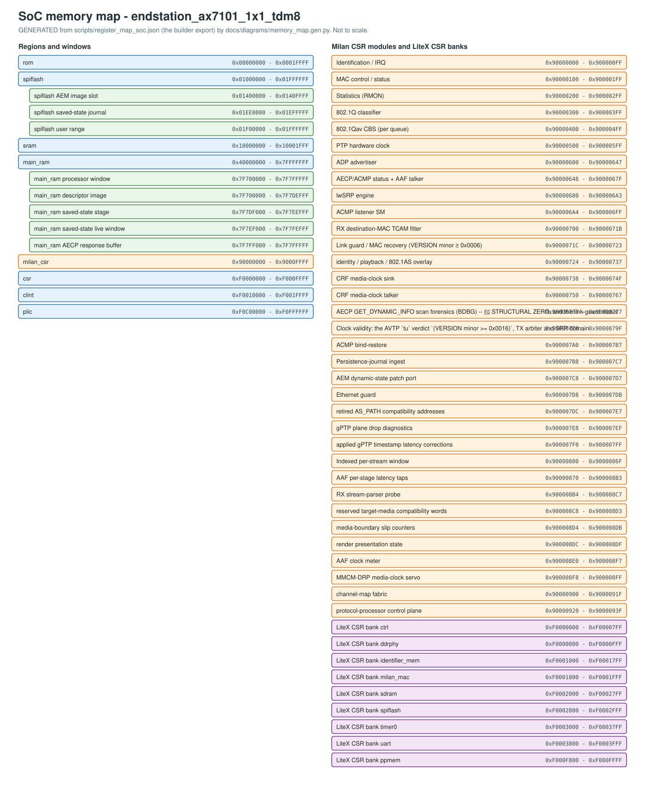
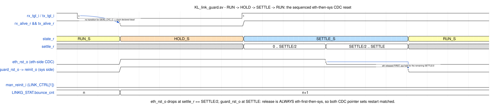

# Milan CSR register reference

**GENERATED** by `scripts/gen_register_reference.py` from `hdl/common/csr/milan_csr.sv` and a builder export.
Do not hand-edit.

Regenerate after any CSR change, then run the gate.

```sh
python3 scripts/gen_register_reference.py --write
python3 scripts/gen_register_reference.py --check
```

The SoC facts come from the `endstation_ax7101_1x1_tdm8` export, recorded in `scripts/register_map_soc.json`.

Production classes are in [REGISTER_MAP_CLASSES.md](REGISTER_MAP_CLASSES.md).

## Contents

| Section | What it holds |
|---|---|
| [Reading this page](#reading-this-page) | Verdicts, history notes and how to read the tables. |
| [Memory map](#memory-map) | Regions and windows of the shipping SoC. |
| [Access types](#access-types) | The access and reset codes the tables use. |
| [Build parameters](#build-parameters) | The parameters the shipping build elaborates. |
| [0x000 - Identification / IRQ](#0x000-----identification--irq) | Identification, capabilities and the interrupt registers. |
| [0x100 - MAC control / status (REQ-MAC-01..03)](#0x100-----mac-control--status--req-mac-0103) | MAC control, link status and the inert PHY reset. |
| [0x200 - Statistics (RMON) (REQ-MAC-04)](#0x200-----statistics-rmon--req-mac-04) | RMON counter snapshot and its capability mask. |
| [0x300 - 802.1Q classifier (REQ-CLS-01..04)](#0x300-----8021q-classifier--req-cls-0104) | Retained classifier words; no logic reads them. |
| [0x400 - 802.1Qav CBS (per queue) (REQ-CBS-01..03)](#0x400-----8021qav-cbs-per-queue--req-cbs-0103) | Retained per-queue CBS words; nothing reads them. |
| [0x500 - PTP hardware clock (REQ-PTP-01..04, 06)](#0x500-----ptp-hardware-clock--req-ptp-0104-06) | PTP hardware clock control, time access and PPS alarm. |
| [0x600 - ADP advertiser (IEEE 1722.1-2021 / Milan v1.2, FR-DISC-01..04)](#0x600-----adp-advertiser--ieee-17221-2021--milan-v12-fr-disc-0104) | ADP identity words, the advertise strobes and status. |
| [0x648 - AECP/ACMP status + AAF talker (IEEE 1722.1 / Milan v1.2)](#0x648-----aecpacmp-status--aaf-talker--ieee-17221--milan-v12) | AECP and ACMP status, and the flat AAF talker words. |
| [0x680 - lwSRP engine (802.1Q MSRP/MVRP, Milan v1.2 Section 5.6, FR-SRP-*)](#0x680-----lwsrp-engine--8021q-msrpmvrp-milan-v12-section-56-fr-srp-) | SRP control and the processor's SRP status. |
| [0x6A4 - ACMP listener SM (Milan v1.2 Section 5.5 listener, FR-CONN-01)](#0x6a4-----acmp-listener-sm--milan-v12-section-55-listener-fr-conn-01) | Listener bind record, AVTP RX, MAAP and audio diagnostics. |
| [0x700 - RX destination-MAC TCAM filter (REQ-MAC-02)](#0x700-----rx-destination-mac-tcam-filter--req-mac-02) | RX destination-MAC filter programming. |
| [0x71C - Link guard / MAC recovery (VERSION minor ≥ 0x0006)](#0x71c-----link-guard--mac-recovery-version-minor--0x0006) | Link guard controls and the reset canary. |
| [0x724 - identity / playback / 802.1AS overlay](#0x724-----identity--playback--8021as-overlay) | Entity name overlay, playback filter and gPTP parent. |
| [0x738 - CRF media-clock sink (Milan v1.2 7.3, KL_crf_rx)](#0x738-----crf-media-clock-sink--milan-v12-73-kl_crf_rx) | CRF media-clock sink control and measurements. |
| [0x750 - CRF media-clock talker (Milan v1.2 7.3.1, KL_crf_tx)](#0x750-----crf-media-clock-talker--milan-v12-731-kl_crf_tx) | CRF media-clock talker control and counters. |
| [0x768 - AECP GET_DYNAMIC_INFO scan forensics (BDBG) -- 🔴 STRUCTURAL ZERO, and the link-guard status](#0x768-----aecp-get_dynamic_info-scan-forensics-bdbg-----structural-zero-and-the-link-guard-status) | Retired scan forensics and the live link-guard status. |
| [0x778 - Clock validity: the AVTP tu verdict (VERSION minor >= 0x0016), TX arbiter and SRP domain](#0x778-----clock-validity-the-avtp-tu-verdict-version-minor--0x0016-tx-arbiter-and-srp-domain) | Clock validity, TX arbiter supervision and the SRP domain. |
| [0x7A0 - ACMP bind-restore (saved-state fast-connect E1, Milan 5.5.3.5.2)](#0x7a0-----acmp-bind-restore--saved-state-fast-connect-e1-milan-55352) | Retired bind-restore port, kept as an ABI. |
| [0x7B8 - Persistence-journal ingest (saved-state fast-connect E3)](#0x7b8-----persistence-journal-ingest--saved-state-fast-connect-e3) | Retired journal ingest port, kept as an ABI. |
| [0x7C8 - AEM dynamic-state patch port (saved-state fast-connect E4)](#0x7c8-----aem-dynamic-state-patch-port--saved-state-fast-connect-e4) | Retired AEM patch port, kept as an ABI. |
| [0x7D8 - Ethernet guard](#0x7d8-----ethernet-guard) | The Ethernet guard kill switch. |
| [0x7DC - retired AS_PATH compatibility addresses](#0x7dc-----retired-as_path-compatibility-addresses) | Retired AS_PATH addresses and the live PathTrace status. |
| [0x7E8 - gPTP plane drop diagnostics](#0x7e8-----gptp-plane-drop-diagnostics) | gPTP plane drop counters. |
| [0x7F0 - applied gPTP timestamp latency corrections](#0x7f0-----applied-gptp-timestamp-latency-corrections) | The timestamp corrections the gPTP plane applies. |
| [0x800 - Indexed per-stream window](#0x800-----indexed-per-stream-window) | Indexed window onto one stream's context. |
| [0x870 - AAF per-stage latency taps (roadmap item-11, KL_aaf_latency_taps)](#0x870-----aaf-per-stage-latency-taps--roadmap-item-11-kl_aaf_latency_taps) | AAF per-stage latency taps. |
| [0x8B4 - RX stream-parser probe (APRB, avtp_stream_parser + milan_datapath)](#0x8b4-----rx-stream-parser-probe--aprb-avtp_stream_parser--milan_datapath) | The RX stream parser's pre-match view. |
| [0x8C8 - reserved target-media compatibility words](#0x8c8-----reserved-target-media-compatibility-words) | Retired telemetry words that read zero. |
| [0x8D4 - media-boundary slip counters (SLIP, KL_chan_map_capture)](#0x8d4-----media-boundary-slip-counters--slip-kl_chan_map_capture) | Media-boundary slip counters. |
| [0x8DC - render presentation state](#0x8dc-----render-presentation-state) | Presentation state of the selected listener. |
| [0x8E0 - AAF clock meter (#629, KL_aaf_clock_meter)](#0x8e0-----aaf-clock-meter--629-kl_aaf_clock_meter) | AAF media clock meter. |
| [0x8F8 - MMCM-DRP media-clock servo (Milan v1.2 7.3.4, KL_mmcm_drp_servo)](#0x8f8-----mmcm-drp-media-clock-servo--milan-v12-734-kl_mmcm_drp_servo) | MMCM DRP media-clock servo. |
| [0x900 - channel-map fabric (Section 6 of docs/CHANNEL_MAP_64.md, KL_chan_map_render / KL_chan_map_capture)](#0x900-----channel-map-fabric--section-6-of-docschannel_map_64md-kl_chan_map_render--kl_chan_map_capture) | Channel-map debug write port and map RAM readback. |
| [0x920 - protocol-processor control plane (KL_pp_shadow, VERSION major 2)](#0x920-----protocol-processor-control-plane--kl_pp_shadow-version-major-2) | Protocol-processor control plane and the saved-state window. |
| [SoC CSR banks](#soc-csr-banks) | The LiteX CSR banks beside the Milan block. |
| [Feature status](#feature-status) | Machine-checked status rows for this page. |

## Reading this page

Production classification (needed / optional / debug, with rationale): [REGISTER_MAP_CLASSES.md](REGISTER_MAP_CLASSES.md).

### How to read this page now: three verdicts, and why the distinction matters

| Verdict | What it means | How software must treat it |
|---|---|---|
| **STRUCTURAL ZERO** | The source of this word is deleted and has no replacement. It reads `0` because there is nothing behind it, **not** because nothing happened | Never read it as a measurement. A word that read a plausible value instead would be a defect -- "engine idle" and "no engine" must not be confusable |
| **Readable, inert scratch** (legacy label: **WRITE-ONLY SCRATCH**) | The register still reads back exactly what software wrote, but the value **no longer reaches the wire** | Writing it changes nothing observable. Do not infer from a successful readback that the setting took effect |
| **LIVE, REPOINTED** | Still real, now sourced from the protocol processor's class-D face instead of a deleted engine | Read it normally; the meaning is unchanged |

### A group can be STRUCTURALLY absent (optional-block prunes, 2026-07-27)

| Parameter | Reads 0 structurally | Other effect |
|---|---|---|
| `MCSERVO_P = 0` | `0x8F8 MCSRV_STAT` | `0x8FC MCSRV_CTRL` still RW; MMCM DRP/PS pins never move |
| `LTAP_P = 0` | `0x874`-`0x8B0`; `0x870 LTAP_CTRL` reads `0x2` (enable bit only, no status) | -- |
| `MAAP_P = 0` | `0x6D0 MAAP_STAT0`, `0x6D4 MAAP_STAT1` | `MAAP_CTRL.en` becomes effectively **reserved**: setting it pins AAF admission shut |
| `I2SPB_P = 0` | `0x6D8 I2SPB_STAT`, `0x6E0 I2SPB_TRIM`, `0x6F0 I2SPB_DBG` | the four `i2s_dac_*` pins park at 0 |
| `RXFILT_P = 0` | -- | the whole `0x700` TCAM group still stores; **nothing reads it** and the port is PROMISCUOUS |
| `LPF_P = 0` | -- | `0x72C LPF_CTRL` still RW with no filter behind it |

### Notes

All command strobes (`STATS_CTRL[0]`, `PTP_CMD[*]`) read back 0 (self-clearing).

Design record: [design notes](../design/CSR_REGISTER_NOTES.md#reading-the-register-map).

## Memory map



| Region | Start address | End address | Size | Description |
|---|---|---|---|---|
| `rom` | `0x00000000` | `0x0001FFFF` | 131,072 (128 KiB) | Boot ROM holding the bare-metal firmware image. |
| `spiflash` | `0x01000000` | `0x01FFFFFF` | 16,777,216 (16 MiB) | Memory-mapped QSPI flash (read path). |
| `spiflash` AEM image slot | `0x01400000` | `0x0140FFFF` | 65,536 (64 KiB) | Flash slot of the AEM entity image. |
| `spiflash` saved-state journal | `0x01EE0000` | `0x01EFFFFF` | 131,072 (128 KiB) | Flash slots of the saved-state journal (A and B); a reflash must not erase it. |
| `spiflash` user range | `0x01F00000` | `0x01FFFFFF` | 1,048,576 (1 MiB) | Reserved user flash range. |
| `sram` | `0x10000000` | `0x10001FFF` | 8,192 (8 KiB) | On-chip SRAM: the firmware's stack and data. |
| `main_ram` | `0x40000000` | `0x7FFFFFFF` | 1,073,741,824 (1 GiB) | DDR3 main memory. |
| `main_ram` processor window | `0x7F700000` | `0x7F7FFFFF` | 1,048,576 (1 MiB) | The protocol processor's reserved main-memory window. |
| `main_ram` descriptor image | `0x7F700000` | `0x7F7DEFFF` | 913,408 (892 KiB) | AEM descriptor image, read by the processor. |
| `main_ram` saved-state stage | `0x7F7DF000` | `0x7F7EEFFF` | 65,536 (64 KiB) | Saved-state private stage, written by the firmware only. |
| `main_ram` saved-state live window | `0x7F7EF000` | `0x7F7FEFFF` | 65,536 (64 KiB) | Saved-state live window the backend reads and writes. |
| `main_ram` AECP response buffer | `0x7F7FF000` | `0x7F7FFFFF` | 4,096 (4 KiB) | AECP response buffer, written by the processor. |
| `milan_csr` | `0x90000000` | `0x9000FFFF` | 65,536 (64 KiB) | The Milan CSR block this page documents. |
| `csr` | `0xF0000000` | `0xF000FFFF` | 65,536 (64 KiB) | LiteX CSR banks. |
| `clint` | `0xF0010000` | `0xF001FFFF` | 65,536 (64 KiB) | RISC-V core-local interruptor. |
| `plic` | `0xF0C00000` | `0xF0FFFFFF` | 4,194,304 (4 MiB) | RISC-V platform-level interrupt controller. |

### Milan CSR modules

| Module | Start address | End address | Size | Description |
|---|---|---|---|---|
| [0x000 - Identification / IRQ](#0x000-----identification--irq) | `0x90000000` | `0x900000FF` | 256 | Identification, capabilities and the interrupt registers. |
| [0x100 - MAC control / status (REQ-MAC-01..03)](#0x100-----mac-control--status--req-mac-0103) | `0x90000100` | `0x900001FF` | 256 | MAC control, link status and the inert PHY reset. |
| [0x200 - Statistics (RMON) (REQ-MAC-04)](#0x200-----statistics-rmon--req-mac-04) | `0x90000200` | `0x900002FF` | 256 | RMON counter snapshot and its capability mask. |
| [0x300 - 802.1Q classifier (REQ-CLS-01..04)](#0x300-----8021q-classifier--req-cls-0104) | `0x90000300` | `0x900003FF` | 256 | Retained classifier words; no logic reads them. |
| [0x400 - 802.1Qav CBS (per queue) (REQ-CBS-01..03)](#0x400-----8021qav-cbs-per-queue--req-cbs-0103) | `0x90000400` | `0x900004FF` | 256 | Retained per-queue CBS words; nothing reads them. |
| [0x500 - PTP hardware clock (REQ-PTP-01..04, 06)](#0x500-----ptp-hardware-clock--req-ptp-0104-06) | `0x90000500` | `0x900005FF` | 256 | PTP hardware clock control, time access and PPS alarm. |
| [0x600 - ADP advertiser (IEEE 1722.1-2021 / Milan v1.2, FR-DISC-01..04)](#0x600-----adp-advertiser--ieee-17221-2021--milan-v12-fr-disc-0104) | `0x90000600` | `0x90000647` | 72 | ADP identity words, the advertise strobes and status. |
| [0x648 - AECP/ACMP status + AAF talker (IEEE 1722.1 / Milan v1.2)](#0x648-----aecpacmp-status--aaf-talker--ieee-17221--milan-v12) | `0x90000648` | `0x9000067F` | 56 | AECP and ACMP status, and the flat AAF talker words. |
| [0x680 - lwSRP engine (802.1Q MSRP/MVRP, Milan v1.2 Section 5.6, FR-SRP-*)](#0x680-----lwsrp-engine--8021q-msrpmvrp-milan-v12-section-56-fr-srp-) | `0x90000680` | `0x900006A3` | 36 | SRP control and the processor's SRP status. |
| [0x6A4 - ACMP listener SM (Milan v1.2 Section 5.5 listener, FR-CONN-01)](#0x6a4-----acmp-listener-sm--milan-v12-section-55-listener-fr-conn-01) | `0x900006A4` | `0x900006FF` | 92 | Listener bind record, AVTP RX, MAAP and audio diagnostics. |
| [0x700 - RX destination-MAC TCAM filter (REQ-MAC-02)](#0x700-----rx-destination-mac-tcam-filter--req-mac-02) | `0x90000700` | `0x9000071B` | 28 | RX destination-MAC filter programming. |
| [0x71C - Link guard / MAC recovery (VERSION minor ≥ 0x0006)](#0x71c-----link-guard--mac-recovery-version-minor--0x0006) | `0x9000071C` | `0x90000723` | 8 | Link guard controls and the reset canary. |
| [0x724 - identity / playback / 802.1AS overlay](#0x724-----identity--playback--8021as-overlay) | `0x90000724` | `0x90000737` | 20 | Entity name overlay, playback filter and gPTP parent. |
| [0x738 - CRF media-clock sink (Milan v1.2 7.3, KL_crf_rx)](#0x738-----crf-media-clock-sink--milan-v12-73-kl_crf_rx) | `0x90000738` | `0x9000074F` | 24 | CRF media-clock sink control and measurements. |
| [0x750 - CRF media-clock talker (Milan v1.2 7.3.1, KL_crf_tx)](#0x750-----crf-media-clock-talker--milan-v12-731-kl_crf_tx) | `0x90000750` | `0x90000767` | 24 | CRF media-clock talker control and counters. |
| [0x768 - AECP GET_DYNAMIC_INFO scan forensics (BDBG) -- 🔴 STRUCTURAL ZERO, and the link-guard status](#0x768-----aecp-get_dynamic_info-scan-forensics-bdbg-----structural-zero-and-the-link-guard-status) | `0x90000768` | `0x90000777` | 16 | Retired scan forensics and the live link-guard status. |
| [0x778 - Clock validity: the AVTP tu verdict (VERSION minor >= 0x0016), TX arbiter and SRP domain](#0x778-----clock-validity-the-avtp-tu-verdict-version-minor--0x0016-tx-arbiter-and-srp-domain) | `0x90000778` | `0x9000079F` | 40 | Clock validity, TX arbiter supervision and the SRP domain. |
| [0x7A0 - ACMP bind-restore (saved-state fast-connect E1, Milan 5.5.3.5.2)](#0x7a0-----acmp-bind-restore--saved-state-fast-connect-e1-milan-55352) | `0x900007A0` | `0x900007B7` | 24 | Retired bind-restore port, kept as an ABI. |
| [0x7B8 - Persistence-journal ingest (saved-state fast-connect E3)](#0x7b8-----persistence-journal-ingest--saved-state-fast-connect-e3) | `0x900007B8` | `0x900007C7` | 16 | Retired journal ingest port, kept as an ABI. |
| [0x7C8 - AEM dynamic-state patch port (saved-state fast-connect E4)](#0x7c8-----aem-dynamic-state-patch-port--saved-state-fast-connect-e4) | `0x900007C8` | `0x900007D7` | 16 | Retired AEM patch port, kept as an ABI. |
| [0x7D8 - Ethernet guard](#0x7d8-----ethernet-guard) | `0x900007D8` | `0x900007DB` | 4 | The Ethernet guard kill switch. |
| [0x7DC - retired AS_PATH compatibility addresses](#0x7dc-----retired-as_path-compatibility-addresses) | `0x900007DC` | `0x900007E7` | 12 | Retired AS_PATH addresses and the live PathTrace status. |
| [0x7E8 - gPTP plane drop diagnostics](#0x7e8-----gptp-plane-drop-diagnostics) | `0x900007E8` | `0x900007EF` | 8 | gPTP plane drop counters. |
| [0x7F0 - applied gPTP timestamp latency corrections](#0x7f0-----applied-gptp-timestamp-latency-corrections) | `0x900007F0` | `0x900007FF` | 16 | The timestamp corrections the gPTP plane applies. |
| [0x800 - Indexed per-stream window](#0x800-----indexed-per-stream-window) | `0x90000800` | `0x9000086F` | 112 | Indexed window onto one stream's context. |
| [0x870 - AAF per-stage latency taps (roadmap item-11, KL_aaf_latency_taps)](#0x870-----aaf-per-stage-latency-taps--roadmap-item-11-kl_aaf_latency_taps) | `0x90000870` | `0x900008B3` | 68 | AAF per-stage latency taps. |
| [0x8B4 - RX stream-parser probe (APRB, avtp_stream_parser + milan_datapath)](#0x8b4-----rx-stream-parser-probe--aprb-avtp_stream_parser--milan_datapath) | `0x900008B4` | `0x900008C7` | 20 | The RX stream parser's pre-match view. |
| [0x8C8 - reserved target-media compatibility words](#0x8c8-----reserved-target-media-compatibility-words) | `0x900008C8` | `0x900008D3` | 12 | Retired telemetry words that read zero. |
| [0x8D4 - media-boundary slip counters (SLIP, KL_chan_map_capture)](#0x8d4-----media-boundary-slip-counters--slip-kl_chan_map_capture) | `0x900008D4` | `0x900008DB` | 8 | Media-boundary slip counters. |
| [0x8DC - render presentation state](#0x8dc-----render-presentation-state) | `0x900008DC` | `0x900008DF` | 4 | Presentation state of the selected listener. |
| [0x8E0 - AAF clock meter (#629, KL_aaf_clock_meter)](#0x8e0-----aaf-clock-meter--629-kl_aaf_clock_meter) | `0x900008E0` | `0x900008F7` | 24 | AAF media clock meter. |
| [0x8F8 - MMCM-DRP media-clock servo (Milan v1.2 7.3.4, KL_mmcm_drp_servo)](#0x8f8-----mmcm-drp-media-clock-servo--milan-v12-734-kl_mmcm_drp_servo) | `0x900008F8` | `0x900008FF` | 8 | MMCM DRP media-clock servo. |
| [0x900 - channel-map fabric (Section 6 of docs/CHANNEL_MAP_64.md, KL_chan_map_render / KL_chan_map_capture)](#0x900-----channel-map-fabric--section-6-of-docschannel_map_64md-kl_chan_map_render--kl_chan_map_capture) | `0x90000900` | `0x9000091F` | 32 | Channel-map debug write port and map RAM readback. |
| [0x920 - protocol-processor control plane (KL_pp_shadow, VERSION major 2)](#0x920-----protocol-processor-control-plane--kl_pp_shadow-version-major-2) | `0x90000920` | `0x9000093F` | 32 | Protocol-processor control plane and the saved-state window. |

## Access types

A field's code reads as access, then reset value.

| Code | Meaning |
|---|---|
| `R` | Read-only. Writes are ignored. |
| `W` | Write-only. The written value is used; a read returns 0. |
| `R/W` | Read and write. A read returns the stored value. |
| `W1C` | Write 1 to clear. Writing 0 has no effect. |
| `R/W1C` | A read returns the latched bit; writing 1 clears it. |
| `W1S` | Write 1 to trigger a one-cycle action. The bit self-clears and reads 0. |
| `R/W1S` | A read returns the bit's status; writing 1 triggers the action. |
| `RC` | Read clears. No register of this block clears on read. |
| `WO` | Write-only word whose write is the action. This block shows such words as W. |

| Reset code | Meaning |
|---|---|
| `X` | This block's reset does not fix the bit: an input or an unreset flop sets it. |
| `0`, `5h` | The reset value in hexadecimal; `h` marks hex digits. |

Reserved read-only fields read as `R-0`.

A reserved `R/W` field stores bits that drive nothing.

## Build parameters

Some reset values depend on these parameters.

`milan_datapath` sets them; the export supplies its values.

| Parameter | Set from | Value |
|---|---|---|
| `NUM_QUEUES` | `NUMBER_OF_QUEUES` | 5 |
| `ADDR_WIDTH` | `16` | 16 |
| `N_LISTENERS_P` | `N_STREAMS` | 1 |
| `N_TALKERS_P` | `N_STREAMS` | 1 |
| `SRP_LSN0_ROW_P` | `SRP_LSN0_ROW_C` | 2 |
| `GPTP_PLANE_EN_P` | `GPTP_PLANE_EN_P` | 1 |
| `MILAN_CLK_FREQ_HZ_P` | `MILAN_CLK_FREQ_HZ` | 50,000,000 |
| `CHMAP_RDBK_P` | `3` | 3 |
| `PPS_P` | `PPS_P` | 0 |
| `PPS_WIDTH_CYC_P` | `PPS_WIDTH_CYC_P` | 50,000 |

## 0x000  -  Identification / IRQ

Identification, capabilities and the interrupt registers.

| Offset | Acronym | Register name | Reset | Section |
|---|---|---|---|---|
| `0x000` | `ID` | Identification | `0x4D494C4E` | [section](#id-register-offset-0x000-reset--0x4d494c4e) |
| `0x004` | `VERSION` | Gateware version | `0x00020060` | [section](#version-register-offset-0x004-reset--0x00020060) |
| `0x008` | `CAP` | Capabilities | `0x00407E05` | [section](#cap-register-offset-0x008-reset--0x00407e05) |
| `0x00C` | `SCRATCH` | Scratch | `0x00000000` | [section](#scratch-register-offset-0x00c-reset--0x00000000) |
| `0x010` | `IRQ_STATUS` | Interrupt status | `0x00000000` | [section](#irq_status-register-offset-0x010-reset--0x00000000) |
| `0x014` | `IRQ_MASK` | Interrupt mask | `0x00000000` | [section](#irq_mask-register-offset-0x014-reset--0x00000000) |
| `0x018` | `IRQ_RAW` | Raw interrupt status | `0x00000000` | [section](#irq_raw-register-offset-0x018-reset--0x00000000) |

**Group summary:** Identification / IRQ (global)

The PS IRQ line = `\|(IRQ_STATUS & IRQ_MASK)`.

### `VERSION` is also what every ATDECC controller is told (2026-07-28)

| ATDECC `firmware_version` | source |
|---|---|
| **major** | `VERSION[31:16]` |
| **minor** | `VERSION[15:0]` -- one flat ABI ordinal, which is how this row's changelog and every `VERSION minor >=` feature gate already read it |
| **rev** | `entity.firmware_rev` in `configs/endstation_*.yaml`, optional, default `0` -- a firmware respin that changes no CSR ABI |

Rationale and history: [design notes](../design/CSR_REGISTER_NOTES.md#0x000-----identification--irq).

### ID register (offset 0x000) [reset = 0x4D494C4E]

Constant magic word that identifies the Milan CSR block.

RTL name: `A_ID`.


| Bit | Field | Type | Reset | Description |
|---|---|---|---|---|
| 31:0 | `ID` | R | 4D494C4Eh | Magic `"MILN"`; firmware/integration probe. |

### VERSION register (offset 0x004) [reset = 0x00020060]

Major and minor version of this CSR block's ABI.

This build's VERSION is `0x0002_0060`.

RTL name: `A_VERSION`.


| Bit | Field | Type | Reset | Description |
|---|---|---|---|---|
| 31:0 | `VERSION` | R | 20060h | Constant. |

Rationale and history: [design notes](../design/CSR_REGISTER_NOTES.md#version-offset-0x004).

### CAP register (offset 0x008) [reset = 0x00407E05]

Constant capability flags and the queue-window geometry.

RTL name: `A_CAP`.


| Bit | Field | Type | Reset | Description |
|---|---|---|---|---|
| 31:24 | `RESERVED` | R | 0 | Reserved. |
| 23:16 | `TS_WIDTH` | R | 40h | Timestamp width in bits. |
| 15 | `CAP_15` | R | 0 | Reads 0. |
| 14 | `LWSRP` | R | 1h | lwSRP control registers present. |
| 13 | `TCAM` | R | 1h | Address filter TCAM present. |
| 12 | `ADP` | R | 1h | ADP present. |
| 11 | `RX_FILTER` | R | 1h | Receive filter present. |
| 10 | `STATS` | R | 1h | Statistics block present. |
| 9 | `PTP` | R | 1h | PTP clock present. |
| 8 | `CBS` | R | 0 | CBS - 🔴 **STRUCTURAL ZERO** since `0x0056`: no shaper is elaborated. |
| 7:4 | `RESERVED` | R | 0 | Reserved. |
| 3:0 | `NUM_QUEUES` | R | 5h | num_queues (the retained `0x400` window geometry, 5) |

### SCRATCH register (offset 0x00C) [reset = 0x00000000]

Read/write word for bus liveness tests.

RTL name: `A_SCRATCH`.


| Bit | Field | Type | Reset | Description |
|---|---|---|---|---|
| 31:0 | `SCRATCH` | R/W | 0 | R/W scratch (bus liveness test) |

### IRQ_STATUS register (offset 0x010) [reset = 0x00000000]

Latched interrupt events, cleared by writing 1.

RTL name: `A_IRQ_STATUS`.


| Bit | Field | Type | Reset | Description |
|---|---|---|---|---|
| 31:3 | `RESERVED` | R | 0 | Reserved. |
| 2 | `EVT_RMON_ROLLOVER` | R/W1C | 0 | Held in `irq_status`. Writing 1 clears this latched bit; writing 0 leaves it. |
| 1 | `EVT_LINK_CHANGE` | R/W1C | 0 | Held in `irq_status`. Writing 1 clears this latched bit; writing 0 leaves it. |
| 0 | `RESERVED` | R | 0 | Reserved. |

Rationale and history: [design notes](../design/CSR_REGISTER_NOTES.md#irq_status-offset-0x010).

### IRQ_MASK register (offset 0x014) [reset = 0x00000000]

Enables each interrupt source onto the IRQ line.

RTL name: `A_IRQ_MASK`.


| Bit | Field | Type | Reset | Description |
|---|---|---|---|---|
| 31:0 | `IRQ_MASK` | R/W | 0 | 1 = interrupt enabled; masked bits still visible in `IRQ_RAW`. |

### IRQ_RAW register (offset 0x018) [reset = 0x00000000]

Latched interrupt events before masking.

RTL name: `A_IRQ_RAW`.


| Bit | Field | Type | Reset | Description |
|---|---|---|---|---|
| 31:3 | `RESERVED` | R | 0 | Reserved. |
| 2 | `EVT_RMON_ROLLOVER` | R | 0 | Held in `irq_status`. |
| 1 | `EVT_LINK_CHANGE` | R | 0 | Held in `irq_status`. |
| 0 | `RESERVED` | R | 0 | Reserved. |

Latched event bits before masking

## 0x100  -  MAC control / status  `(REQ-MAC-01..03)`

MAC control, link status and the inert PHY reset.

| Offset | Acronym | Register name | Reset | Section |
|---|---|---|---|---|
| `0x100` | `MAC_CTRL` | MAC control | `0x00000013` | [section](#mac_ctrl-register-offset-0x100-reset--0x00000013) |
| `0x104` | `MAC_IFG` | MAC inter-frame gap | `0x0000000C` | [section](#mac_ifg-register-offset-0x104-reset--0x0000000c) |
| `0x108` | `MAC_ADDR_LO` | Station MAC address, low word | `0x00000000` | [section](#mac_addr_lo-register-offset-0x108-reset--0x00000000) |
| `0x10C` | `MAC_ADDR_HI` | Station MAC address, high word | `0x00000000` | [section](#mac_addr_hi-register-offset-0x10c-reset--0x00000000) |
| `0x110` | `MAC_STATUS` | MAC link status | `0x0000000X` | [section](#mac_status-register-offset-0x110-reset--0x0000000x) |
| `0x114` | `MC_HASH_LO` | Multicast hash, low word | `0x00000000` | [section](#mc_hash_lo-register-offset-0x114-reset--0x00000000) |
| `0x118` | `MC_HASH_HI` | Multicast hash, high word | `0x00000000` | [section](#mc_hash_hi-register-offset-0x118-reset--0x00000000) |
| `0x11C` | `PHY_RESET` | PHY reset (inert) | `0x00000001` | [section](#phy_reset-register-offset-0x11c-reset--0x00000001) |

**Group summary:** MAC control / status

`MAC_CTRL` reset `0x13` = tx_en+rx_en+is_1g (preserves today's tied constants).

a 1-beat runt is always swallowed;

a TCAM hit → `ACTION[0]` decides;

otherwise `TCAM_CTRL[0]`.

Rationale and history: [design notes](../design/CSR_REGISTER_NOTES.md#0x100-----mac-control--status--req-mac-0103).

### MAC_CTRL register (offset 0x100) [reset = 0x00000013]

MAC enables, receive filtering modes and the link-rate override.

RTL name: `A_MAC_CTRL`.


| Bit | Field | Type | Reset | Description |
|---|---|---|---|---|
| 31:6 | `RESERVED` | R/W | 0 | Reserved; stored and read back, drives nothing. |
| 5 | `MAC_IS_1G_SELECT` | R/W | 0 | Held in `mac_ctrl`. |
| 4 | `MAC_IS_1G` | R/W | 1h | Drives `o_mac_is_1g`. |
| 3 | `MAC_ALLMULTI` | R/W | 0 | Drives `o_mac_allmulti`. |
| 2 | `MAC_PROMISC` | R/W | 0 | Drives `o_mac_promisc`. |
| 1 | `MAC_RX_EN` | R/W | 1h | Drives `o_mac_rx_en`. |
| 0 | `MAC_TX_EN` | R/W | 1h | Drives `o_mac_tx_en`. |

Rationale and history: [design notes](../design/CSR_REGISTER_NOTES.md#mac_ctrl-offset-0x100).

### MAC_IFG register (offset 0x104) [reset = 0x0000000C]

Inter-frame gap in bytes.

RTL name: `A_MAC_IFG`.


| Bit | Field | Type | Reset | Description |
|---|---|---|---|---|
| 31:8 | `RESERVED` | R/W | 0 | Reserved; stored and read back, drives nothing. |
| 7:0 | `MAC_IFG` | R/W | Ch | inter-frame gap (bytes), default 12. |

### MAC_ADDR_LO register (offset 0x108) [reset = 0x00000000]

Station MAC address bits 31 to 0.

RTL name: `A_MAC_ALO`.


| Bit | Field | Type | Reset | Description |
|---|---|---|---|---|
| 31:0 | `MAC_ADDR` | R/W | 0 | Drives `o_mac_addr`. Bits [31:0] of the RTL value. |

Rationale and history: [design notes](../design/CSR_REGISTER_NOTES.md#mac_addr_lo-offset-0x108).

### MAC_ADDR_HI register (offset 0x10C) [reset = 0x00000000]

Station MAC address bits 47 to 32.

RTL name: `A_MAC_AHI`.


| Bit | Field | Type | Reset | Description |
|---|---|---|---|---|
| 31:16 | `RESERVED` | R/W | 0 | Reserved; stored and read back, drives nothing. |
| 15:0 | `MAC_ADDR` | R/W | 0 | Drives `o_mac_addr`. Bits [47:32] of the RTL value. |

station MAC `[47:32]` in `[15:0]` - wire byte 4 in `[7:0]`, byte 5 in `[15:8]`

### MAC_STATUS register (offset 0x110) [reset = 0x0000000X]

Link, speed and duplex as the SoC publishes them.

RTL name: `A_MAC_STATUS`.


| Bit | Field | Type | Reset | Description |
|---|---|---|---|---|
| 31:4 | `RESERVED` | R | 0 | Reserved. |
| 3 | `FULL_DUPLEX` | R | X | full_duplex. |
| 2:1 | `SPEED` | R | X | speed (0=10,1=100,2=1000) |
| 0 | `LINK_UP` | R | X | link_up. |

Rationale and history: [design notes](../design/CSR_REGISTER_NOTES.md#mac_status-offset-0x110).

### MC_HASH_LO register (offset 0x114) [reset = 0x00000000]

Multicast hash filter buckets 0 to 31.

RTL name: `A_MC_LO`.


| Bit | Field | Type | Reset | Description |
|---|---|---|---|---|
| 31:0 | `MC_HASH` | R/W | 0 | multicast hash filter, buckets 0-31 (bit `n` = bucket `n`) Bits [31:0] of the RTL value. |

### MC_HASH_HI register (offset 0x118) [reset = 0x00000000]

Multicast hash filter buckets 32 to 63.

RTL name: `A_MC_HI`.


| Bit | Field | Type | Reset | Description |
|---|---|---|---|---|
| 31:0 | `MC_HASH` | R/W | 0 | multicast hash filter, buckets 32-63. Bits [63:32] of the RTL value. |

### PHY_RESET register (offset 0x11C) [reset = 0x00000001]

Stored PHY reset bit that the shipping SoC leaves unconnected.

RTL name: `A_PHY_RST`.


| Bit | Field | Type | Reset | Description |
|---|---|---|---|---|
| 31:1 | `RESERVED` | R/W | 0 | Reserved; stored and read back, drives nothing. A write takes effect only when `ETH_GUARD[0]` is 0. |
| 0 | `PHY_RESET_N` | R/W | 1h | Drives `o_phy_reset_n` (0 = reset asserted). The shipping SoC leaves that datapath output unconnected, so this bit resets nothing. The PHY reset that reaches the pin is the LiteX `milan_mac_phy_crg_reset` CSR (the PHY clock/reset block's `_reset` storage, `sw/litex/patches/0002-liteeth-gmii-tx-clk-invert.patch`), for the port the image is built for (`--eth-port`). A write takes effect only when `ETH_GUARD[0]` is 0. |

## 0x200  -  Statistics (RMON)  `(REQ-MAC-04)`

RMON counter snapshot and its capability mask.

| Offset | Acronym | Register name | Reset | Section |
|---|---|---|---|---|
| `0x200` | `STATS_CTRL` | Statistics control | `0x00000000` | [section](#stats_ctrl-register-offset-0x200-reset--0x00000000) |
| `0x204` | `STATS_CAP` | Statistics capability | `0xXXXXXXXX` | [section](#stats_cap-register-offset-0x204-reset--0xxxxxxxxx) |
| `0x210` | `STATn` | RMON counter snapshot | `0x00000000` | [section](#statn-registers-offset-0x210-to-0x230-stride-0x4-reset--0x00000000) |

**Group summary:** Statistics (RMON)

the lane counted, and nothing went wrong -- good news;

| lane | source | in `STATS_CAP` on a LiteEth build |
|---|---|---|
| `TX_FIFO_GOOD_FRAME` | datapath MAC-TX AXIS accepted `tlast` | ✅ |
| `RX_FIFO_GOOD_FRAME` | datapath MAC-RX AXIS accepted `tlast` | ✅ |
| `RX_ERROR_BAD_FCS` | LiteEth `crc_errors` (CRC32 checker) | ✅ |
| `RX_ERROR_BAD_FRAME` | LiteEth `preamble_errors` (preamble/alignment) | ✅ |
| `RX_FIFO_BAD_FRAME` | frames delivered with LiteEth's `error` flag set -- FCS failure **or** undersize runt | ✅ |
| `TX_ERROR_UNDERFLOW` | none -- MAC-internal, not exposed | ❌ |
| `TX_FIFO_OVERFLOW` | none -- MAC-internal, not exposed | ❌ |
| `TX_FIFO_BAD_FRAME` | none -- MAC-internal, not exposed | ❌ |
| `RX_FIFO_OVERFLOW` | none -- MAC-internal, not exposed | ❌ |

Rationale and history: [design notes](../design/CSR_REGISTER_NOTES.md#0x200-----statistics-rmon--req-mac-04).

### STATS_CTRL register (offset 0x200) [reset = 0x00000000]

Snapshot and reset strobes for the RMON counters.

RTL name: `A_STATS_CTRL`.


| Bit | Field | Type | Reset | Description |
|---|---|---|---|---|
| 31:2 | `RESERVED` | R | 0 | Reserved. |
| 1 | `STATS_RESET` | W1S | 0 | reset-counters. Writing 1 fires `STATS_RESET` for one cycle. |
| 0 | `STATS_SNAPSHOT` | W1S | 0 | snapshot (W1S, self-clear) Writing 1 fires `STATS_SNAPSHOT` for one cycle. Writing 1 also loads `stat_snap`. |

### STATS_CAP register (offset 0x204) [reset = 0xXXXXXXXX]

Marks which RMON counter lanes have a real source.

RTL name: `A_STATS_CAP`.


| Bit | Field | Type | Reset | Description |
|---|---|---|---|---|
| 31:0 | `STATS_CAP` | R | X | Reads input `i_stats_cap`. |

Rationale and history: [design notes](../design/CSR_REGISTER_NOTES.md#stats_cap-offset-0x204).

### STATn registers (offset 0x210 to 0x230, stride 0x4) [reset = 0x00000000]

Snapshot of one RMON counter, latched by STATS_CTRL.

RTL name: `A_STATS_BASE to A_STATS_END`.


| Bit | Field | Type | Reset | Description |
|---|---|---|---|---|
| 31:0 | `STAT_SNAP` | R | 0 | Held in `stat_snap`. |

| n | Offset | Name | Producer reset | Description |
|---|---|---|---|---|
| 0 | `0x210` | `STAT_TX_ERROR_UNDERFLOW` | `0` | TX underflow -- no source, see `STATS_CAP` |
| 1 | `0x214` | `STAT_TX_FIFO_OVERFLOW` | `0` | TX FIFO overflow -- no source, see `STATS_CAP` |
| 2 | `0x218` | `STAT_TX_FIFO_BAD_FRAME` | `0` | TX FIFO bad frame -- no source, see `STATS_CAP` |
| 3 | `0x21C` | `STAT_TX_FIFO_GOOD_FRAME` | `0` | frames transmitted OK |
| 4 | `0x220` | `STAT_RX_ERROR_BAD_FRAME` | `0` | RX preamble/alignment errors |
| 5 | `0x224` | `STAT_RX_ERROR_BAD_FCS` | `0` | RX FCS errors |
| 6 | `0x228` | `STAT_RX_FIFO_OVERFLOW` | `0` | RX FIFO overflow -- no source, see `STATS_CAP` |
| 7 | `0x22C` | `STAT_RX_FIFO_BAD_FRAME` | `0` | RX frames delivered flagged bad (FCS failure or runt) |
| 8 | `0x230` | `STAT_RX_FIFO_GOOD_FRAME` | `0` | frames received OK |

## 0x300  -  802.1Q classifier  `(REQ-CLS-01..04)`

Retained classifier words; no logic reads them.

| Offset | Acronym | Register name | Reset | Section |
|---|---|---|---|---|
| `0x300` | `CLS_CTRL` | Classifier control (scratch) | `0x00000005` | [section](#cls_ctrl-register-offset-0x300-reset--0x00000005) |
| `0x304` | `CLS_DEFAULT_PCP` | Classifier default PCP (scratch) | `0x00000000` | [section](#cls_default_pcp-register-offset-0x304-reset--0x00000000) |
| `0x308` | `CLS_PCP_TC_MAP` | PCP to traffic-class map (scratch) | `0x00FAC688` | [section](#cls_pcp_tc_map-register-offset-0x308-reset--0x00fac688) |
| `0x30C` | `CLS_PRIO_REGEN` | Priority regeneration (scratch) | `0x00FAC688` | [section](#cls_prio_regen-register-offset-0x30c-reset--0x00fac688) |
| `0x310` | `CLS_TC_QUEUE_MAP` | Traffic-class to queue map (scratch) | `0x004898C0` | [section](#cls_tc_queue_map-register-offset-0x310-reset--0x004898c0) |

**Group summary:** 802.1Q classifier

Rationale and history: [design notes](../design/CSR_REGISTER_NOTES.md#0x300-----8021q-classifier--req-cls-0104).

### CLS_CTRL register (offset 0x300) [reset = 0x00000005]

Retained classifier control word; no logic reads it.

RTL name: `A_CLS_CTRL`.


| Bit | Field | Type | Reset | Description |
|---|---|---|---|---|
| 31:0 | `CLS_CTRL` | R/W | 5h |  |

Rationale and history: [design notes](../design/CSR_REGISTER_NOTES.md#cls_ctrl-offset-0x300).

### CLS_DEFAULT_PCP register (offset 0x304) [reset = 0x00000000]

Retained default-priority word; no logic reads it.

RTL name: `A_CLS_DPCP`.


| Bit | Field | Type | Reset | Description |
|---|---|---|---|---|
| 31:0 | `CLS_DPCP` | R/W | 0 |  |

`[2:0]` default port priority for untagged frames

### CLS_PCP_TC_MAP register (offset 0x308) [reset = 0x00FAC688]

Retained PCP to traffic-class map; no logic reads it.

RTL name: `A_CLS_MAP`.


| Bit | Field | Type | Reset | Description |
|---|---|---|---|---|
| 31:0 | `CLS_MAP` | R/W | FAC688h | PCP→traffic-class, 8×3 bits: TC of PCP `p` = `[3p+2:3p]`. |

### CLS_PRIO_REGEN register (offset 0x30C) [reset = 0x00FAC688]

Retained priority regeneration map; no logic reads it.

RTL name: `A_CLS_REGEN`.


| Bit | Field | Type | Reset | Description |
|---|---|---|---|---|
| 31:0 | `CLS_REGEN` | R/W | FAC688h | priority regeneration, 8×3 bits (ingress PCP→internal prio). Reset was `0x688FAC` until 2026-07-05 - a half-swap (0..3↔4..7) that misrouted every tagged SR frame; fixed to identity. |

### CLS_TC_QUEUE_MAP register (offset 0x310) [reset = 0x004898C0]

Retained traffic-class to queue map; no logic reads it.

RTL name: `A_CLS_TCQ`.


| Bit | Field | Type | Reset | Description |
|---|---|---|---|---|
| 31:0 | `CLS_TCQ` | R/W | 4898C0h | TC→queue, 8×`ceil(log2 N)` bits. At `N`=5 that is still 3 bits/entry and the reset is the 5-queue map: TC0/1→q0, TC2→**q3** (SR class B), TC3→**q4** (SR class A), TC4/5→q1 (control), TC6/7→q2 (gPTP). Every queue is mapped -- there is no spare. An entry naming a queue ≥ `N` is **clamped to q0** by `traffic_class_map` (without the clamp `axis_demux` would silently drop the frame -- `select >= M_COUNT`); 5 is not a power of two either, so the clamp is still load-bearing. |

## 0x400  -  802.1Qav CBS (per queue)  `(REQ-CBS-01..03)`

Retained per-queue CBS words; nothing reads them.

| Offset | Acronym | Register name | Reset | Section |
|---|---|---|---|---|
| `0x400` | `CBS_IDLE_SLOPEn` | CBS idleSlope (scratch) | `see table` | [section](#cbs_idle_slopen-registers-offset-0x400-to-0x480-stride-0x20-reset--see-table) |
| `0x404` | `CBS_HI_CREDITn` | CBS hiCredit (scratch) | `see table` | [section](#cbs_hi_creditn-registers-offset-0x404-to-0x484-stride-0x20-reset--see-table) |
| `0x408` | `CBS_LO_CREDITn` | CBS loCredit (scratch) | `see table` | [section](#cbs_lo_creditn-registers-offset-0x408-to-0x488-stride-0x20-reset--see-table) |
| `0x40C` | `CBS_CTRLn` | CBS control (scratch) | `0x00000000` | [section](#cbs_ctrln-registers-offset-0x40c-to-0x48c-stride-0x20-reset--0x00000000) |

Reset image per queue, from `CBS_IDLE_RST`, `CBS_HI_RST`, `CBS_LO_RST` and `CBS_EN_RST`.

| q | class | idleSlope | % of 1 Gb/s | hiCredit | loCredit | shaped |
|---|---|---|---|---|---|---|
| 4 | SR class A (CBS) | 450 Mb/s | 45 % | 684 | -837 | 0 |
| 3 | SR class B (CBS) | 150 Mb/s | 15 % | 228 | -1293 | 0 |
| 2 | gPTP | 50 Mb/s | 5 % | 76 | -1445 | 0 |
| 1 | control (MAAP/MSRP/MVRP, ADP/ACMP/AECP) | 50 Mb/s | 5 % | 76 | -1445 | 0 |
| 0 | best effort | 25 Mb/s | 2.5 % | 38 | -1483 | 0 |

**Group summary:** 802.1Qav CBS (per-queue, stride `0x20`; `0x400`-`0x49F` at `N`=5)

Per queue `q ∈ [0,N)` at `0x400 + q*0x20`:

| q | class | idleSlope | % of 1 Gb/s | hiCredit | loCredit | shaped |
|---|---|---|---|---|---|---|
| 4 | SR class A (CBS) | 450 Mb/s | 45 % | 684 | −837 | 0 |
| 3 | SR class B (CBS) | 150 Mb/s | 15 % | 228 | −1293 | 0 |
| 2 | gPTP | 50 Mb/s | 5 % | 76 | −1445 | 0 |
| 1 | control (MAAP/MSRP/MVRP, ADP/ACMP/AECP) | 50 Mb/s | 5 % | 76 | −1445 | 0 |
| 0 | best effort | 25 Mb/s | 2.5 % | 38 | −1483 | 0 |

Write semantics:

**Shaping applies per queue, not globally.** A frame is credit-based-shaped **only when both** hold:

its PCP maps - through `CLS_PRIO_REGEN` → `CLS_PCP_TC_MAP` → `CLS_TC_QUEUE_MAP` - to a queue, **and**

that queue's `CBS_CTRL[0]` shaped-enable is **1**.

Rationale and history: [design notes](../design/CSR_REGISTER_NOTES.md#0x400-----8021qav-cbs-per-queue--req-cbs-0103).

### CBS_IDLE_SLOPEn registers (offset 0x400 to 0x480, stride 0x20) [reset = see table]

Retained idleSlope word for one queue; nothing reads it.

RTL name: `A_CBS_BASE + 0x0 + 0x20 * q (CBS_IDLE_RST)`.


| Bit | Field | Type | Reset | Description |
|---|---|---|---|---|
| 31:0 | `CBS_IDLE` | R/W | see table | idleSlope, bits/s (sendSlope = idleSlope − portRate, derived in HW) |

| n | Offset | Reset |
|---|---|---|
| 0 | `0x400` | `0x017D7840` |
| 1 | `0x420` | `0x02FAF080` |
| 2 | `0x440` | `0x02FAF080` |
| 3 | `0x460` | `0x08F0D180` |
| 4 | `0x480` | `0x1AD27480` |

### CBS_HI_CREDITn registers (offset 0x404 to 0x484, stride 0x20) [reset = see table]

Retained hiCredit word for one queue; nothing reads it.

RTL name: `A_CBS_BASE + 0x4 + 0x20 * q (CBS_HI_RST)`.


| Bit | Field | Type | Reset | Description |
|---|---|---|---|---|
| 31:0 | `CBS_HI` | R/W | see table | hiCredit, signed bytes. |

| n | Offset | Reset |
|---|---|---|
| 0 | `0x404` | `0x00000026` |
| 1 | `0x424` | `0x0000004C` |
| 2 | `0x444` | `0x0000004C` |
| 3 | `0x464` | `0x000000E4` |
| 4 | `0x484` | `0x000002AC` |

### CBS_LO_CREDITn registers (offset 0x408 to 0x488, stride 0x20) [reset = see table]

Retained loCredit word for one queue; nothing reads it.

RTL name: `A_CBS_BASE + 0x8 + 0x20 * q (CBS_LO_RST)`.


| Bit | Field | Type | Reset | Description |
|---|---|---|---|---|
| 31:0 | `CBS_LO` | R/W | see table | loCredit, signed bytes. |

| n | Offset | Reset |
|---|---|---|
| 0 | `0x408` | `0xFFFFFA35` |
| 1 | `0x428` | `0xFFFFFA5B` |
| 2 | `0x448` | `0xFFFFFA5B` |
| 3 | `0x468` | `0xFFFFFAF3` |
| 4 | `0x488` | `0xFFFFFCBB` |

### CBS_CTRLn registers (offset 0x40C to 0x48C, stride 0x20) [reset = 0x00000000]

Retained shaping enable for one queue; nothing reads it.

RTL name: `A_CBS_BASE + 0xC + 0x20 * q (CBS_EN_RST)`.


| Bit | Field | Type | Reset | Description |
|---|---|---|---|---|
| 31:1 | `RESERVED` | R | 0 | Reserved. |
| 0 | `CBS_EN` | R/W | 0 | shaped-enable (0 = strict priority, credit forced eligible) |

## 0x500  -  PTP hardware clock  `(REQ-PTP-01..04, 06)`

PTP hardware clock control, time access and PPS alarm.

| Offset | Acronym | Register name | Reset | Section |
|---|---|---|---|---|
| `0x500` | `PTP_CTRL` | PTP clock control | `0x00000001` | [section](#ptp_ctrl-register-offset-0x500-reset--0x00000001) |
| `0x504` | `PTP_INCR` | PTP increment | `0x14000000` | [section](#ptp_incr-register-offset-0x504-reset--0x14000000) |
| `0x508` | `PTP_ADJ` | PTP fine adjustment | `0x00000000` | [section](#ptp_adj-register-offset-0x508-reset--0x00000000) |
| `0x510` | `PTP_TOD_WR_LO` | PTP settime target, low word | `0x00000000` | [section](#ptp_tod_wr_lo-register-offset-0x510-reset--0x00000000) |
| `0x514` | `PTP_TOD_WR_HI` | PTP settime target, high word | `0x00000000` | [section](#ptp_tod_wr_hi-register-offset-0x514-reset--0x00000000) |
| `0x518` | `PTP_OFFSET_LO` | PTP adjtime offset, low word | `0x00000000` | [section](#ptp_offset_lo-register-offset-0x518-reset--0x00000000) |
| `0x51C` | `PTP_OFFSET_HI` | PTP adjtime offset, high word | `0x00000000` | [section](#ptp_offset_hi-register-offset-0x51c-reset--0x00000000) |
| `0x520` | `PTP_CMD` | PTP command | `0x00000000` | [section](#ptp_cmd-register-offset-0x520-reset--0x00000000) |
| `0x530` | `PTP_TOD_RD_LO` | PTP time snapshot, low word | `0x00000000` | [section](#ptp_tod_rd_lo-register-offset-0x530-reset--0x00000000) |
| `0x534` | `PTP_TOD_RD_HI` | PTP time snapshot, high word | `0x00000000` | [section](#ptp_tod_rd_hi-register-offset-0x534-reset--0x00000000) |
| `0x540` | `PTP_INGRESS_LAT` | Ingress latency (scratch) | `0x00000000` | [section](#ptp_ingress_lat-register-offset-0x540-reset--0x00000000) |
| `0x544` | `PTP_EGRESS_LAT` | Egress latency (scratch) | `0x00000000` | [section](#ptp_egress_lat-register-offset-0x544-reset--0x00000000) |
| `0x548` | `PTP_PPS_CTRL` | PPS alarm control | `0x00000000` | [section](#ptp_pps_ctrl-register-offset-0x548-reset--0x00000000) |
| `0x54C` | `PTP_PPS_TGT_LO` | PPS target, low word | `0x00000000` | [section](#ptp_pps_tgt_lo-register-offset-0x54c-reset--0x00000000) |
| `0x550` | `PTP_PPS_TGT_HI` | PPS target, high word | `0x00000000` | [section](#ptp_pps_tgt_hi-register-offset-0x550-reset--0x00000000) |
| `0x554` | `PTP_PPS_RD_LO` | PPS live target, low word | `0xXXXXXXXX` | [section](#ptp_pps_rd_lo-register-offset-0x554-reset--0xxxxxxxxx) |
| `0x558` | `PTP_PPS_RD_HI` | PPS live target, high word | `0xXXXXXXXX` | [section](#ptp_pps_rd_hi-register-offset-0x558-reset--0xxxxxxxxx) |
| `0x55C` | `PTP_PPS_WIDTH` | PPS pulse width | `0x00000000` | [section](#ptp_pps_width-register-offset-0x55c-reset--0x00000000) |

**Group summary:** PTP hardware clock

Rationale and history: [design notes](../design/CSR_REGISTER_NOTES.md#0x500-----ptp-hardware-clock--req-ptp-0104-06).

### PTP_CTRL register (offset 0x500) [reset = 0x00000001]

Enables the PTP hardware clock counter.

RTL name: `A_PTP_CTRL`.


| Bit | Field | Type | Reset | Description |
|---|---|---|---|---|
| 31:1 | `RESERVED` | R/W | 0 | Reserved; stored and read back, drives nothing. |
| 0 | `PTP_ENABLE` | R/W | 1h | counter enable. |

### PTP_INCR register (offset 0x504) [reset = 0x14000000]

Nominal clock increment per tick, Q8.24 nanoseconds.

RTL name: `A_PTP_INCR`.


| Bit | Field | Type | Reset | Description |
|---|---|---|---|---|
| 31:0 | `PTP_INCR` | R/W | 14000000h | Drives `o_ptp_incr`. |

Rationale and history: [design notes](../design/CSR_REGISTER_NOTES.md#ptp_incr-offset-0x504).

### PTP_ADJ register (offset 0x508) [reset = 0x00000000]

Signed addend applied on every tick.

RTL name: `A_PTP_ADJ`.


| Bit | Field | Type | Reset | Description |
|---|---|---|---|---|
| 31:0 | `PTP_ADJ` | R/W | 0 | signed Q8.24-ns adjfine addend added to `PTP_INCR` each tick (rate discipline) |

### PTP_TOD_WR_LO register (offset 0x510) [reset = 0x00000000]

Time-of-day target for settime, bits 31 to 0.

RTL name: `A_PTP_TWLO`.


| Bit | Field | Type | Reset | Description |
|---|---|---|---|---|
| 31:0 | `PTP_TOD_WR` | R/W | 0 | Drives `o_ptp_tod_wr`. Bits [31:0] of the RTL value. |

settime target `[31:0]` (ns)

### PTP_TOD_WR_HI register (offset 0x514) [reset = 0x00000000]

Time-of-day target for settime, bits 63 to 32.

RTL name: `A_PTP_TWHI`.


| Bit | Field | Type | Reset | Description |
|---|---|---|---|---|
| 31:0 | `PTP_TOD_WR` | R/W | 0 | Drives `o_ptp_tod_wr`. Bits [63:32] of the RTL value. |

settime target `[63:32]`

### PTP_OFFSET_LO register (offset 0x518) [reset = 0x00000000]

Signed adjtime delta, bits 31 to 0.

RTL name: `A_PTP_OFLO`.


| Bit | Field | Type | Reset | Description |
|---|---|---|---|---|
| 31:0 | `PTP_OFFSET` | R/W | 0 | Drives `o_ptp_offset`. Bits [31:0] of the RTL value. |

adjtime signed delta `[31:0]`

### PTP_OFFSET_HI register (offset 0x51C) [reset = 0x00000000]

Signed adjtime delta, bits 63 to 32.

RTL name: `A_PTP_OFHI`.


| Bit | Field | Type | Reset | Description |
|---|---|---|---|---|
| 31:0 | `PTP_OFFSET` | R/W | 0 | Drives `o_ptp_offset`. Bits [63:32] of the RTL value. |

adjtime signed delta `[63:32]`

### PTP_CMD register (offset 0x520) [reset = 0x00000000]

Strobes that apply settime, adjtime or a time snapshot.

RTL name: `A_PTP_CMD`.


| Bit | Field | Type | Reset | Description |
|---|---|---|---|---|
| 31:3 | `RESERVED` | R | 0 | Reserved. |
| 2 | `PTP_CMD_SNAPSHOT` | W1S | 0 | snapshot (latch TOD for gettime) - self-clearing pulses. Writing 1 fires `PTP_CMD_SNAPSHOT` for one cycle. |
| 1 | `PTP_CMD_ADJUST` | W1S | 0 | adjust (apply adjtime) Writing 1 fires `PTP_CMD_ADJUST` for one cycle. |
| 0 | `PTP_CMD_LOAD` | W1S | 0 | load (apply settime) Writing 1 fires `PTP_CMD_LOAD` for one cycle. |

### PTP_TOD_RD_LO register (offset 0x530) [reset = 0x00000000]

Time of day latched by the last snapshot, low word.

RTL name: `A_PTP_TRLO`.


| Bit | Field | Type | Reset | Description |
|---|---|---|---|---|
| 31:0 | `PTP_TOD_RD` | R | 0 | Held in `ptp_tod_rd`. |

latched TOD `[31:0]` (updated when the PHC snapshot returns)

### PTP_TOD_RD_HI register (offset 0x534) [reset = 0x00000000]

Time of day latched by the last snapshot, high word.

RTL name: `A_PTP_TRHI`.


| Bit | Field | Type | Reset | Description |
|---|---|---|---|---|
| 31:0 | `PTP_TOD_RD` | R | 0 | Held in `ptp_tod_rd`. |

latched TOD `[63:32]`

### PTP_INGRESS_LAT register (offset 0x540) [reset = 0x00000000]

Readable inert scratch; corrections are published at GPTP_LAT.

RTL name: `A_PTP_ILAT`.


| Bit | Field | Type | Reset | Description |
|---|---|---|---|---|
| 31:0 | `PTP_ILAT` | R/W | 0 | 🟡 **Readable, inert scratch since `0x0056`.** A read returns the last written value; no timestamp-correction consumer reads the word at this VERSION. The live owner since `0x005E` is the fabric gPTP plane, which applies its board's correction as an elaboration constant and publishes the applied pair at `GPTP_LAT` (`0x7F0`); this word stays scratch so the same correction cannot be applied by two owners (#358). Ingress latency correction, ns, that the `ptp_ts_core` RX tap **SUBTRACTED** from its captures; that tap is no longer instantiated. |

### PTP_EGRESS_LAT register (offset 0x544) [reset = 0x00000000]

Readable inert scratch; corrections are published at GPTP_LAT.

RTL name: `A_PTP_ELAT`.


| Bit | Field | Type | Reset | Description |
|---|---|---|---|---|
| 31:0 | `PTP_ELAT` | R/W | 0 | 🟡 **Readable, inert scratch since `0x0056`.** A read returns the last written value; no timestamp-correction consumer reads the word at this VERSION. The live owner since `0x005E` is the fabric gPTP plane, which applies its board's correction as an elaboration constant and publishes the applied pair at `GPTP_LAT` (`0x7F0`); this word stays scratch so the same correction cannot be applied by two owners (#358). Egress latency correction, ns, that the TX tap **ADDED**; that tap is no longer instantiated. |

### PTP_PPS_CTRL register (offset 0x548) [reset = 0x00000000]

PPS enable, arm strobe and the built capability bit.

RTL name: `A_PPS_CTRL`.


| Bit | Field | Type | Reset | Description |
|---|---|---|---|---|
| 31:17 | `RESERVED` | R | 0 | Reserved. |
| 16 | `PPS_P` | R | 0 | Held in `pps_ctrl`. |
| 15:2 | `RESERVED` | R | 0 | Reserved. |
| 1 | `PPS_ARM` | W1S | 0 | Drives `o_pps_arm`. Writing 1 fires `PPS_ARM` for one cycle. |
| 0 | `RESERVED` | R | 0 | Reserved. |

Rationale and history: [design notes](../design/CSR_REGISTER_NOTES.md#ptp_pps_ctrl-offset-0x548).

### PTP_PPS_TGT_LO register (offset 0x54C) [reset = 0x00000000]

Absolute PPS target to arm, bits 31 to 0.

RTL name: `A_PPS_TGLO`.


| Bit | Field | Type | Reset | Description |
|---|---|---|---|---|
| 31:0 | `PPS_TARGET_NS` | R/W | 0 | Drives `o_pps_target_ns`. Bits [31:0] of the RTL value. |

Rationale and history: [design notes](../design/CSR_REGISTER_NOTES.md#ptp_pps_tgt_lo-offset-0x54c).

### PTP_PPS_TGT_HI register (offset 0x550) [reset = 0x00000000]

Absolute PPS target to arm, bits 63 to 32.

RTL name: `A_PPS_TGHI`.


| Bit | Field | Type | Reset | Description |
|---|---|---|---|---|
| 31:0 | `PPS_TARGET_NS` | R/W | 0 | Drives `o_pps_target_ns`. Bits [63:32] of the RTL value. |

Target to arm, `[63:32]`

### PTP_PPS_RD_LO register (offset 0x554) [reset = 0xXXXXXXXX]

Target the PHC publishes back, bits 31 to 0.

RTL name: `A_PPS_RDLO`.


| Bit | Field | Type | Reset | Description |
|---|---|---|---|---|
| 31:0 | `PPS_TARGET_RD_NS` | R | X | Reads input `i_pps_target_rd_ns`. Bits [31:0] of the RTL value. |

Rationale and history: [design notes](../design/CSR_REGISTER_NOTES.md#ptp_pps_rd_lo-offset-0x554).

### PTP_PPS_RD_HI register (offset 0x558) [reset = 0xXXXXXXXX]

Target the PHC publishes back, bits 63 to 32.

RTL name: `A_PPS_RDHI`.


| Bit | Field | Type | Reset | Description |
|---|---|---|---|---|
| 31:0 | `PPS_TARGET_RD_NS` | R | X | Reads input `i_pps_target_rd_ns`. Bits [63:32] of the RTL value. |

**Live** target `[63:32]`

### PTP_PPS_WIDTH register (offset 0x55C) [reset = 0x00000000]

PPS pulse width in PHC clock cycles.

RTL name: `A_PPS_WIDTH`.


| Bit | Field | Type | Reset | Description |
|---|---|---|---|---|
| 31:0 | `PPS_WIDTH` | R | 0 | Pulse width in PHC clock **cycles**, not seconds: `width_s = PTP_PPS_WIDTH / f_PHC`, and `f_PHC` is the period `PTP_INCR` already reports. Elaborated as one millisecond of the datapath clock (`100 000` in the 100 MHz shape, `125 000` at the recommended 125 MHz). 0 when the comparator was not built. |

## 0x600  -  ADP advertiser  `(IEEE 1722.1-2021 / Milan v1.2, FR-DISC-01..04)`

ADP identity words, the advertise strobes and status.

| Offset | Acronym | Register name | Reset | Section |
|---|---|---|---|---|
| `0x600` | `ADP_CTRL` | ADP control | `0x00000A00` | [section](#adp_ctrl-register-offset-0x600-reset--0x00000a00) |
| `0x604` | `ADP_ENTITY_ID_LO` | Entity ID, low word | `0x00000000` | [section](#adp_entity_id_lo-register-offset-0x604-reset--0x00000000) |
| `0x608` | `ADP_ENTITY_ID_HI` | Entity ID, high word | `0x00000000` | [section](#adp_entity_id_hi-register-offset-0x608-reset--0x00000000) |
| `0x60C` | `ADP_MODEL_ID_LO` | Entity model ID, low word | `0x00000000` | [section](#adp_model_id_lo-register-offset-0x60c-reset--0x00000000) |
| `0x610` | `ADP_MODEL_ID_HI` | Entity model ID, high word | `0x00000000` | [section](#adp_model_id_hi-register-offset-0x610-reset--0x00000000) |
| `0x614` | `ADP_ENTITY_CAPS` | Entity capabilities (scratch) | `0x00000000` | [section](#adp_entity_caps-register-offset-0x614-reset--0x00000000) |
| `0x618` | `ADP_TALKER` | ADP talker shape | `0x48010002` | [section](#adp_talker-register-offset-0x618-reset--0x48010002) |
| `0x61C` | `ADP_LISTENER` | ADP listener shape | `0x48010002` | [section](#adp_listener-register-offset-0x61c-reset--0x48010002) |
| `0x620` | `ADP_CONTROLLER_CAPS` | Controller capabilities (scratch) | `0x00000000` | [section](#adp_controller_caps-register-offset-0x620-reset--0x00000000) |
| `0x624` | `ADP_GPTP_GM_LO` | gPTP grandmaster, low word | `0xXXXXXXXX` | [section](#adp_gptp_gm_lo-register-offset-0x624-reset--0xxxxxxxxx) |
| `0x628` | `ADP_GPTP_GM_HI` | gPTP grandmaster, high word | `0xXXXXXXXX` | [section](#adp_gptp_gm_hi-register-offset-0x628-reset--0xxxxxxxxx) |
| `0x62C` | `ADP_GPTP_DOMAIN` | gPTP domain | `0x00000000` | [section](#adp_gptp_domain-register-offset-0x62c-reset--0x00000000) |
| `0x630` | `ADP_IDX0` | ADP indices 0 | `0x00000000` | [section](#adp_idx0-register-offset-0x630-reset--0x00000000) |
| `0x634` | `ADP_IDX1` | ADP indices 1 (scratch) | `0x00000000` | [section](#adp_idx1-register-offset-0x634-reset--0x00000000) |
| `0x638` | `ADP_ASSOC_ID_LO` | Association ID, low word (scratch) | `0x00000000` | [section](#adp_assoc_id_lo-register-offset-0x638-reset--0x00000000) |
| `0x63C` | `ADP_ASSOC_ID_HI` | Association ID, high word (scratch) | `0x00000000` | [section](#adp_assoc_id_hi-register-offset-0x63c-reset--0x00000000) |
| `0x640` | `ADP_CMD` | ADP command | `0x00000000` | [section](#adp_cmd-register-offset-0x640-reset--0x00000000) |
| `0x644` | `ADP_STATUS` | ADP status | `0xXXXXXXXX` | [section](#adp_status-register-offset-0x644-reset--0xxxxxxxxx) |

Rationale and history: [design notes](../design/CSR_REGISTER_NOTES.md#0x600-----adp-advertiser--ieee-17221-2021--milan-v12-fr-disc-0104).

### ADP_CTRL register (offset 0x600) [reset = 0x00000A00]

Entity enable and the advertised valid time.

RTL name: `A_ADP_CTRL`.


| Bit | Field | Type | Reset | Description |
|---|---|---|---|---|
| 31:13 | `RESERVED` | R/W | 0 | Reserved; stored and read back, drives nothing. |
| 12:8 | `ADP_VALID_TIME` | R/W | Ah | valid_time (units of 2 s; reset 10 per Milan 5.6.2 ⇒ 20 s validity) is 🟡 **WRITE-ONLY SCRATCH** -- the processor holds valid_time as an internal constant and the ADPDU carries that, not this. |
| 7:1 | `RESERVED` | R/W | 0 | Reserved; stored and read back, drives nothing. |
| 0 | `ADP_ENABLE` | R/W | 0 | advertise-enable -- **LIVE, and ORed with `PP_CTRL[0]` (`0x920`): either bit enables the entity**. |

### ADP_ENTITY_ID_LO register (offset 0x604) [reset = 0x00000000]

entity_id bits 31 to 0.

RTL name: `A_ADP_EIDLO`.


| Bit | Field | Type | Reset | Description |
|---|---|---|---|---|
| 31:0 | `ADP_ENTITY_ID` | R/W | 0 | Drives `o_adp_entity_id`. Bits [31:0] of the RTL value. |

entity_id `[31:0]` (EUI-64)

### ADP_ENTITY_ID_HI register (offset 0x608) [reset = 0x00000000]

entity_id bits 63 to 32.

RTL name: `A_ADP_EIDHI`.


| Bit | Field | Type | Reset | Description |
|---|---|---|---|---|
| 31:0 | `ADP_ENTITY_ID` | R/W | 0 | Drives `o_adp_entity_id`. Bits [63:32] of the RTL value. |

entity_id `[63:32]`

### ADP_MODEL_ID_LO register (offset 0x60C) [reset = 0x00000000]

entity_model_id bits 31 to 0.

RTL name: `A_ADP_MIDLO`.


| Bit | Field | Type | Reset | Description |
|---|---|---|---|---|
| 31:0 | `ADP_ENTITY_MODEL_ID` | R/W | 0 | Drives `o_adp_entity_model_id`. Bits [31:0] of the RTL value. |

entity_model_id `[31:0]`

### ADP_MODEL_ID_HI register (offset 0x610) [reset = 0x00000000]

entity_model_id bits 63 to 32.

RTL name: `A_ADP_MIDHI`.


| Bit | Field | Type | Reset | Description |
|---|---|---|---|---|
| 31:0 | `ADP_ENTITY_MODEL_ID` | R/W | 0 | Drives `o_adp_entity_model_id`. Bits [63:32] of the RTL value. |

entity_model_id `[63:32]`

### ADP_ENTITY_CAPS register (offset 0x614) [reset = 0x00000000]

Stored and read back; the processor supplies the ADPDU field.

RTL name: `A_ADP_ECAPS`.


| Bit | Field | Type | Reset | Description |
|---|---|---|---|---|
| 31:0 | `ADP_ENTITY_CAPS` | R/W | 0 | 🟡 **WRITE-ONLY SCRATCH**: entity_capabilities (e.g. `0xC588` for a Milan PAAD). Stored and read back; the ADPDU carries the processor's internal constant (`ADP_ENTITY_CAPS_C` in `pp_adp_pkg.sv`). Writing it changes nothing observable. **Nothing writes it**: the bare-metal firmware no longer writes its stale `0x8588` copy (#398), so the word reads back its reset `0`. |

### ADP_TALKER register (offset 0x618) [reset = 0x48010002]

Constant talker sources and capabilities from the build config.

RTL name: `A_ADP_TALK`.


| Bit | Field | Type | Reset | Description |
|---|---|---|---|---|
| 31:0 | `ADP_TALK` | R | 48010002h | Constant. |

Rationale and history: [design notes](../design/CSR_REGISTER_NOTES.md#adp_talker-offset-0x618).

### ADP_LISTENER register (offset 0x61C) [reset = 0x48010002]

Constant listener sinks and capabilities from the build config.

RTL name: `A_ADP_LIST`.


| Bit | Field | Type | Reset | Description |
|---|---|---|---|---|
| 31:0 | `ADP_LIST` | R | 48010002h | Constant. |

Rationale and history: [design notes](../design/CSR_REGISTER_NOTES.md#adp_listener-offset-0x61c).

### ADP_CONTROLLER_CAPS register (offset 0x620) [reset = 0x00000000]

Stored and read back; the processor supplies the ADPDU field.

RTL name: `A_ADP_CCAPS`.


| Bit | Field | Type | Reset | Description |
|---|---|---|---|---|
| 31:0 | `ADP_CONTROLLER_CAPS` | R/W | 0 | 🟡 **WRITE-ONLY SCRATCH** -- controller_capabilities. Stored and read back; never reaches the wire. |

### ADP_GPTP_GM_LO register (offset 0x624) [reset = 0xXXXXXXXX]

Grandmaster identity bits 31 to 0, coherent with GMHI.

RTL name: `A_ADP_GMLO`.


| Bit | Field | Type | Reset | Description |
|---|---|---|---|---|
| 31:0 | `GPTP_GM_RD_SNAP` | R | X | Held in `gptp_gm_rd_snap_r`. |

Rationale and history: [design notes](../design/CSR_REGISTER_NOTES.md#adp_gptp_gm_lo-offset-0x624).

### ADP_GPTP_GM_HI register (offset 0x628) [reset = 0xXXXXXXXX]

Grandmaster identity bits 63 to 32, coherent with GMLO.

RTL name: `A_ADP_GMHI`.


| Bit | Field | Type | Reset | Description |
|---|---|---|---|---|
| 31:0 | `GPTP_GM_RD_SNAP` | R | X | Held in `gptp_gm_rd_snap_r`. |

Rationale and history: [design notes](../design/CSR_REGISTER_NOTES.md#adp_gptp_gm_hi-offset-0x628).

### ADP_GPTP_DOMAIN register (offset 0x62C) [reset = 0x00000000]

The gPTP domain number, a structural zero.

RTL name: `A_ADP_DOMAIN`.


| Bit | Field | Type | Reset | Description |
|---|---|---|---|---|
| 31:0 | `ADP_DOMAIN` | R | 0 | Constant. |

Rationale and history: [design notes](../design/CSR_REGISTER_NOTES.md#adp_gptp_domain-offset-0x62c).

### ADP_IDX0 register (offset 0x630) [reset = 0x00000000]

Current configuration and identify-control indices.

RTL name: `A_ADP_IDX0`.


| Bit | Field | Type | Reset | Description |
|---|---|---|---|---|
| 31:16 | `ADP_IDENTIFY_INDEX` | R/W | 0 | identify_control_index. |
| 15:0 | `ADP_CURRENT_CONFIG` | R/W | 0 | current_configuration_index the ADPDU carries until a SET_CONFIGURATION or D3 restore writes the processor's configuration row, and again after a D3 roll-back (from processor pin `631eeb34`) |

### ADP_IDX1 register (offset 0x634) [reset = 0x00000000]

Stored interface index; never reaches the wire.

RTL name: `A_ADP_IDX1`.


| Bit | Field | Type | Reset | Description |
|---|---|---|---|---|
| 31:16 | `RESERVED` | R/W | 0 | Reserved; stored and read back, drives nothing. |
| 15:0 | `ADP_INTERFACE_INDEX` | R/W | 0 | Drives `o_adp_interface_index`. |

🟡 **WRITE-ONLY SCRATCH** -- `[15:0]` interface_index. Stored and read back; never reaches the wire

### ADP_ASSOC_ID_LO register (offset 0x638) [reset = 0x00000000]

Stored association_id bits 31 to 0; never reaches the wire.

RTL name: `A_ADP_ASLO`.


| Bit | Field | Type | Reset | Description |
|---|---|---|---|---|
| 31:0 | `ADP_ASSOCIATION_ID` | R/W | 0 | Drives `o_adp_association_id`. Bits [31:0] of the RTL value. |

🟡 **WRITE-ONLY SCRATCH** -- association_id `[31:0]`. Stored and read back; never reaches the wire

### ADP_ASSOC_ID_HI register (offset 0x63C) [reset = 0x00000000]

Stored association_id bits 63 to 32; never reaches the wire.

RTL name: `A_ADP_ASHI`.


| Bit | Field | Type | Reset | Description |
|---|---|---|---|---|
| 31:0 | `ADP_ASSOCIATION_ID` | R/W | 0 | Drives `o_adp_association_id`. Bits [63:32] of the RTL value. |

🟡 **WRITE-ONLY SCRATCH** -- association_id `[63:32]`. Stored and read back; never reaches the wire

### ADP_CMD register (offset 0x640) [reset = 0x00000000]

Advertise-now and depart strobes.

RTL name: `A_ADP_CMD`.


| Bit | Field | Type | Reset | Description |
|---|---|---|---|---|
| 31:2 | `RESERVED` | R | 0 | Reserved. |
| 1 | `ADP_DEPART` | W1S | 0 | Writing 1 fires `ADP_DEPART` for one cycle. |
| 0 | `ADP_ADVERTISE` | W1S | 0 | Writing 1 fires `ADP_ADVERTISE` for one cycle. |

Rationale and history: [design notes](../design/CSR_REGISTER_NOTES.md#adp_cmd-offset-0x640).

### ADP_STATUS register (offset 0x644) [reset = 0xXXXXXXXX]

The available_index the processor advertises.

RTL name: `A_ADP_STATUS`.


| Bit | Field | Type | Reset | Description |
|---|---|---|---|---|
| 31:0 | `ADP_AVAILABLE_INDEX` | R | X | Reads input `i_adp_available_index`. |

Rationale and history: [design notes](../design/CSR_REGISTER_NOTES.md#adp_status-offset-0x644).

## 0x648  -  AECP/ACMP status + AAF talker  `(IEEE 1722.1 / Milan v1.2)`

AECP and ACMP status, and the flat AAF talker words.

| Offset | Acronym | Register name | Reset | Section |
|---|---|---|---|---|
| `0x648` | `AECP_STAT0` | AECP status 0 | `0x000XXXXX` | [section](#aecp_stat0-register-offset-0x648-reset--0x000xxxxx) |
| `0x64C` | `AECP_STAT1` | AECP status 1 | `0xXXXXXXXX` | [section](#aecp_stat1-register-offset-0x64c-reset--0xxxxxxxxx) |
| `0x650` | `ACMP_STAT` | ACMP status | `0xXXXXXXXX` | [section](#acmp_stat-register-offset-0x650-reset--0xxxxxxxxx) |
| `0x654` | `AAF_CTRL` | AAF talker control | `0x00000000` | [section](#aaf_ctrl-register-offset-0x654-reset--0x00000000) |
| `0x658` | `AAF_DMLO` | AAF destination MAC, low word | `0xF000FE01` | [section](#aaf_dmlo-register-offset-0x658-reset--0xf000fe01) |
| `0x65C` | `AAF_DMHI` | AAF destination MAC, high word | `0x000091E0` | [section](#aaf_dmhi-register-offset-0x65c-reset--0x000091e0) |
| `0x660` | `AAF_FRAMES` | AAF frames sent | `0xXXXXXXXX` | [section](#aaf_frames-register-offset-0x660-reset--0xxxxxxxxx) |
| `0x664` | `AAF_PAIRS` | AAF pairs captured | `0xXXXXXXXX` | [section](#aaf_pairs-register-offset-0x664-reset--0xxxxxxxxx) |
| `0x668` | `ADP_DIAG` | ADP diagnostics | `0x000XXXXX` | [section](#adp_diag-register-offset-0x668-reset--0x000xxxxx) |
| `0x66C` | `ACMP_TALKER` | ACMP talker state | `0x0000000X` | [section](#acmp_talker-register-offset-0x66c-reset--0x0000000x) |
| `0x670` | `ACMP_LOBS` | Listener-observed override | `0x00000000` | [section](#acmp_lobs-register-offset-0x670-reset--0x00000000) |
| `0x674` | `ADP_DIAG2` | ADP liveness diagnostics | `0xXX00XXXX` | [section](#adp_diag2-register-offset-0x674-reset--0xxx00xxxx) |

Rationale and history: [design notes](../design/CSR_REGISTER_NOTES.md#0x648-----aecpacmp-status--aaf-talker--ieee-17221--milan-v12).

### AECP_STAT0 register (offset 0x648) [reset = 0x000XXXXX]

Entity lock level and a retired command count.

RTL name: `A_AECP_STAT0`.


| Bit | Field | Type | Reset | Description |
|---|---|---|---|---|
| 31:17 | `RESERVED` | R | 0 | Reserved. |
| 16 | `AECP_LOCKED` | R | X | Reads input `i_aecp_locked`. |
| 15:0 | `AECP_CMD_COUNT` | R | X | Reads input `i_aecp_cmd_count`. |

Rationale and history: [design notes](../design/CSR_REGISTER_NOTES.md#aecp_stat0-offset-0x648).

### AECP_STAT1 register (offset 0x64C) [reset = 0xXXXXXXXX]

Retired AECP response count and configuration index.

RTL name: `A_AECP_STAT1`.


| Bit | Field | Type | Reset | Description |
|---|---|---|---|---|
| 31:16 | `AECP_RESP_COUNT` | R | X | Reads input `i_aecp_resp_count`. |
| 15:0 | `AECP_CURRENT_CONFIG` | R | X | Reads input `i_aecp_current_config`. |

Rationale and history: [design notes](../design/CSR_REGISTER_NOTES.md#aecp_stat1-offset-0x64c).

### ACMP_STAT register (offset 0x650) [reset = 0xXXXXXXXX]

Retired ACMP command and response counts.

RTL name: `A_ACMP_STAT`.


| Bit | Field | Type | Reset | Description |
|---|---|---|---|---|
| 31:16 | `ACMP_RESP_COUNT` | R | X | Reads input `i_acmp_resp_count`. |
| 15:0 | `ACMP_CMD_COUNT` | R | X | Reads input `i_acmp_cmd_count`. |

Rationale and history: [design notes](../design/CSR_REGISTER_NOTES.md#acmp_stat-offset-0x650).

### AAF_CTRL register (offset 0x654) [reset = 0x00000000]

AAF talker enable, gate bypass and stream VID.

RTL name: `A_AAF_CTRL`.


| Bit | Field | Type | Reset | Description |
|---|---|---|---|---|
| 31:28 | `RESERVED` | R/W | 0 | Reserved; stored and read back, drives nothing. |
| 27:16 | `AAF_VID` | R/W | 0 | Drives `o_aaf_vid`. |
| 15:2 | `RESERVED` | R/W | 0 | Reserved; stored and read back, drives nothing. |
| 1 | `AAF_BYPASS` | R/W | 0 | Drives `o_aaf_bypass`. |
| 0 | `AAF_ENABLE` | R/W | 0 | Drives `o_aaf_enable`. |

Rationale and history: [design notes](../design/CSR_REGISTER_NOTES.md#aaf_ctrl-offset-0x654).

### AAF_DMLO register (offset 0x658) [reset = 0xF000FE01]

AAF stream destination MAC bits 31 to 0.

RTL name: `A_AAF_DMLO`.


| Bit | Field | Type | Reset | Description |
|---|---|---|---|---|
| 31:0 | `AAF_DEST_MAC` | R/W | F000FE01h | Drives `o_aaf_dest_mac`. Bits [31:0] of the RTL value. |

Rationale and history: [design notes](../design/CSR_REGISTER_NOTES.md#aaf_dmlo-offset-0x658).

### AAF_DMHI register (offset 0x65C) [reset = 0x000091E0]

AAF stream destination MAC bits 47 to 32.

RTL name: `A_AAF_DMHI`.


| Bit | Field | Type | Reset | Description |
|---|---|---|---|---|
| 31:16 | `RESERVED` | R/W | 0 | Reserved; stored and read back, drives nothing. |
| 15:0 | `AAF_DEST_MAC` | R/W | 91E0h | Drives `o_aaf_dest_mac`. Bits [47:32] of the RTL value. |

dest MAC `[47:32]` in `[15:0]`

### AAF_FRAMES register (offset 0x660) [reset = 0xXXXXXXXX]

AAF frames the talker has sent.

RTL name: `A_AAF_FRAMES`.


| Bit | Field | Type | Reset | Description |
|---|---|---|---|---|
| 31:0 | `AAF_FRAMES` | R | X | AAF frames sent (the window `PDUS` word latches this at talker idx 0) |

### AAF_PAIRS register (offset 0x664) [reset = 0xXXXXXXXX]

Audio sample pairs the talker front end captured.

RTL name: `A_AAF_PAIRS`.


| Bit | Field | Type | Reset | Description |
|---|---|---|---|---|
| 31:0 | `AAF_PAIRS` | R | X | I2S sample pairs captured by the talker front-end. |

### ADP_DIAG register (offset 0x668) [reset = 0x000XXXXX]

Retired ADP depart and re-arm counters.

RTL name: `A_ADP_DIAG`.


| Bit | Field | Type | Reset | Description |
|---|---|---|---|---|
| 31:18 | `RESERVED` | R | 0 | Reserved. |
| 17:16 | `ADP_DEPART_SRC` | R | X | Reads input `i_adp_depart_src`. |
| 15:8 | `ADP_REARM_CNT` | R | X | Reads input `i_adp_rearm_cnt`. |
| 7:0 | `ADP_DEPART_CNT` | R | X | Reads input `i_adp_depart_cnt`. |

Rationale and history: [design notes](../design/CSR_REGISTER_NOTES.md#adp_diag-offset-0x668).

### ACMP_TALKER register (offset 0x66C) [reset = 0x0000000X]

Talker probe, active, observed and gate bits.

RTL name: `A_ACMP_TALKER`.


| Bit | Field | Type | Reset | Description |
|---|---|---|---|---|
| 31:4 | `RESERVED` | R | 0 | Reserved. |
| 3 | `AAF_GATE` | R | X | Reads input `i_aaf_gate`. |
| 2 | `ACMP_LOBS` | R | 0 | Reads back `o_acmp_lobs`. |
| 1 | `ACMP_TALKER_ACTIVE` | R | X | Reads input `i_acmp_talker_active`. |
| 0 | `ACMP_PROBE_ARMED` | R | X | Reads input `i_acmp_probe_armed`. |

Rationale and history: [design notes](../design/CSR_REGISTER_NOTES.md#acmp_talker-offset-0x66c).

### ACMP_LOBS register (offset 0x670) [reset = 0x00000000]

Manual listener_observed override for the AAF gate.

RTL name: `A_ACMP_LOBS`.


| Bit | Field | Type | Reset | Description |
|---|---|---|---|---|
| 31:1 | `RESERVED` | R/W | 0 | Reserved; stored and read back, drives nothing. |
| 0 | `ACMP_LOBS` | R/W | 0 | manual listener_observed override -- OR-ed with the lwSRP-sourced listener_observed (the lwSRP socket, see the 0x680 group) |

### ADP_DIAG2 register (offset 0x674) [reset = 0xXX00XXXX]

Retired ADP liveness and discover counters.

RTL name: `A_ADP_DIAG2`.


| Bit | Field | Type | Reset | Description |
|---|---|---|---|---|
| 31:28 | `ADP_STATE` | R | X | Reads input `i_adp_state`. |
| 27:24 | `ADP_LAST_MSG` | R | X | Reads input `i_adp_last_msg`. |
| 23:16 | `ADP_DISC_SEEN_CNT` | R | 0 | Held in `adp_disc_seen_cnt_r`. |
| 15:8 | `ADP_DISC_RX_CNT` | R | X | Reads input `i_adp_disc_rx_cnt`. |
| 7:0 | `ADP_SENT_CNT` | R | X | Reads input `i_adp_sent_cnt`. |

Rationale and history: [design notes](../design/CSR_REGISTER_NOTES.md#adp_diag2-offset-0x674).

## 0x680  -  lwSRP engine  `(802.1Q MSRP/MVRP, Milan v1.2 Section 5.6, FR-SRP-*)`

SRP control and the processor's SRP status.

| Offset | Acronym | Register name | Reset | Section |
|---|---|---|---|---|
| `0x680` | `LWSRP_CTRL` | SRP control | `0x00000010` | [section](#lwsrp_ctrl-register-offset-0x680-reset--0x00000010) |
| `0x684` | `LWSRP_VID` | SRP VID | `0x00000002` | [section](#lwsrp_vid-register-offset-0x684-reset--0x00000002) |
| `0x688` | `LWSRP_DMAC_LO` | SRP destination MAC, low word (scratch) | `0xF000FE01` | [section](#lwsrp_dmac_lo-register-offset-0x688-reset--0xf000fe01) |
| `0x68C` | `LWSRP_DMAC_HI` | SRP destination MAC, high word (scratch) | `0x000091E0` | [section](#lwsrp_dmac_hi-register-offset-0x68c-reset--0x000091e0) |
| `0x690` | `LWSRP_TSPEC` | SRP TSpec (scratch) | `0x000100E0` | [section](#lwsrp_tspec-register-offset-0x690-reset--0x000100e0) |
| `0x694` | `LWSRP_STATUS` | SRP status | `0xXXXXXXXX` | [section](#lwsrp_status-register-offset-0x694-reset--0xxxxxxxxx) |
| `0x698` | `LWSRP_SLOPE` | SRP granted slope | `0xXXXXXXXX` | [section](#lwsrp_slope-register-offset-0x698-reset--0xxxxxxxxx) |
| `0x69C` | `LWSRP_CNT` | SRP PDU counts | `0xXXXXXXXX` | [section](#lwsrp_cnt-register-offset-0x69c-reset--0xxxxxxxxx) |
| `0x6A0` | `LWSRP_LATENCY` | SRP accumulated latency | `0x00000000` | [section](#lwsrp_latency-register-offset-0x6a0-reset--0x00000000) |

While enabled it also:

sources ACMP `listener_observed` (OR-ed with the manual `A_ACMP_LOBS` override at 0x670), and

Rationale and history: [design notes](../design/CSR_REGISTER_NOTES.md#0x680-----lwsrp-engine--8021q-msrpmvrp-milan-v12-section-56-fr-srp-).

### LWSRP_CTRL register (offset 0x680) [reset = 0x00000010]

SRP admission enable and talker admission arm.

RTL name: `A_LWSRP_CTRL`.


| Bit | Field | Type | Reset | Description |
|---|---|---|---|---|
| 31:6 | `RESERVED` | R/W | 0 | Reserved; stored and read back, drives nothing. |
| 5 | `LWSRP_DECL_BYPASS` | R/W | 0 | Drives `o_lwsrp_decl_bypass`. |
| 4:2 | `RESERVED` | R/W | 4h | Reserved; stored and read back, drives nothing. |
| 1 | `LWSRP_TALKER_EN` | R/W | 0 | Drives `o_lwsrp_talker_en`. |
| 0 | `LWSRP_ENABLE` | R/W | 0 | Drives `o_lwsrp_enable`. |

Rationale and history: [design notes](../design/CSR_REGISTER_NOTES.md#lwsrp_ctrl-offset-0x680).

### LWSRP_VID register (offset 0x684) [reset = 0x00000002]

Software-owned default SR VID.

RTL name: `A_LWSRP_VID`.


| Bit | Field | Type | Reset | Description |
|---|---|---|---|---|
| 31:12 | `RESERVED` | R/W | 0 | Reserved; stored and read back, drives nothing. |
| 11:0 | `LWSRP_VID` | R/W | 2h | Drives `o_lwsrp_vid`. |

Rationale and history: [design notes](../design/CSR_REGISTER_NOTES.md#lwsrp_vid-offset-0x684).

### LWSRP_DMAC_LO register (offset 0x688) [reset = 0xF000FE01]

Retained stream destination MAC bits 31 to 0.

RTL name: `A_LWSRP_DMLO`.


| Bit | Field | Type | Reset | Description |
|---|---|---|---|---|
| 31:0 | `LWSRP_DEST_MAC` | R/W | F000FE01h | Drives `o_lwsrp_dest_mac`. Bits [31:0] of the RTL value. |

Rationale and history: [design notes](../design/CSR_REGISTER_NOTES.md#lwsrp_dmac_lo-offset-0x688).

### LWSRP_DMAC_HI register (offset 0x68C) [reset = 0x000091E0]

Retained stream destination MAC bits 47 to 32.

RTL name: `A_LWSRP_DMHI`.


| Bit | Field | Type | Reset | Description |
|---|---|---|---|---|
| 31:16 | `RESERVED` | R/W | 0 | Reserved; stored and read back, drives nothing. |
| 15:0 | `LWSRP_DEST_MAC` | R/W | 91E0h | Drives `o_lwsrp_dest_mac`. Bits [47:32] of the RTL value. |

🟡 **WRITE-ONLY SCRATCH** -- stream dest MAC `[47:32]`

### LWSRP_TSPEC register (offset 0x690) [reset = 0x000100E0]

Retained MaxFrameSize and MaxIntervalFrames words.

RTL name: `A_LWSRP_TSPEC`.


| Bit | Field | Type | Reset | Description |
|---|---|---|---|---|
| 31:16 | `LWSRP_INTERVAL` | R/W | 1h | Drives `o_lwsrp_interval`. |
| 15:0 | `LWSRP_MAX_FRAME` | R/W | E0h | Drives `o_lwsrp_max_frame`. |

Rationale and history: [design notes](../design/CSR_REGISTER_NOTES.md#lwsrp_tspec-offset-0x690).

### LWSRP_STATUS register (offset 0x694) [reset = 0xXXXXXXXX]

SRP registrar and declaration status from the processor.

RTL name: `A_LWSRP_STATUS`.


| Bit | Field | Type | Reset | Description |
|---|---|---|---|---|
| 31:0 | `LWSRP_STATUS` | R | X | Reads input `i_lwsrp_status`. |

Rationale and history: [design notes](../design/CSR_REGISTER_NOTES.md#lwsrp_status-offset-0x694).

### LWSRP_SLOPE register (offset 0x698) [reset = 0xXXXXXXXX]

Granted idleSlope summed across admitted sources.

RTL name: `A_LWSRP_SLOPE`.


| Bit | Field | Type | Reset | Description |
|---|---|---|---|---|
| 31:0 | `LWSRP_SLOPE` | R | X | 🟢 **LIVE, REPOINTED**: the granted idleSlope in bits/s, now the processor's **sum across admitted sources** (which is what a single shaped queue's idleSlope must be), not a single stream's `MaxIntervalFrames × (MaxFrameSize+42) × 8 × 8000`. Status only: no shaper is instantiated to consume it, licences require ACTIVE AND the real grant (#551) |

### LWSRP_CNT register (offset 0x69C) [reset = 0xXXXXXXXX]

Retired MRPDU counters, a structural zero.

RTL name: `A_LWSRP_CNT`.


| Bit | Field | Type | Reset | Description |
|---|---|---|---|---|
| 31:0 | `LWSRP_CNT` | R | X | Reads input `i_lwsrp_cnt`. |

Rationale and history: [design notes](../design/CSR_REGISTER_NOTES.md#lwsrp_cnt-offset-0x69c).

### LWSRP_LATENCY register (offset 0x6A0) [reset = 0x00000000]

TalkerAdvertise AccumulatedLatency in nanoseconds.

RTL name: `A_LWSRP_LAT`.


| Bit | Field | Type | Reset | Description |
|---|---|---|---|---|
| 31:0 | `LWSRP_LATENCY` | R/W | 0 | TalkerAdvertise AccumulatedLatency, ns -- still LIVE: `milan_datapath` passes it to the processor as `cfg_acc_lat_ns_i`. |

## 0x6A4  -  ACMP listener SM  `(Milan v1.2 Section 5.5 listener, FR-CONN-01)`

Listener bind record, AVTP RX, MAAP and audio diagnostics.

| Offset | Acronym | Register name | Reset | Section |
|---|---|---|---|---|
| `0x6A4` | `ACMPL_STATE` | ACMP listener state | `0xXXXXXXXX` | [section](#acmpl_state-register-offset-0x6a4-reset--0xxxxxxxxx) |
| `0x6A8` | `ACMPL_TALKER_LO` | Bound talker, low word | `0xXXXXXXXX` | [section](#acmpl_talker_lo-register-offset-0x6a8-reset--0xxxxxxxxx) |
| `0x6AC` | `ACMPL_TALKER_HI` | Bound talker, high word | `0xXXXXXXXX` | [section](#acmpl_talker_hi-register-offset-0x6ac-reset--0xxxxxxxxx) |
| `0x6B0` | `ACMPL_CNT` | ACMP listener counts | `0xXXXXXXXX` | [section](#acmpl_cnt-register-offset-0x6b0-reset--0xxxxxxxxx) |
| `0x6B4` | `ACMPL_TUID` | ACMP listener talker ID | `0xXXXXXXXX` | [section](#acmpl_tuid-register-offset-0x6b4-reset--0xxxxxxxxx) |
| `0x6B8` | `AVTPRX_STAT` | AVTP RX status (saturating views) | `0xXXXXXXXX` | [section](#avtprx_stat-register-offset-0x6b8-reset--0xxxxxxxxx) |
| `0x6BC` | `AVTPRX_FRX` | AVTP RX frames received | `0xXXXXXXXX` | [section](#avtprx_frx-register-offset-0x6bc-reset--0xxxxxxxxx) |
| `0x6C0` | `AVTPRX_ERR` | AVTP RX errors (saturating views) | `0xXXXXXXXX` | [section](#avtprx_err-register-offset-0x6c0-reset--0xxxxxxxxx) |
| `0x6C4` | `PCMRX_CNT` | AAF RX depacketizer counts | `0xXXXXXXXX` | [section](#pcmrx_cnt-register-offset-0x6c4-reset--0xxxxxxxxx) |
| `0x6C8` | `PCMRX_TS` | AAF RX last timestamp | `0xXXXXXXXX` | [section](#pcmrx_ts-register-offset-0x6c8-reset--0xxxxxxxxx) |
| `0x6CC` | `MAAP_CTRL` | MAAP control | `0x00000000` | [section](#maap_ctrl-register-offset-0x6cc-reset--0x00000000) |
| `0x6D0` | `MAAP_STAT0` | MAAP status 0 | `0xXXXXXXXX` | [section](#maap_stat0-register-offset-0x6d0-reset--0xxxxxxxxx) |
| `0x6D4` | `MAAP_STAT1` | MAAP status 1 | `0xXXXXXXXX` | [section](#maap_stat1-register-offset-0x6d4-reset--0xxxxxxxxx) |
| `0x6D8` | `I2SPB_STAT` | I2S playback drift rails | `0xXXXXXXXX` | [section](#i2spb_stat-register-offset-0x6d8-reset--0xxxxxxxxx) |
| `0x6DC` | `TONE_CTRL` | Pilot tone control | `0x00000000` | [section](#tone_ctrl-register-offset-0x6dc-reset--0x00000000) |
| `0x6E0` | `I2SPB_TRIM` | I2S playback trim | `0xXXXXXXXX` | [section](#i2spb_trim-register-offset-0x6e0-reset--0xxxxxxxxx) |
| `0x6E4` | `GPTP_PDELAY` | gPTP neighbor delay | `0xXXXXXXXX` | [section](#gptp_pdelay-register-offset-0x6e4-reset--0xxxxxxxxx) |
| `0x6E8` | `ACMPL_DBG` | Listener walker forensics | `0xXXXXXXXX` | [section](#acmpl_dbg-register-offset-0x6e8-reset--0xxxxxxxxx) |
| `0x6EC` | `AVTPRX_TSD` | AVTP RX timestamp delta | `0xXXXXXXXX` | [section](#avtprx_tsd-register-offset-0x6ec-reset--0xxxxxxxxx) |
| `0x6F0` | `I2SPB_DBG` | I2S DAC forensics | `0xXXXXXXXX` | [section](#i2spb_dbg-register-offset-0x6f0-reset--0xxxxxxxxx) |
| `0x6F4` | `CTLR_DIAG` | Controller diagnostics | `0xXXXXXXXX` | [section](#ctlr_diag-register-offset-0x6f4-reset--0xxxxxxxxx) |

| Offset | Register | Access | Fields |
|---|---|---|---|
| `0x6F8` | -- | -- | **reserved**, free. Claim it here before wiring it |
| `0x6FC` | -- | -- | **reserved**, free -- the last word of this group. The next group starts at `0x700` (`TCAM_CTRL`) |

Rationale and history: [design notes](../design/CSR_REGISTER_NOTES.md#0x6a4-----acmp-listener-sm--milan-v12-section-55-listener-fr-conn-01).

### ACMPL_STATE register (offset 0x6A4) [reset = 0xXXXXXXXX]

Bound state of listener sink 0 and its SRP bits.

RTL name: `A_ACMPL_STATE`.


| Bit | Field | Type | Reset | Description |
|---|---|---|---|---|
| 31:0 | `ACMPL_STATE` | R | X | Reads input `i_acmpl_state`. |

Rationale and history: [design notes](../design/CSR_REGISTER_NOTES.md#acmpl_state-offset-0x6a4).

### ACMPL_TALKER_LO register (offset 0x6A8) [reset = 0xXXXXXXXX]

Retired bound talker entity ID, a structural zero.

RTL name: `A_ACMPL_TKLO`.


| Bit | Field | Type | Reset | Description |
|---|---|---|---|---|
| 31:0 | `ACMPL_TALKER_LO` | R | X | Reads input `i_acmpl_talker_lo`. |

Rationale and history: [design notes](../design/CSR_REGISTER_NOTES.md#acmpl_talker_lo-offset-0x6a8).

### ACMPL_TALKER_HI register (offset 0x6AC) [reset = 0xXXXXXXXX]

Retired bound talker entity ID, a structural zero.

RTL name: `A_ACMPL_TKHI`.


| Bit | Field | Type | Reset | Description |
|---|---|---|---|---|
| 31:0 | `ACMPL_TALKER_HI` | R | X | Reads input `i_acmpl_talker_hi`. |

🔴 **STRUCTURAL ZERO**. Was the bound talker entity id `[63:32]`

### ACMPL_CNT register (offset 0x6B0) [reset = 0xXXXXXXXX]

Retired listener command counts, a structural zero.

RTL name: `A_ACMPL_CNT`.


| Bit | Field | Type | Reset | Description |
|---|---|---|---|---|
| 31:0 | `ACMPL_CNT` | R | X | Reads input `i_acmpl_cnt`. |

Rationale and history: [design notes](../design/CSR_REGISTER_NOTES.md#acmpl_cnt-offset-0x6b0).

### ACMPL_TUID register (offset 0x6B4) [reset = 0xXXXXXXXX]

Retired talker unique ID and the live failure code.

RTL name: `A_ACMPL_TUID`.


| Bit | Field | Type | Reset | Description |
|---|---|---|---|---|
| 31:0 | `ACMPL_TUID` | R | X | Reads input `i_acmpl_tuid`. |

Rationale and history: [design notes](../design/CSR_REGISTER_NOTES.md#acmpl_tuid-offset-0x6b4).

### AVTPRX_STAT register (offset 0x6B8) [reset = 0xXXXXXXXX]

Stream Input 0 lock and interruption counters.

RTL name: `A_AVTPRX_STAT`.


| Bit | Field | Type | Reset | Description |
|---|---|---|---|---|
| 31:0 | `AVTPRX_STAT` | R | X | Reads input `i_avtprx_stat`. |

Rationale and history: [design notes](../design/CSR_REGISTER_NOTES.md#avtprx_stat-offset-0x6b8).

### AVTPRX_FRX register (offset 0x6BC) [reset = 0xXXXXXXXX]

Stream Input 0 FRAMES_RX, a full 32-bit counter.

RTL name: `A_AVTPRX_FRX`.


| Bit | Field | Type | Reset | Description |
|---|---|---|---|---|
| 31:0 | `AVTPRX_FRX` | R | X | STREAM_INPUT[0] FRAMES_RX (full 32-bit counter) |

### AVTPRX_ERR register (offset 0x6C0) [reset = 0xXXXXXXXX]

Stream Input 0 sequence, format and timestamp counters.

RTL name: `A_AVTPRX_ERR`.


| Bit | Field | Type | Reset | Description |
|---|---|---|---|---|
| 31:0 | `AVTPRX_ERR` | R | X | Reads input `i_avtprx_err`. |

Rationale and history: [design notes](../design/CSR_REGISTER_NOTES.md#avtprx_err-offset-0x6c0).

### PCMRX_CNT register (offset 0x6C4) [reset = 0xXXXXXXXX]

Frames dropped and payloads emitted by the depacketizer.

RTL name: `A_PCMRX_CNT`.


| Bit | Field | Type | Reset | Description |
|---|---|---|---|---|
| 31:0 | `PCMRX_CNT` | R | X | Reads input `i_pcmrx_cnt`. |

Rationale and history: [design notes](../design/CSR_REGISTER_NOTES.md#pcmrx_cnt-offset-0x6c4).

### PCMRX_TS register (offset 0x6C8) [reset = 0xXXXXXXXX]

avtp_timestamp of the last depacketized PDU.

RTL name: `A_PCMRX_TS`.


| Bit | Field | Type | Reset | Description |
|---|---|---|---|---|
| 31:0 | `PCMRX_TS` | R | X | `avtp_timestamp` of the last depacketized PDU (media-clock recovery hook) |

### MAAP_CTRL register (offset 0x6CC) [reset = 0x00000000]

MAAP enable, seed and block count.

RTL name: `A_MAAP_CTRL`.


| Bit | Field | Type | Reset | Description |
|---|---|---|---|---|
| 31:16 | `MAAP_SEED_OFFSET` | R/W | 0 | Drives `o_maap_seed_offset`. |
| 15:8 | `MAAP_COUNT` | R/W | 0 | Drives `o_maap_count`. |
| 7:2 | `RESERVED` | R/W | 0 | Reserved; stored and read back, drives nothing. |
| 1 | `MAAP_SEED_VALID` | R/W | 0 | Drives `o_maap_seed_valid`. |
| 0 | `MAAP_ENABLE` | R/W | 0 | Drives `o_maap_enable`. |

Rationale and history: [design notes](../design/CSR_REGISTER_NOTES.md#maap_ctrl-offset-0x6cc).

### MAAP_STAT0 register (offset 0x6D0) [reset = 0xXXXXXXXX]

MAAP conflicts, defends and the claimed offset.

RTL name: `A_MAAP_STAT0`.


| Bit | Field | Type | Reset | Description |
|---|---|---|---|---|
| 31:0 | `MAAP_STAT0` | R | X | Reads input `i_maap_stat0`. |

`[31:24]` conflicts (re-address events), `[23:16]` DEFENDs sent, `[15:0]` claimed offset

### MAAP_STAT1 register (offset 0x6D4) [reset = 0xXXXXXXXX]

MAAP state and address-valid flag.

RTL name: `A_MAAP_STAT1`.


| Bit | Field | Type | Reset | Description |
|---|---|---|---|---|
| 31:0 | `MAAP_STAT1` | R | X | Reads input `i_maap_stat1`. |

Rationale and history: [design notes](../design/CSR_REGISTER_NOTES.md#maap_stat1-offset-0x6d4).

### I2SPB_STAT register (offset 0x6D8) [reset = 0xXXXXXXXX]

Underrun and overrun counts, each half cleared on write.

RTL name: `A_I2SPB_STAT`.


| Bit | Field | Type | Reset | Description |
|---|---|---|---|---|
| 31:16 | `UNDERRUN` | R/W1C | X | Underrun count. Any set bit written here restarts this whole half, not only the set bits. Writing any set bit in `[31:16]` fires `I2SPB_CLR_UNDER` once. |
| 15:0 | `OVERRUN` | R/W1C | X | Overrun count. Any set bit written here restarts this whole half, not only the set bits. Writing any set bit in `[15:0]` fires `I2SPB_CLR_OVER` once. |

Rationale and history: [design notes](../design/CSR_REGISTER_NOTES.md#i2spb_stat-offset-0x6d8).

### TONE_CTRL register (offset 0x6DC) [reset = 0x00000000]

Pilot tone enable and attenuation.

RTL name: `A_TONE_CTRL`.


| Bit | Field | Type | Reset | Description |
|---|---|---|---|---|
| 31:4 | `RESERVED` | R/W | 0 | Reserved; stored and read back, drives nothing. |
| 3:1 | `TONE_ATT` | R/W | 0 | **attenuation**, −6 dB steps applied as `TONE_TAB_C[idx] >>> att` (0 = 0 dBFS full scale, 7 = −42 dB); reset is `0`, so the power-on tone is 0 dBFS and any smaller amplitude was dialled in at the bench. A capture at amplitude 0.25 means `att = 2`, not a quarter-scale table: `8388607 >>> 2 = 2097151`, and `2097151 / 2^23 = 0.24999988`. Reduce before measuring through a sample-rate conversion or an analog stage, because a 0 dBFS sampled sine overshoots between samples (measured +0.91 dB through a 48 kHz to 44.1 kHz conversion) and would clip; at 48 kHz end to end the maxima land on table entries and 0 dBFS is safe. See the [obsolete historical media-clock finding](../history/v1/findings/MEDIA_CLOCK_LOCK_0810.md) |
| 0 | `TONE_ENABLE` | R/W | 0 | pilot tone enable: 1 kHz exact-period 48×24-bit sine replaces the I2S ADC on both talker channels (digital THD+N −148.1 dB; E2E acceptance ≤ −120 dBFS at the physical Listener output). |

### I2SPB_TRIM register (offset 0x6E0) [reset = 0xXXXXXXXX]

Media-clock recovery trim and FIFO fill.

RTL name: `A_I2SPB_TRIM`.


| Bit | Field | Type | Reset | Description |
|---|---|---|---|---|
| 31:0 | `I2SPB_TRIM` | R | X | Reads input `i_i2spb_trim`. |

Rationale and history: [design notes](../design/CSR_REGISTER_NOTES.md#i2spb_trim-offset-0x6e0).

### GPTP_PDELAY register (offset 0x6E4) [reset = 0xXXXXXXXX]

Measured gPTP neighbor propagation delay in nanoseconds.

RTL name: `A_GPTP_PDELAY`.


| Bit | Field | Type | Reset | Description |
|---|---|---|---|---|
| 31:0 | `GPTP_PDELAY_NS` | R | X | reset `0`: fabric-owned measured gPTP neighbor propagation delay in ns. Option OFF reads zero; writes are inert. GET_AVB_INFO consumes this value. |

### ACMPL_DBG register (offset 0x6E8) [reset = 0xXXXXXXXX]

Retired listener walker counters, a structural zero.

RTL name: `A_ACMPL_DBG`.


| Bit | Field | Type | Reset | Description |
|---|---|---|---|---|
| 31:0 | `ACMPL_DBG` | R | X | 🔴 **STRUCTURAL ZERO**. Was the listener walker forensics -- CLASSIFY entries, ACMP-subtype classifies, the flag bundle at the last ACMP classify, ACMP-base + listener-command hits. The walker is deleted. The protocol processor's own RX accounting (control frames in, FIFO drops, frames out) is at `PP_DIAG` `0x930`. |

### AVTPRX_TSD register (offset 0x6EC) [reset = 0xXXXXXXXX]

Signed timestamp delta at the last accepted PDU.

RTL name: `A_AVTPRX_TSD`.


| Bit | Field | Type | Reset | Description |
|---|---|---|---|---|
| 31:0 | `AVTPRX_TSD` | R | X | signed ts_delta = `avtp_timestamp - ptp_now` (ns) at the last accepted STREAM_INPUT[0] PDU -- the stream-sync error signal (LATE counts when delta < 0, EARLY beyond offset + margin; [presentation validity](../design/TIME_SYNC.md#presentation-validity)) |

### I2SPB_DBG register (offset 0x6F0) [reset = 0xXXXXXXXX]

Serial bits of the last left half-frame at the DAC.

RTL name: `A_I2SPB_DBG`.


| Bit | Field | Type | Reset | Description |
|---|---|---|---|---|
| 31:0 | `I2SPB_DBG` | R | X | DAC-serial forensics: the exact 32 serial bits of the last LEFT half-frame as sent at the DAC pin (CDC-latched) |

### CTLR_DIAG register (offset 0x6F4) [reset = 0xXXXXXXXX]

Retired controller counter, a structural zero.

RTL name: `A_CTLR_DIAG`.


| Bit | Field | Type | Reset | Description |
|---|---|---|---|---|
| 31:0 | `CTLR_DIAG` | R | X | 🔴 **STRUCTURAL ZERO**. Reads `0`; never read it as a measurement. The deleted local monitor's probe, reply and eviction counters have no replacement source for this word. The departing-controller monitor lives in the protocol processor. |

## 0x700  -  RX destination-MAC TCAM filter  `(REQ-MAC-02)`

RX destination-MAC filter programming.

| Offset | Acronym | Register name | Reset | Section |
|---|---|---|---|---|
| `0x700` | `TCAM_CTRL` | TCAM control | `0x00000001` | [section](#tcam_ctrl-register-offset-0x700-reset--0x00000001) |
| `0x704` | `TCAM_KEY_LO` | TCAM key, low word | `0x00000000` | [section](#tcam_key_lo-register-offset-0x704-reset--0x00000000) |
| `0x708` | `TCAM_KEY_HI` | TCAM key, high word | `0x00000000` | [section](#tcam_key_hi-register-offset-0x708-reset--0x00000000) |
| `0x70C` | `TCAM_MASK_LO` | TCAM mask, low word | `0x00000000` | [section](#tcam_mask_lo-register-offset-0x70c-reset--0x00000000) |
| `0x710` | `TCAM_MASK_HI` | TCAM mask, high word | `0x00000000` | [section](#tcam_mask_hi-register-offset-0x710-reset--0x00000000) |
| `0x714` | `TCAM_ACTION` | TCAM action | `0x00000000` | [section](#tcam_action-register-offset-0x714-reset--0x00000000) |
| `0x718` | `TCAM_CMD` | TCAM command | `0x00000000` | [section](#tcam_cmd-register-offset-0x718-reset--0x00000000) |

**Group summary:** RX destination-MAC TCAM filter

Rationale and history: [design notes](../design/CSR_REGISTER_NOTES.md#0x700-----rx-destination-mac-tcam-filter--req-mac-02).

### TCAM_CTRL register (offset 0x700) [reset = 0x00000001]

Default pass and address-filter enable for the RX filter.

RTL name: `A_TCAM_CTRL`.


| Bit | Field | Type | Reset | Description |
|---|---|---|---|---|
| 31:2 | `RESERVED` | R/W | 0 | Reserved; stored and read back, drives nothing. |
| 1 | `TCAM_ADDR_FILT_EN` | R/W | 0 | Drives `o_tcam_addr_filt_en`. |
| 0 | `TCAM_DEFAULT_PASS` | R/W | 1h | Drives `o_tcam_default_pass`. |

Rationale and history: [design notes](../design/CSR_REGISTER_NOTES.md#tcam_ctrl-offset-0x700).

### TCAM_KEY_LO register (offset 0x704) [reset = 0x00000000]

Match key bits 31 to 0 for the next commit.

RTL name: `A_TCAM_KLO`.


| Bit | Field | Type | Reset | Description |
|---|---|---|---|---|
| 31:0 | `TCAM_WR_KEY` | R/W | 0 | Drives `o_tcam_wr_key`. Bits [31:0] of the RTL value. |

match key `[31:0]` (dest MAC, MSB-first: byte0 in `[31:24]`? no - see note)

### TCAM_KEY_HI register (offset 0x708) [reset = 0x00000000]

Match key bits 47 to 32 for the next commit.

RTL name: `A_TCAM_KHI`.


| Bit | Field | Type | Reset | Description |
|---|---|---|---|---|
| 31:16 | `RESERVED` | R/W | 0 | Reserved; stored and read back, drives nothing. |
| 15:0 | `TCAM_WR_KEY` | R/W | 0 | Drives `o_tcam_wr_key`. Bits [47:32] of the RTL value. |

match key `[47:32]` in `[15:0]`

### TCAM_MASK_LO register (offset 0x70C) [reset = 0x00000000]

Care mask bits 31 to 0 for the next commit.

RTL name: `A_TCAM_MLO`.


| Bit | Field | Type | Reset | Description |
|---|---|---|---|---|
| 31:0 | `TCAM_WR_MASK` | R/W | 0 | Drives `o_tcam_wr_mask`. Bits [31:0] of the RTL value. |

care mask `[31:0]` (1 = compare, 0 = wildcard)

### TCAM_MASK_HI register (offset 0x710) [reset = 0x00000000]

Care mask bits 47 to 32 for the next commit.

RTL name: `A_TCAM_MHI`.


| Bit | Field | Type | Reset | Description |
|---|---|---|---|---|
| 31:16 | `RESERVED` | R/W | 0 | Reserved; stored and read back, drives nothing. |
| 15:0 | `TCAM_WR_MASK` | R/W | 0 | Drives `o_tcam_wr_mask`. Bits [47:32] of the RTL value. |

care mask `[47:32]` in `[15:0]`

### TCAM_ACTION register (offset 0x714) [reset = 0x00000000]

Action byte for the next commit.

RTL name: `A_TCAM_ACT`.


| Bit | Field | Type | Reset | Description |
|---|---|---|---|---|
| 31:8 | `RESERVED` | R/W | 0 | Reserved; stored and read back, drives nothing. |
| 7:0 | `TCAM_WR_ACTION` | R/W | 0 | Drives `o_tcam_wr_action`. |

`[0]` drop-on-match (else accept), `[7:1]` steer tag

### TCAM_CMD register (offset 0x718) [reset = 0x00000000]

Commits one TCAM entry: index, add or remove.

RTL name: `A_TCAM_CMD`.


| Bit | Field | Type | Reset | Description |
|---|---|---|---|---|
| 31:17 | `RESERVED` | R | 0 | Reserved. |
| 16 | `TCAM_WR_EN` | W1S | 0 | commit (self-clearing) - latches KEY/MASK/ACTION shadows into the entry. Writing 1 fires `TCAM_WR_EN` for one cycle. |
| 15:9 | `RESERVED` | R | 0 | Reserved. |
| 8 | `TCAM_WR_VALID` | W | 0 | valid (1 = add/update, 0 = remove) |
| 7:5 | `RESERVED` | R | 0 | Reserved. |
| 4:0 | `TCAM_WR_INDEX` | W | 0 | entry index. |

## 0x71C  -  Link guard / MAC recovery (VERSION minor ≥ 0x0006)

Link guard controls and the reset canary.

| Offset | Acronym | Register name | Reset | Section |
|---|---|---|---|---|
| `0x71C` | `LINK_CTRL` | Link control | `0x00000001` | [section](#link_ctrl-register-offset-0x71c-reset--0x00000001) |
| `0x720` | `RST_EPOCH` | Reset epoch | `0x000000XX` | [section](#rst_epoch-register-offset-0x720-reset--0x000000xx) |

**Group summary:** Link guard / MAC recovery (`LINK_CTRL`, `RST_EPOCH`, `LINKG_STAT` 0x774)

Rationale and history: [design notes](../design/CSR_REGISTER_NOTES.md#0x71c-----link-guard--mac-recovery-version-minor--0x0006).

### LINK_CTRL register (offset 0x71C) [reset = 0x00000001]

Firmware link qualification and link-guard controls.

RTL name: `A_LINK_CTRL`.


| Bit | Field | Type | Reset | Description |
|---|---|---|---|---|
| 31:4 | `RESERVED` | R/W | 0 | Reserved; stored and read back, drives nothing. |
| 3 | `LINKG_FREEZE` | R/W | 0 | linkg_freeze (test hook: fake eth clock death drills the full FSM with no cable) |
| 2 | `LINKG_DIS` | R/W | 0 | linkg_dis (1 = guard disabled) |
| 1 | `MAC_REINIT` | R/W | 0 | manual mac_reinit (hold MAC sys-side in reset) A write stores 0 here while `ETH_GUARD[0]` is 1. |
| 0 | `SW_LINK` | R/W | 1h | firmware link qualification (assumed up at reset) |

### RST_EPOCH register (offset 0x720) [reset = 0x000000XX]

Count of datapath reset releases, the reset canary.

RTL name: `A_RST_EPOCH`.


| Bit | Field | Type | Reset | Description |
|---|---|---|---|---|
| 31:8 | `RESERVED` | R | 0 | Reserved. |
| 7:0 | `RST_EPOCH` | R | X | Held in `rst_epoch_r`. |

Rationale and history: [design notes](../design/CSR_REGISTER_NOTES.md#rst_epoch-offset-0x720).

## 0x724  -  identity / playback / 802.1AS overlay

Entity name overlay, playback filter and gPTP parent.

| Offset | Acronym | Register name | Reset | Section |
|---|---|---|---|---|
| `0x724` | `ENT_NAME_LO` | Entity name overlay, characters 0 to 3 | `0x00000000` | [section](#ent_name_lo-register-offset-0x724-reset--0x00000000) |
| `0x728` | `ENT_NAME_HI` | Entity name overlay, characters 4 to 7 | `0x00000000` | [section](#ent_name_hi-register-offset-0x728-reset--0x00000000) |
| `0x72C` | `LPF_CTRL` | Playback filter control | `0x00000001` | [section](#lpf_ctrl-register-offset-0x72c-reset--0x00000001) |
| `0x730` | `AS2_LO` | gPTP parent, low word | `0xXXXXXXXX` | [section](#as2_lo-register-offset-0x730-reset--0xxxxxxxxx) |
| `0x734` | `AS2_HI` | gPTP parent, high word | `0xXXXXXXXX` | [section](#as2_hi-register-offset-0x734-reset--0xxxxxxxxx) |

**Group summary:** Identity / playback / 802.1AS overlay words

Rationale and history: [design notes](../design/CSR_REGISTER_NOTES.md#0x724-----identity--playback--8021as-overlay).

### ENT_NAME_LO register (offset 0x724) [reset = 0x00000000]

Board-name overlay characters 0 to 3.

RTL name: `A_ENT_NAME_LO`.


| Bit | Field | Type | Reset | Description |
|---|---|---|---|---|
| 31:24 | `ENTITY_NAME8_31_24` | R/W | 0 | Held in `ent_name_lo`. Bits [39:32] of the RTL value. |
| 23:16 | `ENTITY_NAME8_23_16` | R/W | 0 | Held in `ent_name_lo`. Bits [47:40] of the RTL value. |
| 15:8 | `ENTITY_NAME8_15_8` | R/W | 0 | Held in `ent_name_lo`. Bits [55:48] of the RTL value. |
| 7:0 | `ENTITY_NAME8_7_0` | R/W | 0 | Held in `ent_name_lo`. Bits [63:56] of the RTL value. |

Rationale and history: [design notes](../design/CSR_REGISTER_NOTES.md#ent_name_lo-offset-0x724).

### ENT_NAME_HI register (offset 0x728) [reset = 0x00000000]

Board-name overlay characters 4 to 7.

RTL name: `A_ENT_NAME_HI`.


| Bit | Field | Type | Reset | Description |
|---|---|---|---|---|
| 31:24 | `ENTITY_NAME8_31_24` | R/W | 0 | Held in `ent_name_hi`. Bits [7:0] of the RTL value. |
| 23:16 | `ENTITY_NAME8_23_16` | R/W | 0 | Held in `ent_name_hi`. Bits [15:8] of the RTL value. |
| 15:8 | `ENTITY_NAME8_15_8` | R/W | 0 | Held in `ent_name_hi`. Bits [23:16] of the RTL value. |
| 7:0 | `ENTITY_NAME8_7_0` | R/W | 0 | Held in `ent_name_hi`. Bits [31:24] of the RTL value. |

entity_name chars 4-7

### LPF_CTRL register (offset 0x72C) [reset = 0x00000001]

Enables the playback low-pass filter.

RTL name: `A_LPF_CTRL`.


| Bit | Field | Type | Reset | Description |
|---|---|---|---|---|
| 31:1 | `RESERVED` | R/W | 0 | Reserved; stored and read back, drives nothing. |
| 0 | `LPF_ENABLE` | R/W | 1h | playback biquad LPF enable (`KL_pcm_lpf`), on by default. |

### AS2_LO register (offset 0x730) [reset = 0xXXXXXXXX]

Parent clockIdentity bits 31 to 0, coherent with AS2_HI.

RTL name: `A_AS2_LO`.


| Bit | Field | Type | Reset | Description |
|---|---|---|---|---|
| 31:0 | `GPTP_PARENT_RD_SNAP` | R | X | Held in `gptp_parent_rd_snap_r`. |

Rationale and history: [design notes](../design/CSR_REGISTER_NOTES.md#as2_lo-offset-0x730).

### AS2_HI register (offset 0x734) [reset = 0xXXXXXXXX]

Parent clockIdentity bits 63 to 32, coherent with AS2_LO.

RTL name: `A_AS2_HI`.


| Bit | Field | Type | Reset | Description |
|---|---|---|---|---|
| 31:0 | `GPTP_PARENT_RD_SNAP` | R | X | Held in `gptp_parent_rd_snap_r`. |

Rationale and history: [design notes](../design/CSR_REGISTER_NOTES.md#as2_hi-offset-0x734).

## 0x738  -  CRF media-clock sink  `(Milan v1.2 7.3, KL_crf_rx)`

CRF media-clock sink control and measurements.

| Offset | Acronym | Register name | Reset | Section |
|---|---|---|---|---|
| `0x738` | `CRF_CTRL` | CRF sink control | `0xX0000000` | [section](#crf_ctrl-register-offset-0x738-reset--0xx0000000) |
| `0x73C` | `CRF_SIDLO` | CRF sink stream ID, low word | `0x00000000` | [section](#crf_sidlo-register-offset-0x73c-reset--0x00000000) |
| `0x740` | `CRF_SIDHI` | CRF sink stream ID, high word | `0x00000000` | [section](#crf_sidhi-register-offset-0x740-reset--0x00000000) |
| `0x744` | `CRF_DELTA` | CRF timestamp delta | `0xXXXXXXXX` | [section](#crf_delta-register-offset-0x744-reset--0xxxxxxxxx) |
| `0x748` | `CRF_RATE` | CRF rate | `0xXXXXXXXX` | [section](#crf_rate-register-offset-0x748-reset--0xxxxxxxxx) |
| `0x74C` | `CRF_STATUS` | CRF status | `0xXXXXXXXX` | [section](#crf_status-register-offset-0x74c-reset--0xxxxxxxxx) |

**Group summary:** CRF media-clock sink (Milan v1.2 7.3, `KL_crf_rx`)

a silence on a started input counts once;

STOP with live traffic counts nothing;

after START, a sequence gap counts again;

| Quadlet (block offset) | Counter | `KL_crf_rx` output |
|---|---|---|
| 0 (`@0`) | MEDIA_LOCKED | `cnt_locked_o` |
| 1 (`@4`) | MEDIA_UNLOCKED | `cnt_unlocked_o` |
| 2 (`@8`) | STREAM_INTERRUPTED | `cnt_intr_o` |
| 3 (`@12`) | SEQ_NUM_MISMATCH | `seq_err_o` |
| 4 (`@16`) | MEDIA_RESET | `mr_cnt_o` |
| 5 (`@20`) | TIMESTAMP_UNCERTAIN | `tu_cnt_o` |
| 8 (`@32`) | UNSUPPORTED_FORMAT | `fmt_err_o` |
| 9 (`@36`) | LATE_TIMESTAMP | `late_cnt_o` |
| 10 (`@40`) | EARLY_TIMESTAMP | `early_cnt_o` |
| 11 (`@44`) | FRAMES_RX | `pdu_count_o` |

Rationale and history: [design notes](../design/CSR_REGISTER_NOTES.md#0x738-----crf-media-clock-sink--milan-v12-73-kl_crf_rx).

### CRF_CTRL register (offset 0x738) [reset = 0xX0000000]

CRF sink enable and the locked flag.

RTL name: `A_CRF_CTRL`.


| Bit | Field | Type | Reset | Description |
|---|---|---|---|---|
| 31 | `CRF_LOCKED` | R | X | locked (RO live). Eight clean consecutive PDUs establish lock. No consumed accepted PDU for 100 ms clears lock. So does an unbind (enable and ACMP bind both low). Each counts one MEDIA_UNLOCKED (#653). A profile validation error retains lock and breaks settling. It does not refresh the timeout. Each observation interval containing errors increments `UNSUPPORTED_FORMAT` (`fmt_err_o`) once. `CRF_STATUS[15:8]` (`0x74C`) exposes its low eight bits. GET_COUNTERS exposes all 32 bits. |
| 30:1 | `RESERVED` | R | 0 | Reserved. |
| 0 | `CRF_EN` | R/W | 0 | CRF sink enable (RW) |

### CRF_SIDLO register (offset 0x73C) [reset = 0x00000000]

Followed CRF stream_id bits 31 to 0.

RTL name: `A_CRF_SIDLO`.


| Bit | Field | Type | Reset | Description |
|---|---|---|---|---|
| 31:0 | `CRF_SID` | R/W | 0 | Drives `o_crf_sid`. Bits [31:0] of the RTL value. |

followed CRF stream_id `[31:0]`

### CRF_SIDHI register (offset 0x740) [reset = 0x00000000]

Followed CRF stream_id bits 63 to 32.

RTL name: `A_CRF_SIDHI`.


| Bit | Field | Type | Reset | Description |
|---|---|---|---|---|
| 31:0 | `CRF_SID` | R/W | 0 | Drives `o_crf_sid`. Bits [63:32] of the RTL value. |

stream_id `[63:32]`

### CRF_DELTA register (offset 0x744) [reset = 0xXXXXXXXX]

Signed crf_ts minus ptp_now at the last PDU.

RTL name: `A_CRF_DELTA`.


| Bit | Field | Type | Reset | Description |
|---|---|---|---|---|
| 31:0 | `CRF_DELTA` | R | X | signed `crf_ts - ptp_now` (ns) at each accepted PDU -- phase, same signed-delta contract as `AVTPRX_TSD` (0x6EC); carries the talker+transit constant, deliberately NOT a servo input. |

### CRF_RATE register (offset 0x748) [reset = 0xXXXXXXXX]

Talker media clock rate measured against gPTP.

RTL name: `A_CRF_RATE`.


| Bit | Field | Type | Reset | Description |
|---|---|---|---|---|
| 31:0 | `CRF_RATE` | R | X | The talker's media clock measured against gPTP, the servo frequency input. Signed ns error per 512 ms window (256-PDU ring); 1 ppm = 512 units. Holds the last clean value during discontinuity refill. Internal validity gates servo sampling; this CSR does not expose validity. |

### CRF_STATUS register (offset 0x74C) [reset = 0xXXXXXXXX]

CRF PDUs accepted, format errors and sequence errors.

RTL name: `A_CRF_STATUS`.


| Bit | Field | Type | Reset | Description |
|---|---|---|---|---|
| 31:0 | `CRF_STATUS` | R | X | Reads input `i_crf_status`. |

Rationale and history: [design notes](../design/CSR_REGISTER_NOTES.md#crf_status-offset-0x74c).

## 0x750  -  CRF media-clock talker  `(Milan v1.2 7.3.1, KL_crf_tx)`

CRF media-clock talker control and counters.

| Offset | Acronym | Register name | Reset | Section |
|---|---|---|---|---|
| `0x750` | `CRFT_CTRL` | CRF talker control | `0xXXXXXXXX` | [section](#crft_ctrl-register-offset-0x750-reset--0xxxxxxxxx) |
| `0x754` | `CRFT_SIDLO` | CRF talker stream ID, low word | `0x00000000` | [section](#crft_sidlo-register-offset-0x754-reset--0x00000000) |
| `0x758` | `CRFT_SIDHI` | CRF talker stream ID, high word | `0x00000000` | [section](#crft_sidhi-register-offset-0x758-reset--0x00000000) |
| `0x75C` | `CRFT_DMLO` | CRF talker destination MAC, low word | `0x00000000` | [section](#crft_dmlo-register-offset-0x75c-reset--0x00000000) |
| `0x760` | `CRFT_DMHI` | CRF talker destination MAC, high word | `0x00000000` | [section](#crft_dmhi-register-offset-0x760-reset--0x00000000) |
| `0x764` | `CRFT_COUNT` | CRF talker PDU count | `0xXXXXXXXX` | [section](#crft_count-register-offset-0x764-reset--0xxxxxxxxx) |

**Group summary:** CRF media-clock talker (`KL_crf_tx`)

Rationale and history: [design notes](../design/CSR_REGISTER_NOTES.md#0x750-----crf-media-clock-talker--milan-v12-731-kl_crf_tx).

### CRFT_CTRL register (offset 0x750) [reset = 0xXXXXXXXX]

CRF talker enable, class-A declare and live status.

RTL name: `A_CRFT_CTRL`.


| Bit | Field | Type | Reset | Description |
|---|---|---|---|---|
| 31:2 | `CRFT_STAT` | R | X | Reads input `i_crft_stat`. Bits [31:2] of the RTL value. |
| 1 | `CRFT_CLASS_A` | R/W | 0 | Drives `o_crft_class_a`. |
| 0 | `CRFT_EN` | R/W | 0 | Drives `o_crft_en`. |

Rationale and history: [design notes](../design/CSR_REGISTER_NOTES.md#crft_ctrl-offset-0x750).

### CRFT_SIDLO register (offset 0x754) [reset = 0x00000000]

CRF talker stream_id bits 31 to 0.

RTL name: `A_CRFT_SIDLO`.


| Bit | Field | Type | Reset | Description |
|---|---|---|---|---|
| 31:0 | `CRFT_SID` | R/W | 0 | Drives `o_crft_sid`. Bits [31:0] of the RTL value. |

Rationale and history: [design notes](../design/CSR_REGISTER_NOTES.md#crft_sidlo-offset-0x754).

### CRFT_SIDHI register (offset 0x758) [reset = 0x00000000]

CRF talker stream_id bits 63 to 32.

RTL name: `A_CRFT_SIDHI`.


| Bit | Field | Type | Reset | Description |
|---|---|---|---|---|
| 31:0 | `CRFT_SID` | R/W | 0 | Drives `o_crft_sid`. Bits [63:32] of the RTL value. |

stream_id `[63:32]`, same AUTO rule (the pair is tested together)

### CRFT_DMLO register (offset 0x75C) [reset = 0x00000000]

CRF talker destination MAC bits 31 to 0.

RTL name: `A_CRFT_DMLO`.


| Bit | Field | Type | Reset | Description |
|---|---|---|---|---|
| 31:0 | `CRFT_DEST_MAC` | R/W | 0 | Drives `o_crft_dest_mac`. Bits [31:0] of the RTL value. |

Rationale and history: [design notes](../design/CSR_REGISTER_NOTES.md#crft_dmlo-offset-0x75c).

### CRFT_DMHI register (offset 0x760) [reset = 0x00000000]

CRF talker destination MAC bits 47 to 32.

RTL name: `A_CRFT_DMHI`.


| Bit | Field | Type | Reset | Description |
|---|---|---|---|---|
| 31:16 | `RESERVED` | R/W | 0 | Reserved; stored and read back, drives nothing. |
| 15:0 | `CRFT_DEST_MAC` | R/W | 0 | Drives `o_crft_dest_mac`. Bits [47:32] of the RTL value. |

dest MAC `[47:32]` in `[15:0]`, same AUTO rule

### CRFT_COUNT register (offset 0x764) [reset = 0xXXXXXXXX]

CRF PDUs emitted since reset.

RTL name: `A_CRFT_COUNT`.


| Bit | Field | Type | Reset | Description |
|---|---|---|---|---|
| 31:0 | `CRFT_COUNT` | R | X | Raw CRF PDUs emitted since reset. GET_COUNTERS FRAMES_TX counts the same transmitted AVTPDUs but resets at every talker start; both wrap at 32 bits. IEEE 1722.1-2021 7.4.42.2.5 Table 7.159 and the [2026-10-12 ruling](https://github.com/kebag-logic/milan-fpga/issues/726#issuecomment-6125741685) replace the former occupied-interval interpretation. MEDIA_RESET and TIMESTAMP_UNCERTAIN retain their interval law. |

## 0x768  -  AECP GET_DYNAMIC_INFO scan forensics (BDBG) -- 🔴 STRUCTURAL ZERO, and the link-guard status

Retired scan forensics and the live link-guard status.

| Offset | Acronym | Register name | Reset | Section |
|---|---|---|---|---|
| `0x768` | `BDBG0` | Scan forensics 0 | `0xXXXXXXXX` | [section](#bdbg0-register-offset-0x768-reset--0xxxxxxxxx) |
| `0x76C` | `BDBG1` | Scan forensics 1 | `0xXXXXXXXX` | [section](#bdbg1-register-offset-0x76c-reset--0xxxxxxxxx) |
| `0x770` | `BDBG2` | Scan forensics 2 | `0xXXXXXXXX` | [section](#bdbg2-register-offset-0x770-reset--0xxxxxxxxx) |
| `0x774` | `LINKG_STAT` | Link guard status | `0xXXXXXXXX` | [section](#linkg_stat-register-offset-0x774-reset--0xxxxxxxxx) |

Rationale and history: [design notes](../design/CSR_REGISTER_NOTES.md#0x768-----aecp-get_dynamic_info-scan-forensics-bdbg-----structural-zero-and-the-link-guard-status).

### BDBG0 register (offset 0x768) [reset = 0xXXXXXXXX]

Retired AECP scan forensics, a structural zero.

RTL name: `A_BDBG0`.


| Bit | Field | Type | Reset | Description |
|---|---|---|---|---|
| 31:0 | `BDBG0` | R | X | 🔴 STRUCTURAL ZERO. Was: the four record-header bytes as scanned `{dlen_hi, dlen_lo, cmd_hi, cmd_lo}`. |

### BDBG1 register (offset 0x76C) [reset = 0xXXXXXXXX]

Retired AECP scan forensics, a structural zero.

RTL name: `A_BDBG1`.


| Bit | Field | Type | Reset | Description |
|---|---|---|---|---|
| 31:0 | `BDBG1` | R | X | Reads input `i_bdbg1`. |

🔴 STRUCTURAL ZERO. Was: `[30:16]` record command_type, `[15:0]` record data length, at the verdict

### BDBG2 register (offset 0x770) [reset = 0xXXXXXXXX]

Retired AECP scan forensics, a structural zero.

RTL name: `A_BDBG2`.


| Bit | Field | Type | Reset | Description |
|---|---|---|---|---|
| 31:0 | `BDBG2` | R | X | Reads input `i_bdbg2`. |

🔴 STRUCTURAL ZERO. Was: `[24:16]` scan pointer, `[8:0]` payload end (bytes)

### LINKG_STAT register (offset 0x774) [reset = 0xXXXXXXXX]

Live link-guard state, flags and bounce count.

RTL name: `A_LINKG_STAT`.


| Bit | Field | Type | Reset | Description |
|---|---|---|---|---|
| 31:0 | `LINKG_STAT` | R | X | Reads input `i_linkg_stat`. |

Rationale and history: [design notes](../design/CSR_REGISTER_NOTES.md#linkg_stat-offset-0x774).

## 0x778  -  Clock validity: the AVTP `tu` verdict `(VERSION minor >= 0x0016)`, TX arbiter and SRP domain

Clock validity, TX arbiter supervision and the SRP domain.

| Offset | Acronym | Register name | Reset | Section |
|---|---|---|---|---|
| `0x778` | `CLKV_CTRL` | Clock validity control (inert) | `0x00000000` | [section](#clkv_ctrl-register-offset-0x778-reset--0x00000000) |
| `0x77C` | `CLKV_STAT` | Clock validity status | `0xXXXXXXXX` | [section](#clkv_stat-register-offset-0x77c-reset--0xxxxxxxxx) |
| `0x780` | `CLKV_TUCNT` | Timestamp-uncertain count | `0xXXXXXXXX` | [section](#clkv_tucnt-register-offset-0x780-reset--0xxxxxxxxx) |
| `0x784` | `TXARB_DIAG` | TX arbiter diagnostics | `0xXXXXXXXX` | [section](#txarb_diag-register-offset-0x784-reset--0xxxxxxxxx) |
| `0x788` | `LWSRP_DOM` | SRP operational domain | `0xXXXXXXXX` | [section](#lwsrp_dom-register-offset-0x788-reset--0xxxxxxxxx) |

**Group summary:** Clock validity -- the AVTP `tu` verdict (`CLKV_CTRL`/`STAT`/`TUCNT`, minor ≥ `0x0016`)



Rationale and history: [design notes](../design/CSR_REGISTER_NOTES.md#0x778-----clock-validity-the-avtp-tu-verdict-version-minor--0x0016-tx-arbiter-and-srp-domain).

### CLKV_CTRL register (offset 0x778) [reset = 0x00000000]

Retained address; reads zero and writes change nothing.

RTL name: `A_CLKV_CTRL`.


| Bit | Field | Type | Reset | Description |
|---|---|---|---|---|
| 31:0 | `CLKV_CTRL` | R | 0 | Retained address-map slot. Writes are acknowledged and discarded in both elaborations; reads return zero. Clock validity comes only from the fabric publication bank. |

### CLKV_STAT register (offset 0x77C) [reset = 0xXXXXXXXX]

The tu verdict and the fabric sync and asCapable state.

RTL name: `A_CLKV_STAT`.


| Bit | Field | Type | Reset | Description |
|---|---|---|---|---|
| 31:0 | `CLKV_STAT` | R | X | Reads input `i_clkv_stat`. |

Rationale and history: [design notes](../design/CSR_REGISTER_NOTES.md#clkv_stat-offset-0x77c).

### CLKV_TUCNT register (offset 0x780) [reset = 0xXXXXXXXX]

Seconds in which the talkers stamped tu.

RTL name: `A_CLKV_TUCNT`.


| Bit | Field | Type | Reset | Description |
|---|---|---|---|---|
| 31:0 | `CLKV_TUCNT` | R | X | Milan v1.2 Table 5.4 / Table 5.6 `TIMESTAMP_UNCERTAIN` for the talker side: one increment per **1 s observation interval** in which `tu` was set at least once -- **not** one per frame and **not** one per `tu` edge (that is the IEEE 1722.1-2021 Table 7-159 reading, which Milan overrides for a PAAD). Engine-wide: one PHC, so the value serves every STREAM_OUTPUT. |

### TXARB_DIAG register (offset 0x784) [reset = 0xXXXXXXXX]

TX trunk arbiter lock supervision per lane.

RTL name: `A_TXARB_DIAG`.


| Bit | Field | Type | Reset | Description |
|---|---|---|---|---|
| 31:0 | `TXARB_DIAG` | R | X | Reads input `i_txarb_diag`. |

Rationale and history: [design notes](../design/CSR_REGISTER_NOTES.md#txarb_diag-offset-0x784).

### LWSRP_DOM register (offset 0x788) [reset = 0xXXXXXXXX]

Operational SR class-A VID and priority.

RTL name: `A_LWSRP_DOM`.


| Bit | Field | Type | Reset | Description |
|---|---|---|---|---|
| 31:0 | `LWSRP_DOM` | R | X | Reads input `i_lwsrp_dom`. |

Rationale and history: [design notes](../design/CSR_REGISTER_NOTES.md#lwsrp_dom-offset-0x788).

## 0x7A0  -  ACMP bind-restore  `(saved-state fast-connect E1, Milan 5.5.3.5.2)`

Retired bind-restore port, kept as an ABI.

| Offset | Acronym | Register name | Reset | Section |
|---|---|---|---|---|
| `0x7A0` | `REST_TK_LO` | Bind-restore talker, low word | `0x00000000` | [section](#rest_tk_lo-register-offset-0x7a0-reset--0x00000000) |
| `0x7A4` | `REST_TK_HI` | Bind-restore talker, high word | `0x00000000` | [section](#rest_tk_hi-register-offset-0x7a4-reset--0x00000000) |
| `0x7A8` | `REST_META` | Bind-restore metadata | `0x00000000` | [section](#rest_meta-register-offset-0x7a8-reset--0x00000000) |
| `0x7AC` | `REST_CTLR_LO` | Bind-restore controller, low word | `0x00000000` | [section](#rest_ctlr_lo-register-offset-0x7ac-reset--0x00000000) |
| `0x7B0` | `REST_CTLR_HI` | Bind-restore controller, high word | `0x00000000` | [section](#rest_ctlr_hi-register-offset-0x7b0-reset--0x00000000) |
| `0x7B4` | `REST_CMD` | Bind-restore command | `0x00000000` | [section](#rest_cmd-register-offset-0x7b4-reset--0x00000000) |

Rationale and history: [design notes](../design/CSR_REGISTER_NOTES.md#0x7a0-----acmp-bind-restore--saved-state-fast-connect-e1-milan-55352).

### REST_TK_LO register (offset 0x7A0) [reset = 0x00000000]

Saved talker_entity_id bits 31 to 0.

RTL name: `A_REST_TKLO`.


| Bit | Field | Type | Reset | Description |
|---|---|---|---|---|
| 31:0 | `ACMP_REST_TALKER` | R/W | 0 | Drives `o_acmp_rest_talker`. Bits [31:0] of the RTL value. |

saved talker_entity_id `[31:0]` (doubles as the feature probe word)

### REST_TK_HI register (offset 0x7A4) [reset = 0x00000000]

Saved talker_entity_id bits 63 to 32.

RTL name: `A_REST_TKHI`.


| Bit | Field | Type | Reset | Description |
|---|---|---|---|---|
| 31:0 | `ACMP_REST_TALKER` | R/W | 0 | Drives `o_acmp_rest_talker`. Bits [63:32] of the RTL value. |

saved talker_entity_id `[63:32]`

### REST_META register (offset 0x7A8) [reset = 0x00000000]

Saved talker_unique_id and VLAN.

RTL name: `A_REST_META`.


| Bit | Field | Type | Reset | Description |
|---|---|---|---|---|
| 31:16 | `RESERVED` | R/W | 0 | Reserved; stored and read back, drives nothing. |
| 15:0 | `ACMP_REST_TUID` | R/W | 0 | Drives `o_acmp_rest_tuid`. |

Rationale and history: [design notes](../design/CSR_REGISTER_NOTES.md#rest_meta-offset-0x7a8).

### REST_CTLR_LO register (offset 0x7AC) [reset = 0x00000000]

Saved controller_entity_id bits 31 to 0.

RTL name: `A_REST_CTLO`.


| Bit | Field | Type | Reset | Description |
|---|---|---|---|---|
| 31:0 | `ACMP_REST_CTLR` | R/W | 0 | Drives `o_acmp_rest_ctlr`. Bits [31:0] of the RTL value. |

saved controller_entity_id `[31:0]`

### REST_CTLR_HI register (offset 0x7B0) [reset = 0x00000000]

Saved controller_entity_id bits 63 to 32.

RTL name: `A_REST_CTHI`.


| Bit | Field | Type | Reset | Description |
|---|---|---|---|---|
| 31:0 | `ACMP_REST_CTLR` | R/W | 0 | Drives `o_acmp_rest_ctlr`. Bits [63:32] of the RTL value. |

saved controller_entity_id `[63:32]`

### REST_CMD register (offset 0x7B4) [reset = 0x00000000]

Commit and status of the retired bind-restore port.

RTL name: `A_REST_CMD`.


| Bit | Field | Type | Reset | Description |
|---|---|---|---|---|
| 31 | `REST_PEND` | R/W1S | 0 | Held in `rest_pend_r`. A write takes effect only when `REST_CMD[31]` is 0. Writing 1 fires `ACMP_REST_REQ` for one cycle. A read returns this bit's status. When `REST_CMD[31]` is 0, writing 1 also clears `rest_done_r`, `rest_stat_r`. |
| 30 | `REST_DONE` | R | 0 | Held in `rest_done_r`. |
| 29:24 | `RESERVED` | R | 0 | Reserved. |
| 23:10 | `REST_FLAGS` | W | 0 | Held in `rest_flags_r`. A write takes effect only when `REST_CMD[31]` is 0. |
| 9:8 | `REST_STAT` | R/W | 0 | Held in `rest_stat_r`. A write takes effect only when `REST_CMD[31]` is 0. A write sets `REST_FLAGS`; a read returns this field. |
| 7:4 | `RESERVED` | R | 0 | Reserved. |
| 3:0 | `REST_IDX` | R/W | 0 | Held in `rest_idx_r`. A write takes effect only when `REST_CMD[31]` is 0. |

Rationale and history: [design notes](../design/CSR_REGISTER_NOTES.md#rest_cmd-offset-0x7b4).

## 0x7B8  -  Persistence-journal ingest  `(saved-state fast-connect E3)`

Retired journal ingest port, kept as an ABI.

| Offset | Acronym | Register name | Reset | Section |
|---|---|---|---|---|
| `0x7B8` | `JNL_CTRL` | Journal ingest control | `0xX0000000` | [section](#jnl_ctrl-register-offset-0x7b8-reset--0xx0000000) |
| `0x7BC` | `JNL_DATA` | Journal ingest data | `0x00000000` | [section](#jnl_data-register-offset-0x7bc-reset--0x00000000) |
| `0x7C0` | `JNL_STAT` | Journal ingest status | `0xXXXXXXXX` | [section](#jnl_stat-register-offset-0x7c0-reset--0xxxxxxxxx) |
| `0x7C4` | `JNL_SEQ` | Journal ingest sequence | `0xXXXXXXXX` | [section](#jnl_seq-register-offset-0x7c4-reset--0xxxxxxxxx) |

Rationale and history: [design notes](../design/CSR_REGISTER_NOTES.md#0x7b8-----persistence-journal-ingest--saved-state-fast-connect-e3).

### JNL_CTRL register (offset 0x7B8) [reset = 0xX0000000]

Start, end and abort strobes of the retired journal ingest.

RTL name: `A_JNL_CTRL`.


| Bit | Field | Type | Reset | Description |
|---|---|---|---|---|
| 31:30 | `JNL_STAT` | R | X | Reads input `i_jnl_stat`. Bits [31:30] of the RTL value. |
| 29:3 | `RESERVED` | R | 0 | Reserved. |
| 2 | `JNL_ABORT` | W1S | 0 | Drives `o_jnl_abort`. Writing 1 fires `JNL_ABORT` for one cycle. |
| 1 | `JNL_END` | W1S | 0 | Drives `o_jnl_end`. Writing 1 fires `JNL_END` for one cycle. |
| 0 | `JNL_START` | W1S | 0 | Drives `o_jnl_start`. Writing 1 fires `JNL_START` for one cycle. |

Rationale and history: [design notes](../design/CSR_REGISTER_NOTES.md#jnl_ctrl-offset-0x7b8).

### JNL_DATA register (offset 0x7BC) [reset = 0x00000000]

Next journal word for the retired journal ingest.

RTL name: `A_JNL_DATA`.


| Bit | Field | Type | Reset | Description |
|---|---|---|---|---|
| 31:0 | `JNL_DATA` | W | 0 | next 32-bit journal word, little-endian exactly as read from flash. Reads `0`. A write also sets `jnl_wr_p`. |

### JNL_STAT register (offset 0x7C0) [reset = 0xXXXXXXXX]

Retired journal engine status, a structural zero.

RTL name: `A_JNL_STAT`.


| Bit | Field | Type | Reset | Description |
|---|---|---|---|---|
| 31:0 | `JNL_STAT` | R | X | Reads input `i_jnl_stat`. |

Rationale and history: [design notes](../design/CSR_REGISTER_NOTES.md#jnl_stat-offset-0x7c0).

### JNL_SEQ register (offset 0x7C4) [reset = 0xXXXXXXXX]

Retired accepted-image sequence, a structural zero.

RTL name: `A_JNL_SEQ`.


| Bit | Field | Type | Reset | Description |
|---|---|---|---|---|
| 31:0 | `JNL_SEQ` | R | X | `SEQ` of the last **accepted** image; 0 = none accepted this boot. A rejected image never advances it, which is what makes the A/B fall-back to an older intact slot admissible. |

## 0x7C8  -  AEM dynamic-state patch port  `(saved-state fast-connect E4)`

Retired AEM patch port, kept as an ABI.

| Offset | Acronym | Register name | Reset | Section |
|---|---|---|---|---|
| `0x7C8` | `AEMP_SEL` | AEM patch select | `0x00000000` | [section](#aemp_sel-register-offset-0x7c8-reset--0x00000000) |
| `0x7CC` | `AEMP_FIELD` | AEM patch field | `0x00000000` | [section](#aemp_field-register-offset-0x7cc-reset--0x00000000) |
| `0x7D0` | `AEMP_DATA` | AEM patch data | `0x00000000` | [section](#aemp_data-register-offset-0x7d0-reset--0x00000000) |
| `0x7D4` | `AEMP_CTRL` | AEM patch control | `0xXXXXXXXX` | [section](#aemp_ctrl-register-offset-0x7d4-reset--0xxxxxxxxx) |

Rationale and history: [design notes](../design/CSR_REGISTER_NOTES.md#0x7c8-----aem-dynamic-state-patch-port--saved-state-fast-connect-e4).

### AEMP_SEL register (offset 0x7C8) [reset = 0x00000000]

Descriptor selection for the retired AEM patch port.

RTL name: `A_AEMP_SEL`.


| Bit | Field | Type | Reset | Description |
|---|---|---|---|---|
| 31:0 | `AEMP_WDATA` | W | 0 | `{descriptor_type[31:16], descriptor_index[15:0]}` -- WHAT to patch. Reads `0`: the selection is engine state, not a shadow register, and a read-back would invite software to believe a selection survived a refusal it did not survive. A write also sets `aemp_sel_p`. |

### AEMP_FIELD register (offset 0x7CC) [reset = 0x00000000]

Field selection for the retired AEM patch port.

RTL name: `A_AEMP_FIELD`.


| Bit | Field | Type | Reset | Description |
|---|---|---|---|---|
| 31:0 | `AEMP_WDATA` | W | 0 | Drives `o_aemp_wdata`. A write also sets `aemp_field_p`. |

Rationale and history: [design notes](../design/CSR_REGISTER_NOTES.md#aemp_field-offset-0x7cc).

### AEMP_DATA register (offset 0x7D0) [reset = 0x00000000]

Payload word for the retired AEM patch port.

RTL name: `A_AEMP_DATA`.


| Bit | Field | Type | Reset | Description |
|---|---|---|---|---|
| 31:0 | `AEMP_WDATA` | W | 0 | next payload word, **MSW first**, as a left-aligned big-endian byte stream in descriptor order. Push `ceil(len/4)` words: 2 for a format, 1 for a sampling rate or a clock source. Reads `0`. A write also sets `aemp_data_p`. |

### AEMP_CTRL register (offset 0x7D4) [reset = 0xXXXXXXXX]

Commit and abort strobes of the retired AEM patch port.

RTL name: `A_AEMP_CTRL`.


| Bit | Field | Type | Reset | Description |
|---|---|---|---|---|
| 31:2 | `AEMP_STAT` | R | X | Reads input `i_aemp_stat`. |
| 1 | `AEMP_ABORT` | R/W1S | X | Reads input `i_aemp_stat`. A read returns `AEMP_STAT`. Writing 1 fires `AEMP_ABORT` for one cycle. A read returns this bit's status. |
| 0 | `AEMP_COMMIT` | R/W1S | X | Reads input `i_aemp_stat`. A read returns `AEMP_STAT`. Writing 1 fires `AEMP_COMMIT` for one cycle. A read returns this bit's status. |

Rationale and history: [design notes](../design/CSR_REGISTER_NOTES.md#aemp_ctrl-offset-0x7d4).

## 0x7D8  -  Ethernet guard

The Ethernet guard kill switch.

| Offset | Acronym | Register name | Reset | Section |
|---|---|---|---|---|
| `0x7D8` | `ETH_GUARD` | Ethernet guard | `0x00000001` | [section](#eth_guard-register-offset-0x7d8-reset--0x00000001) |

Rationale and history: [design notes](../design/CSR_REGISTER_NOTES.md#0x7d8-----ethernet-guard).

### ETH_GUARD register (offset 0x7D8) [reset = 0x00000001]

Kill switch that refuses the CPU's Ethernet disruption levers.

RTL name: `A_ETH_GUARD`.


| Bit | Field | Type | Reset | Description |
|---|---|---|---|---|
| 31:1 | `RESERVED` | R | 0 | Reserved. A write compares the whole word with the unlock key. |
| 0 | `ETH_GUARD` | R/W | 1h | 1 = guarded: the reset state, armed at power-on. Software may re-arm it before risky work. The link guard's own automatic recovery is not gated. The SoC exports the level (`o_eth_guard`), but at this head nothing in `sw/litex/milan_soc.py` consumes it, so the LiteX `milan_mac_phy_crg_reset` CSR is NOT gated. Writing exactly `0x554E4C4B` (ASCII `UNLK`) clears it; any other written value sets it. While it is 1, writes to `PHY_RESET` are dropped; `LINK_CTRL[1]` (MAC_REINIT) is stored as 0. |

Rationale and history: [design notes](../design/CSR_REGISTER_NOTES.md#eth_guard-offset-0x7d8).

## 0x7DC  -  retired AS_PATH compatibility addresses

Retired AS_PATH addresses and the live PathTrace status.

| Offset | Acronym | Register name | Reset | Section |
|---|---|---|---|---|
| `0x7DC` | `ASP_LO` | AS_PATH staging, low word (retired) | `0x00000000` | [section](#asp_lo-register-offset-0x7dc-reset--0x00000000) |
| `0x7E0` | `ASP_HI` | AS_PATH staging, high word (retired) | `0x00000000` | [section](#asp_hi-register-offset-0x7e0-reset--0x00000000) |
| `0x7E4` | `ASP_CMD` | AS_PATH status | `0x000000XX` | [section](#asp_cmd-register-offset-0x7e4-reset--0x000000xx) |

Rationale and history: [design notes](../design/CSR_REGISTER_NOTES.md#0x7dc-----retired-as_path-compatibility-addresses).

### ASP_LO register (offset 0x7DC) [reset = 0x00000000]

Retired AS_PATH address; reads zero.

RTL name: `A_ASP_LO`.


| Bit | Field | Type | Reset | Description |
|---|---|---|---|---|
| 31:0 | `ASP_LO` | R | 0 | Retired slot; reads zero and writes are discarded. |

### ASP_HI register (offset 0x7E0) [reset = 0x00000000]

Retired AS_PATH address; reads zero.

RTL name: `A_ASP_HI`.


| Bit | Field | Type | Reset | Description |
|---|---|---|---|---|
| 31:0 | `ASP_HI` | R | 0 | Retired slot; reads zero and writes are discarded. |

### ASP_CMD register (offset 0x7E4) [reset = 0x000000XX]

Generation and length of the fabric's selected PathTrace.

RTL name: `A_ASP_CMD`.


| Bit | Field | Type | Reset | Description |
|---|---|---|---|---|
| 31:8 | `RESERVED` | R | 0 | Reserved. |
| 7:4 | `ASP_GEN` | R | X | fabric publication generation. |
| 3:0 | `ASP_COUNT` | R | X | path count; option OFF reads zero and all writes are discarded. |

## 0x7E8  -  gPTP plane drop diagnostics

gPTP plane drop counters.

| Offset | Acronym | Register name | Reset | Section |
|---|---|---|---|---|
| `0x7E8` | `GPTP_DROPW` | gPTP wire drops | `0xXXXXXXXX` | [section](#gptp_dropw-register-offset-0x7e8-reset--0xxxxxxxxx) |
| `0x7EC` | `GPTP_DROPE` | gPTP event drops | `0xXXXXXXXX` | [section](#gptp_drope-register-offset-0x7ec-reset--0xxxxxxxxx) |

Rationale and history: [design notes](../design/CSR_REGISTER_NOTES.md#0x7e8-----gptp-plane-drop-diagnostics).

### GPTP_DROPW register (offset 0x7E8) [reset = 0xXXXXXXXX]

gPTP frames lost at the tap or the parser.

RTL name: `A_GPTP_DROPW`.


| Bit | Field | Type | Reset | Description |
|---|---|---|---|---|
| 31:16 | `GPTP_TAP_DROP` | R | X | tap-FIFO drop count. |
| 15:0 | `GPTP_RX_DROP` | R | X | parser refusal count; both 16-bit wrapping; option OFF reads zero. |

### GPTP_DROPE register (offset 0x7EC) [reset = 0xXXXXXXXX]

Lost launch records and refused gPTP events.

RTL name: `A_GPTP_DROPE`.


| Bit | Field | Type | Reset | Description |
|---|---|---|---|---|
| 31:16 | `GPTP_TXTS_LOST` | R | X | `GPTP_TXTS_LOST` (issue #360): egress launch records that closed with NO timestamp - an admitted frame whose entry a barrier cancelled, a record the launch observer aborted, or a reconstruction refused because the PHC trajectory across the interval was outside the model. Nonzero here is the plane saying which frames it could not time, rather than publishing a plausible one. |
| 15:0 | `GPTP_EV_DROP` | R | X | events the dispatch queue refused - a full queue, or an announce arriving without its frozen capture context. Both 16-bit wrapping; option OFF reads zero. |

## 0x7F0  -  applied gPTP timestamp latency corrections

The timestamp corrections the gPTP plane applies.

| Offset | Acronym | Register name | Reset | Section |
|---|---|---|---|---|
| `0x7F0` | `GPTP_LAT` | gPTP latency corrections | `0xXXXXXXXX` | [section](#gptp_lat-register-offset-0x7f0-reset--0xxxxxxxxx) |

**Group summary:** applied gPTP timestamp latency corrections, RO live (#358)

Rationale and history: [design notes](../design/CSR_REGISTER_NOTES.md#0x7f0-----applied-gptp-timestamp-latency-corrections).

### GPTP_LAT register (offset 0x7F0) [reset = 0xXXXXXXXX]

Ingress and egress timestamp corrections the plane applies.

RTL name: `A_GPTP_LAT`.


| Bit | Field | Type | Reset | Description |
|---|---|---|---|---|
| 31:0 | `GPTP_LAT_NS` | R | X | Reads input `i_gptp_lat_ns`. |

Rationale and history: [design notes](../design/CSR_REGISTER_NOTES.md#gptp_lat-offset-0x7f0).

## 0x800  -  Indexed per-stream window

Indexed window onto one stream's context.

| Offset | Acronym | Register name | Reset | Section |
|---|---|---|---|---|
| `0x800` | `STRM_SEL` | Stream window select | `0x00000000` | [section](#strm_sel-register-offset-0x800-reset--0x00000000) |
| `0x804` | `STRM_SNAP` | Stream window snapshot | `0x00000000` | [section](#strm_snap-register-offset-0x804-reset--0x00000000) |
| `0x810` | `STRMW_CTRL` | Stream window control | `0xXXXXXXXX` | [section](#strmw_ctrl-register-offset-0x810-reset--0xxxxxxxxx) |
| `0x814` | `STRMW_SID_LO` | Stream window stream ID, low word | `0x00000000` | [section](#strmw_sid_lo-register-offset-0x814-reset--0x00000000) |
| `0x818` | `STRMW_SID_HI` | Stream window stream ID, high word | `0x00000000` | [section](#strmw_sid_hi-register-offset-0x818-reset--0x00000000) |
| `0x81C` | `STRMW_DMAC_LO` | Stream window destination MAC, low word | `0x00000000` | [section](#strmw_dmac_lo-register-offset-0x81c-reset--0x00000000) |
| `0x820` | `STRMW_DMAC_HI` | Stream window destination MAC, high word | `0x00000000` | [section](#strmw_dmac_hi-register-offset-0x820-reset--0x00000000) |
| `0x824` | `STRMW_FMT_LO` | Stream window format, low word | `0xXXXXXXXX` | [section](#strmw_fmt_lo-register-offset-0x824-reset--0xxxxxxxxx) |
| `0x828` | `STRMW_FMT_HI` | Stream window format, high word | `0xXXXXXXXX` | [section](#strmw_fmt_hi-register-offset-0x828-reset--0xxxxxxxxx) |
| `0x82C` | `STRMW_STATE` | Stream window state | `0x00000000` | [section](#strmw_state-register-offset-0x82c-reset--0x00000000) |
| `0x830` | `STRMW_CNTn` | Stream window counter | `0x00000000` | [section](#strmw_cntn-registers-offset-0x830-to-0x854-stride-0x4-reset--0x00000000) |
| `0x858` | `STRMW_PDUS` | Stream window PDU count | `0x00000000` | [section](#strmw_pdus-register-offset-0x858-reset--0x00000000) |
| `0x85C` | `STRMW_SRP` | Stream window SRP status | `0xXXXXXXXX` | [section](#strmw_srp-register-offset-0x85c-reset--0xxxxxxxxx) |
| `0x860` | `STRMW_CTLR_LO` | Stream window controller, low word | `0x00000000` | [section](#strmw_ctlr_lo-register-offset-0x860-reset--0x00000000) |
| `0x864` | `STRMW_CTLR_HI` | Stream window controller, high word | `0x00000000` | [section](#strmw_ctlr_hi-register-offset-0x864-reset--0x00000000) |
| `0x868` | `STRMW_BIND` | Stream window binding | `0x00000000` | [section](#strmw_bind-register-offset-0x868-reset--0x00000000) |
| `0x86C` | `STRMW_RSVD_86C` | Stream window hole | `0xDEADDEAD` | [section](#strmw_rsvd_86c-register-offset-0x86c-reset--0xdeaddead) |

**Group summary:** Indexed per-stream window (NxN streams, SEL/SNAP + 0x810-0x868)

`SRP` idx 0 is the live `0x694` word, and

Reset default: stream 0 = `0b10`, others `0b00`.

Rationale and history: [design notes](../design/CSR_REGISTER_NOTES.md#0x800-----indexed-per-stream-window).

### STRM_SEL register (offset 0x800) [reset = 0x00000000]

Selects the stream the 0x810 to 0x868 words view.

RTL name: `A_STRM_SEL`.


| Bit | Field | Type | Reset | Description |
|---|---|---|---|---|
| 31:10 | `RESERVED` | R | 0 | Reserved. |
| 9 | `STRM_LSN0` | W | 0 | Held in `strm_lsn0_r`. |
| 8 | `STRM_DIR` | R/W | 0 | Held in `strm_dir_r`. |
| 7:4 | `RESERVED` | R | 0 | Reserved. |
| 3:0 | `STRM_IDX` | R/W | 0 | Held in `strm_idx_r`. |

Rationale and history: [design notes](../design/CSR_REGISTER_NOTES.md#strm_sel-offset-0x800).

### STRM_SNAP register (offset 0x804) [reset = 0x00000000]

Latches the selected stream's state and counters.

RTL name: `A_STRM_SNAP`.


| Bit | Field | Type | Reset | Description |
|---|---|---|---|---|
| 31:1 | `RESERVED` | R | 0 | Reserved. |
| 0 | `SNAP_BUSY` | R/W1S | 0 | Held in `snap_busy_r`. Writing 1 fires `SNAP_GO` for one cycle. A read returns this bit's status. |

Rationale and history: [design notes](../design/CSR_REGISTER_NOTES.md#strm_snap-offset-0x804).

### STRMW_CTRL register (offset 0x810) [reset = 0xXXXXXXXX]

Enable and route flags of the selected stream.

RTL name: `A_STRMW_CTRL`.


| Bit | Field | Type | Reset | Description |
|---|---|---|---|---|
| 31:1 | `STRMW_CTRL_31_1` | R/W | X | A write takes effect only when the selected stream exists and `STRM_SEL[8]` selects a listener, or when the selected stream exists and `STRM_SEL[8]` selects a talker and the stream index `STRM_SEL[3:0]` is not 0. When the selected stream exists and `STRM_SEL[8]` selects a listener, a write also sets `lctx_wr_p_r` and loads `lctx_wr_addr_r`. When the selected stream exists and `STRM_SEL[8]` selects a talker and the stream index `STRM_SEL[3:0]` is not 0, a write also sets `tctx_wr_p_r` and loads `tctx_wr_addr_r`. |
| 0 | `STRMW_CTRL_0` | R/W | X | A write takes effect only when the selected stream exists and `STRM_SEL[8]` selects a listener, or when the selected stream exists and `STRM_SEL[8]` selects a talker and the stream index `STRM_SEL[3:0]` is not 0, or when the selected stream exists and `STRM_SEL[8]` selects a talker and the stream index `STRM_SEL[3:0]` is 0. |

| When | A read returns |
|---|---|
| the selected stream exists and no snapshot is running and `STRM_SEL[8]` selects a listener or the stream index `STRM_SEL[3:0]` is not 0 and `STRM_SEL[8]` selects a talker | `i_tctx_rd_data` |
| the selected stream exists and no snapshot is running and `STRM_SEL[8]` selects a listener or the stream index `STRM_SEL[3:0]` is not 0 and `STRM_SEL[8]` selects a listener | `i_lctx_rd_data` |
| the selected stream does not exist or a snapshot is running or `STRM_SEL[8]` selects a talker and the stream index `STRM_SEL[3:0]` is 0 and the selected stream exists and `STRM_SEL[8]` selects a talker and the stream index `STRM_SEL[3:0]` is 0 | `{31'd0, aaf_ctrl[0]}` |
| the selected stream does not exist or a snapshot is running or `STRM_SEL[8]` selects a talker and the stream index `STRM_SEL[3:0]` is 0 and the selected stream exists and `STRM_SEL[8]` selects a listener or the stream index `STRM_SEL[3:0]` is not 0 | `0x00000000` |
| the selected stream does not exist or a snapshot is running or `STRM_SEL[8]` selects a talker and the stream index `STRM_SEL[3:0]` is 0 and the selected stream does not exist | `0x00000000` |

Rationale and history: [design notes](../design/CSR_REGISTER_NOTES.md#strmw_ctrl-offset-0x810).

### STRMW_SID_LO register (offset 0x814) [reset = 0x00000000]

stream_id bits 31 to 0 of the selected stream.

RTL name: `A_STRMW_SID_LO`.


| Bit | Field | Type | Reset | Description |
|---|---|---|---|---|
| 31:0 | `STRMW_SID_LO` | R/W | 0 | A write takes effect only when the selected stream exists, or when the selected stream exists and `STRM_SEL[8]` selects a listener. When the selected stream exists and the staged identity belongs to another stream, a write also clears `stg_dmac_hi_r`, `stg_dmac_lo_r`, `stg_sid_hi_r`. When the selected stream exists, a write also sets `stg_vld_r` and loads `stg_sel_r`. When the selected stream exists and `STRM_SEL[8]` selects a listener, a write also sets `lctx_wr_p_r` and loads `lctx_wr_addr_r`. |

| When | A read returns |
|---|---|
| the selected stream exists and `STRM_SEL[8]` selects a listener and the ACMP table answered since the last selection | `acmp_sid_q_r[31:0]` |
| the selected stream exists and `STRM_SEL[8]` selects a listener and the ACMP table has not answered since the last selection | `0x00000000` |
| the selected stream exists and `STRM_SEL[8]` selects a talker and the stream index `STRM_SEL[3:0]` is 0 | `{mac_wire_w[15:0], 16'd0}` |
| the selected stream exists and `STRM_SEL[8]` selects a talker and the stream index `STRM_SEL[3:0]` is not 0 and the SRP table answered since the last selection | `i_srp_ctx_rd_sid[31:0]` |
| the selected stream exists and `STRM_SEL[8]` selects a talker and the stream index `STRM_SEL[3:0]` is not 0 and the SRP table has not answered since the last selection | `0x00000000` |
| the selected stream does not exist | `0x00000000` |

Rationale and history: [design notes](../design/CSR_REGISTER_NOTES.md#strmw_sid_lo-offset-0x814).

### STRMW_SID_HI register (offset 0x818) [reset = 0x00000000]

stream_id bits 63 to 32 of the selected stream.

RTL name: `A_STRMW_SID_HI`.


| Bit | Field | Type | Reset | Description |
|---|---|---|---|---|
| 31:0 | `STRMW_SID_HI` | R/W | 0 | A write takes effect only when the selected stream exists, or when the selected stream exists and `STRM_SEL[8]` selects a listener. When the selected stream exists and the staged identity belongs to another stream, a write also clears `stg_dmac_hi_r`, `stg_dmac_lo_r`, `stg_sid_lo_r`. When the selected stream exists, a write also sets `stg_vld_r` and loads `stg_sel_r`. When the selected stream exists and `STRM_SEL[8]` selects a listener, a write also sets `lctx_wr_p_r` and loads `lctx_wr_addr_r`. |

| When | A read returns |
|---|---|
| the selected stream exists and `STRM_SEL[8]` selects a listener and the ACMP table answered since the last selection | `acmp_sid_q_r[63:32]` |
| the selected stream exists and `STRM_SEL[8]` selects a listener and the ACMP table has not answered since the last selection | `0x00000000` |
| the selected stream exists and `STRM_SEL[8]` selects a talker and the stream index `STRM_SEL[3:0]` is 0 | `mac_wire_w[47:16]` |
| the selected stream exists and `STRM_SEL[8]` selects a talker and the stream index `STRM_SEL[3:0]` is not 0 and the SRP table answered since the last selection | `i_srp_ctx_rd_sid[63:32]` |
| the selected stream exists and `STRM_SEL[8]` selects a talker and the stream index `STRM_SEL[3:0]` is not 0 and the SRP table has not answered since the last selection | `0x00000000` |
| the selected stream does not exist | `0x00000000` |

stream_id `[63:32]`, same rules (LCTX w1)

### STRMW_DMAC_LO register (offset 0x81C) [reset = 0x00000000]

Destination MAC bits 31 to 0 of the selected stream.

RTL name: `A_STRMW_DMAC_LO`.


| Bit | Field | Type | Reset | Description |
|---|---|---|---|---|
| 31:0 | `STRMW_DMAC_LO` | R/W | 0 | A write takes effect only when the selected stream exists, or when the selected stream exists and `STRM_SEL[8]` selects a talker and the stream index `STRM_SEL[3:0]` is not 0, or when the selected stream exists and `STRM_SEL[8]` selects a talker and the stream index `STRM_SEL[3:0]` is 0. When the selected stream exists and the staged identity belongs to another stream, a write also clears `stg_dmac_hi_r`, `stg_sid_hi_r`, `stg_sid_lo_r`. When the selected stream exists, a write also sets `stg_vld_r` and loads `stg_sel_r`. When the selected stream exists and `STRM_SEL[8]` selects a talker and the stream index `STRM_SEL[3:0]` is not 0, a write also sets `tctx_wr_p_r` and loads `tctx_wr_addr_r`. |

| When | A read returns |
|---|---|
| the selected stream exists and no snapshot is running and `STRM_SEL[8]` selects a talker and the stream index `STRM_SEL[3:0]` is not 0 and `STRM_SEL[8]` selects a talker | `i_tctx_rd_data` |
| the selected stream exists and no snapshot is running and `STRM_SEL[8]` selects a talker and the stream index `STRM_SEL[3:0]` is not 0 and `STRM_SEL[8]` selects a listener | `i_lctx_rd_data` |
| the selected stream does not exist or a snapshot is running or `STRM_SEL[8]` selects a listener or the stream index `STRM_SEL[3:0]` is 0 and the selected stream exists and `STRM_SEL[8]` selects a listener and the ACMP table answered since the last selection | `acmp_dmac_q_r[31:0]` |
| the selected stream does not exist or a snapshot is running or `STRM_SEL[8]` selects a listener or the stream index `STRM_SEL[3:0]` is 0 and the selected stream exists and `STRM_SEL[8]` selects a listener and the ACMP table has not answered since the last selection | `0x00000000` |
| the selected stream does not exist or a snapshot is running or `STRM_SEL[8]` selects a listener or the stream index `STRM_SEL[3:0]` is 0 and the selected stream exists and `STRM_SEL[8]` selects a talker and the stream index `STRM_SEL[3:0]` is 0 | `aaf_dmlo` |
| the selected stream does not exist or a snapshot is running or `STRM_SEL[8]` selects a listener or the stream index `STRM_SEL[3:0]` is 0 and the selected stream exists and `STRM_SEL[8]` selects a talker and the stream index `STRM_SEL[3:0]` is not 0 | `0x00000000` |
| the selected stream does not exist or a snapshot is running or `STRM_SEL[8]` selects a listener or the stream index `STRM_SEL[3:0]` is 0 and the selected stream does not exist | `0x00000000` |

Rationale and history: [design notes](../design/CSR_REGISTER_NOTES.md#strmw_dmac_lo-offset-0x81c).

### STRMW_DMAC_HI register (offset 0x820) [reset = 0x00000000]

Destination MAC bits 47 to 32 of the selected stream.

RTL name: `A_STRMW_DMAC_HI`.


| Bit | Field | Type | Reset | Description |
|---|---|---|---|---|
| 31:0 | `STRMW_DMAC_HI` | R/W | 0 | A write takes effect only when the selected stream exists, or when the selected stream exists and `STRM_SEL[8]` selects a talker and the stream index `STRM_SEL[3:0]` is not 0, or when the selected stream exists and `STRM_SEL[8]` selects a talker and the stream index `STRM_SEL[3:0]` is 0. When the selected stream exists and the staged identity belongs to another stream, a write also clears `stg_dmac_lo_r`, `stg_sid_hi_r`, `stg_sid_lo_r`. When the selected stream exists, a write also sets `stg_vld_r` and loads `stg_sel_r`. When the selected stream exists and `STRM_SEL[8]` selects a talker and the stream index `STRM_SEL[3:0]` is not 0, a write also sets `tctx_wr_p_r` and loads `tctx_wr_addr_r`. |

| When | A read returns |
|---|---|
| the selected stream exists and no snapshot is running and `STRM_SEL[8]` selects a talker and the stream index `STRM_SEL[3:0]` is not 0 and `STRM_SEL[8]` selects a talker | `i_tctx_rd_data` |
| the selected stream exists and no snapshot is running and `STRM_SEL[8]` selects a talker and the stream index `STRM_SEL[3:0]` is not 0 and `STRM_SEL[8]` selects a listener | `i_lctx_rd_data` |
| the selected stream does not exist or a snapshot is running or `STRM_SEL[8]` selects a listener or the stream index `STRM_SEL[3:0]` is 0 and the selected stream exists and `STRM_SEL[8]` selects a listener and the ACMP table answered since the last selection | `{16'd0, acmp_dmac_q_r[47:32]}` |
| the selected stream does not exist or a snapshot is running or `STRM_SEL[8]` selects a listener or the stream index `STRM_SEL[3:0]` is 0 and the selected stream exists and `STRM_SEL[8]` selects a listener and the ACMP table has not answered since the last selection | `0x00000000` |
| the selected stream does not exist or a snapshot is running or `STRM_SEL[8]` selects a listener or the stream index `STRM_SEL[3:0]` is 0 and the selected stream exists and `STRM_SEL[8]` selects a talker and the stream index `STRM_SEL[3:0]` is 0 | `{16'd0, aaf_dmhi[15:0]}` |
| the selected stream does not exist or a snapshot is running or `STRM_SEL[8]` selects a listener or the stream index `STRM_SEL[3:0]` is 0 and the selected stream exists and `STRM_SEL[8]` selects a talker and the stream index `STRM_SEL[3:0]` is not 0 | `0x00000000` |
| the selected stream does not exist or a snapshot is running or `STRM_SEL[8]` selects a listener or the stream index `STRM_SEL[3:0]` is 0 and the selected stream does not exist | `0x00000000` |

Rationale and history: [design notes](../design/CSR_REGISTER_NOTES.md#strmw_dmac_hi-offset-0x820).

### STRMW_FMT_LO register (offset 0x824) [reset = 0xXXXXXXXX]

Current stream format bits 31 to 0.

RTL name: `A_STRMW_FMT_LO`.


| Bit | Field | Type | Reset | Description |
|---|---|---|---|---|
| 31:0 | `STRMW_FMT_LO` | R/W | X | A write takes effect only when the selected stream exists and `STRM_SEL[8]` selects a listener. When the selected stream exists and `STRM_SEL[8]` selects a listener, a write also sets `lctx_wr_p_r` and loads `lctx_wr_addr_r`. |

| When | A read returns |
|---|---|
| the selected stream exists and no snapshot is running and `STRM_SEL[8]` selects a listener and `STRM_SEL[8]` selects a talker | `i_tctx_rd_data` |
| the selected stream exists and no snapshot is running and `STRM_SEL[8]` selects a listener and `STRM_SEL[8]` selects a listener | `i_lctx_rd_data` |
| the selected stream does not exist or a snapshot is running or `STRM_SEL[8]` selects a talker and the selected stream exists and `STRM_SEL[8]` selects a talker | `0xDEADDEAD` |
| the selected stream does not exist or a snapshot is running or `STRM_SEL[8]` selects a talker and the selected stream exists and `STRM_SEL[8]` selects a listener | `0x00000000` |
| the selected stream does not exist or a snapshot is running or `STRM_SEL[8]` selects a talker and the selected stream does not exist | `0x00000000` |

Rationale and history: [design notes](../design/CSR_REGISTER_NOTES.md#strmw_fmt_lo-offset-0x824).

### STRMW_FMT_HI register (offset 0x828) [reset = 0xXXXXXXXX]

Current stream format bits 63 to 32.

RTL name: `A_STRMW_FMT_HI`.


| Bit | Field | Type | Reset | Description |
|---|---|---|---|---|
| 31:0 | `STRMW_FMT_HI` | R/W | X | A write takes effect only when the selected stream exists and `STRM_SEL[8]` selects a listener. When the selected stream exists and `STRM_SEL[8]` selects a listener, a write also sets `lctx_wr_p_r` and loads `lctx_wr_addr_r`. |

| When | A read returns |
|---|---|
| the selected stream exists and no snapshot is running and `STRM_SEL[8]` selects a listener and `STRM_SEL[8]` selects a talker | `i_tctx_rd_data` |
| the selected stream exists and no snapshot is running and `STRM_SEL[8]` selects a listener and `STRM_SEL[8]` selects a listener | `i_lctx_rd_data` |
| the selected stream does not exist or a snapshot is running or `STRM_SEL[8]` selects a talker and the selected stream exists and `STRM_SEL[8]` selects a talker | `0xDEADDEAD` |
| the selected stream does not exist or a snapshot is running or `STRM_SEL[8]` selects a talker and the selected stream exists and `STRM_SEL[8]` selects a listener | `0x00000000` |
| the selected stream does not exist or a snapshot is running or `STRM_SEL[8]` selects a talker and the selected stream does not exist | `0x00000000` |

format `[63:32]` (LCTX w3; talker side reads `0xDEADDEAD`)

### STRMW_STATE register (offset 0x82C) [reset = 0x00000000]

Snapshot-latched state word of the selected stream.

RTL name: `A_STRMW_STATE`.


| Bit | Field | Type | Reset | Description |
|---|---|---|---|---|
| 31:0 | `STRMW_STATE` | R | 0 | Held in `snap_shadow_r`. |

| When | A read returns |
|---|---|
| the selected stream exists | the fields above |
| the selected stream does not exist | `0x00000000` |

Rationale and history: [design notes](../design/CSR_REGISTER_NOTES.md#strmw_state-offset-0x82c).

### STRMW_CNTn registers (offset 0x830 to 0x854, stride 0x4) [reset = 0x00000000]

One of the ten snapshot-latched Stream Input counters.

RTL name: `A_STRMW_CNT0 to A_STRMW_CNT_END`.


| Bit | Field | Type | Reset | Description |
|---|---|---|---|---|
| 31:0 | `SNAP_SHADOW` | R | 0 | The 10 Milan Table 5.6 / 1722.1-2021 Table 7-157 STREAM_INPUT counters at the Table 7-157 word offsets 0..36: MEDIA_LOCKED, MEDIA_UNLOCKED, STREAM_INTERRUPTED, SEQ_NUM_MISMATCH, MEDIA_RESET, TIMESTAMP_UNCERTAIN, UNSUPPORTED_FORMAT, LATE_TIMESTAMP, EARLY_TIMESTAMP, FRAMES_RX. **Full 32-bit** -- this is the authoritative width; the flat `AVTPRX_STAT`/`AVTPRX_ERR` words are saturating 8/16-bit summaries of these. Until VERSION `0x0013` the index-0 words were re-derived from those packed views and inherited their truncation (and MEDIA_RESET / LATE / EARLY_TIMESTAMP read a hard 0 while the monitor was counting them), so there was **no** full-width path anywhere. Talker contexts read `0xDEADDEAD` (the not-backed rule below). **The two Milan 1.3 5.3.8.10 additions -- TIMESTAMP_VALID / TIMESTAMP_NOT_VALID (per-frame tv-bit tallies, LCTX words 26/27, `TV + TNV == FRAMES_RX`) -- are NOT window-exposed** (the `0x858+` words were already claimed); they are served by AECP GET_COUNTERS at the 1722.1-2021 block offsets 24/28 under valid mask `0xFFF` (was `0xF3F`), and a bench read can fetch LCTX w26/w27 through the raw `lctx` read port if ever needed. |

| When | A read returns |
|---|---|
| the selected stream exists and the kind the last snapshot recorded for this counter is `SK_RAW_C` | the fields above |
| the selected stream exists and the kind the last snapshot recorded for this counter is not `SK_RAW_C` and the kind the last snapshot recorded for this counter is `SK_POISON_C` | `0xDEADDEAD` |
| the selected stream exists and the kind the last snapshot recorded for this counter is not `SK_RAW_C` and the kind the last snapshot recorded for this counter is not `SK_POISON_C` | `0x00000000` |
| the selected stream does not exist | `0x00000000` |

### STRMW_PDUS register (offset 0x858) [reset = 0x00000000]

Snapshot-latched PDU and drop counts of the selected stream.

RTL name: `A_STRMW_PDUS`.


| Bit | Field | Type | Reset | Description |
|---|---|---|---|---|
| 31:0 | `STRMW_PDUS` | R | 0 | listener: `{drops[31:16], pdus[15:0]}` (= `PCMRX_CNT` at idx 0); talker: per-stream frames_sent (idx 0 = `AAF_FRAMES`; idx>0 = the packetizer ctx FRAMES word, snap-fetched through the TCTX port) |

| When | A read returns |
|---|---|
| the selected stream exists | the fields above |
| the selected stream does not exist | `0x00000000` |

### STRMW_SRP register (offset 0x85C) [reset = 0xXXXXXXXX]

SRP status of the selected stream.

RTL name: `A_STRMW_SRP`.


| Bit | Field | Type | Reset | Description |
|---|---|---|---|---|
| 31:0 | `STRMW_SRP` | R | X | 🔴 **STRUCTURAL ZERO at every index.** There is no lwSRP attribute-row table in this fabric any more, so the window's SRP port is never granted and this word reads 0 -- including at idx 0, whose live hard alias of `LWSRP_STATUS` (`0x694`) went with the port. Read `LWSRP_STATUS` `0x694` directly instead: it carries the processor's class-D declaration/registration levels for the whole plane. Was: `{valid, dir, declared, registered, ready, failed, decl[1:0], fail_code[7:0]}` from the selected context row, with `0xDEAD` for a row above `N_CTX_P`. |

| When | A read returns |
|---|---|
| the selected stream exists and the stream index `STRM_SEL[3:0]` is 0 and `STRM_SEL[9]` does not select the listener row at index 0 | `i_lwsrp_status` |
| the selected stream exists and the stream index `STRM_SEL[3:0]` is not 0 or `STRM_SEL[9]` selects the listener row at index 0 and the SRP table answered since the last selection | `{16'd0, i_srp_ctx_rd_stat}` |
| the selected stream exists and the stream index `STRM_SEL[3:0]` is not 0 or `STRM_SEL[9]` selects the listener row at index 0 and the SRP table has not answered since the last selection | `0x00000000` |
| the selected stream does not exist | `0x00000000` |

### STRMW_CTLR_LO register (offset 0x860) [reset = 0x00000000]

Retired binding controller ID, a structural zero.

RTL name: `A_STRMW_CTLR_LO`.


| Bit | Field | Type | Reset | Description |
|---|---|---|---|---|
| 31:0 | `ACMP_CTLR_Q` | R | 0 | Held in `acmp_ctlr_q_r`. |

| When | A read returns |
|---|---|
| the selected stream exists and `STRM_SEL[8]` selects a listener and the ACMP table answered since the last selection | the fields above |
| the selected stream exists and `STRM_SEL[8]` selects a listener and the ACMP table has not answered since the last selection | `0x00000000` |
| the selected stream exists and `STRM_SEL[8]` selects a talker | `0xDEADDEAD` |
| the selected stream does not exist | `0x00000000` |

Rationale and history: [design notes](../design/CSR_REGISTER_NOTES.md#strmw_ctlr_lo-offset-0x860).

### STRMW_CTLR_HI register (offset 0x864) [reset = 0x00000000]

Retired binding controller ID, a structural zero.

RTL name: `A_STRMW_CTLR_HI`.


| Bit | Field | Type | Reset | Description |
|---|---|---|---|---|
| 31:0 | `ACMP_CTLR_Q` | R | 0 | Held in `acmp_ctlr_q_r`. |

| When | A read returns |
|---|---|
| the selected stream exists and `STRM_SEL[8]` selects a listener and the ACMP table answered since the last selection | the fields above |
| the selected stream exists and `STRM_SEL[8]` selects a listener and the ACMP table has not answered since the last selection | `0x00000000` |
| the selected stream exists and `STRM_SEL[8]` selects a talker | `0xDEADDEAD` |
| the selected stream does not exist | `0x00000000` |

🔴 **STRUCTURAL ZERO.** Was controller_entity_id `[63:32]`

### STRMW_BIND register (offset 0x868) [reset = 0x00000000]

Retired binding flags and talker ID, a structural zero.

RTL name: `A_STRMW_BIND`.


| Bit | Field | Type | Reset | Description |
|---|---|---|---|---|
| 31:16 | `ACMP_FLAGS_Q` | R | 0 | **Structural zero.** Was the flags half of the ACMP bind context. |
| 15:0 | `ACMP_TUID_Q` | R | 0 | **Structural zero.** Was the talker unique ID half of the ACMP bind context. |

| When | A read returns |
|---|---|
| the selected stream exists and `STRM_SEL[8]` selects a listener and the ACMP table answered since the last selection | the fields above |
| the selected stream exists and `STRM_SEL[8]` selects a listener and the ACMP table has not answered since the last selection | `0x00000000` |
| the selected stream exists and `STRM_SEL[8]` selects a talker | `0xDEADDEAD` |
| the selected stream does not exist | `0x00000000` |

### STRMW_RSVD_86C register (offset 0x86C) [reset = 0xDEADDEAD]

An undefined word of the stream window.

RTL name: `literal 0x86C`.


| Bit | Field | Type | Reset | Description |
|---|---|---|---|---|
| 31:0 | `STRMW_RSVD_86C` | R | DEADDEADh | Constant. |

| When | A read returns |
|---|---|
| the selected stream exists | `0xDEADDEAD` |
| the selected stream does not exist | `0x00000000` |

## 0x870  -  AAF per-stage latency taps  `(roadmap item-11, KL_aaf_latency_taps)`

AAF per-stage latency taps.

| Offset | Acronym | Register name | Reset | Section |
|---|---|---|---|---|
| `0x870` | `LTAP_CTRL` | Latency tap control | `0xXXXXXXXX` | [section](#ltap_ctrl-register-offset-0x870-reset--0xxxxxxxxx) |
| `0x874` | `LTAP_Wn` | Latency tap readback | `0xXXXXXXXX` | [section](#ltap_wn-registers-offset-0x874-to-0x8b0-stride-0x4-reset--0xxxxxxxxx) |

**Group summary:** AAF per-stage latency taps (item-11, `KL_aaf_latency_taps`)

Rationale and history: [design notes](../design/CSR_REGISTER_NOTES.md#0x870-----aaf-per-stage-latency-taps--roadmap-item-11-kl_aaf_latency_taps).

### LTAP_CTRL register (offset 0x870) [reset = 0xXXXXXXXX]

Latency tap enable, clear strobe and live status.

RTL name: `A_LTAP_CTRL`.


| Bit | Field | Type | Reset | Description |
|---|---|---|---|---|
| 31:2 | `LTAP_STATUS` | R | X | Reads input `i_ltap_status`. |
| 1 | `LTAP_EN` | R/W | 1h | Drives `o_ltap_en`. A read returns the OR with `LTAP_STATUS`. |
| 0 | `LTAP_CLR` | R/W1S | X | Drives `o_ltap_clr`. A read returns `LTAP_STATUS`. Writing 1 fires `LTAP_CLR` for one cycle. A read returns this bit's status. |

Rationale and history: [design notes](../design/CSR_REGISTER_NOTES.md#ltap_ctrl-offset-0x870).

### LTAP_Wn registers (offset 0x874 to 0x8B0, stride 0x4) [reset = 0xXXXXXXXX]

One packed readback word of the AAF latency taps.

RTL name: `A_LTAP_BASE to A_LTAP_END`.


| Bit | Field | Type | Reset | Description |
|---|---|---|---|---|
| 31:0 | `LTAP_REGS` | R | X | Reads input `i_ltap_regs`. Bits [31:0] of the RTL value. |

| n | Offset | Name | Producer reset | Description |
|---|---|---|---|---|
| 0 | `0x874` | `LTAP_TX_EPOCH` | `0` | gPTP ns (`ptp_now[31:0]`) latched at the last completed TX frame's CAP stage |
| 1 | `0x878` | `LTAP_TX_INFO` | `0` | `[15:0]` samples (completed TX frames, saturating), `[31:16]` timeouts (aborted tokens) |
| 2 | `0x87C` | `LTAP_TX_D0` | `0` | CAP→SOF: `[15:0]` last, `[31:16]` max (cycles) |
| 3 | `0x880` | `LTAP_TX_D0_MIN` | `0xFFFF` | CAP→SOF: `[15:0]` min (cycles) |
| 4 | `0x884` | `LTAP_TX_D1` | `0` | SOF→EOF: `[15:0]` last, `[31:16]` max |
| 5 | `0x888` | `LTAP_TX_D1_MIN` | `0xFFFF` | SOF→EOF: `[15:0]` min |
| 6 | `0x88C` | `LTAP_TX_D2` | `0` | EOF→MAC_TX: `[15:0]` last, `[31:16]` max |
| 7 | `0x890` | `LTAP_TX_D2_MIN` | `0xFFFF` | EOF→MAC_TX: `[15:0]` min |
| 8 | `0x894` | `LTAP_RX_EPOCH` | `0` | gPTP ns latched at the last completed RX frame's MAC_RX stage |
| 9 | `0x898` | `LTAP_RX_INFO` | `0` | `[15:0]` samples, `[31:16]` timeouts |
| 10 | `0x89C` | `LTAP_RX_D0` | `0` | MAC_RX→ACCEPT: `[15:0]` last, `[31:16]` max |
| 11 | `0x8A0` | `LTAP_RX_D0_MIN` | `0xFFFF` | MAC_RX→ACCEPT: `[15:0]` min |
| 12 | `0x8A4` | `LTAP_RX_D1` | `0` | ACCEPT→DEPKT: `[15:0]` last, `[31:16]` max |
| 13 | `0x8A8` | `LTAP_RX_D1_MIN` | `0xFFFF` | ACCEPT→DEPKT: `[15:0]` min |
| 14 | `0x8AC` | `LTAP_RX_D2` | `0` | DEPKT→FABRIC_RENDER: `[15:0]` last, `[31:16]` max |
| 15 | `0x8B0` | `LTAP_RX_D2_MIN` | `0xFFFF` | DEPKT→FABRIC_RENDER: `[15:0]` min |

## 0x8B4  -  RX stream-parser probe  `(APRB, avtp_stream_parser + milan_datapath)`

The RX stream parser's pre-match view.

| Offset | Acronym | Register name | Reset | Section |
|---|---|---|---|---|
| `0x8B4` | `APRB_Wn` | Stream parser probe | `0xXXXXXXXX` | [section](#aprb_wn-registers-offset-0x8b4-to-0x8c4-stride-0x4-reset--0xxxxxxxxx) |

**Group summary:** RX stream-parser probe (the pre-match listener view)

**Reading the three failure modes** (listener bound, nothing accepted):

| `PARSED` | `MATCHED` | verdict |
|---|---|---|
| static | static | frames are not reaching the parser at all -- look upstream (MAC, filter, classify), not at the listener |
| climbing | static | the parser sees them and the compare misses -- diff `APRB_SID_*` against the bind record (`0x814`/`0x818`) and check `INFO[23:16]` is non-zero (a table with **no armed entry** matches nothing) |
| climbing | climbing | the match is fine; the loss is downstream -- `AVTPRX_ERR` (format), then depacketizer and fabric render |

Rationale and history: [design notes](../design/CSR_REGISTER_NOTES.md#0x8b4-----rx-stream-parser-probe--aprb-avtp_stream_parser--milan_datapath).

### APRB_Wn registers (offset 0x8B4 to 0x8C4, stride 0x4) [reset = 0xXXXXXXXX]

One readback word of the RX stream-parser probe.

RTL name: `A_APRB_BASE to A_APRB_END`.


| Bit | Field | Type | Reset | Description |
|---|---|---|---|---|
| 31:0 | `APRB_REGS` | R | X | Reads input `i_aprb_regs`. Bits [31:0] of the RTL value. |

| n | Offset | Name | Producer reset | Description |
|---|---|---|---|---|
| 0 | `0x8B4` | `APRB_PARSED` | `0` | AVTP frames the RX parser fully parsed (32-bit free-running, all subtypes) |
| 1 | `0x8B8` | `APRB_MATCHED` | `0` | of those, frames whose `stream_id` matched an ARMED stream-table entry |
| 2 | `0x8BC` | `APRB_SID_LO` | `0` | `stream_id[31:0]` **as lifted off the wire** for the last stream-subtype frame |
| 3 | `0x8C0` | `APRB_SID_HI` | `0` | `stream_id[63:32]` of that frame |
| 4 | `0x8C4` | `APRB_INFO` | `0` | `[7:0]` that frame's AVTP subtype, `[8]` it matched, `[15:12]` matched entry index, `[23:16]` stream-table entries currently armed |

## 0x8C8  -  reserved target-media compatibility words

Retired telemetry words that read zero.

| Offset | Acronym | Register name | Reset | Section |
|---|---|---|---|---|
| `0x8C8` | `RSVD_GAPn` | Reserved compatibility word | `0x00000000` | [section](#rsvd_gapn-registers-offset-0x8c8-to-0x8d0-stride-0x4-reset--0x00000000) |

**Group summary:** Reserved target-media compatibility words (structural zero)

Rationale and history: [design notes](../design/CSR_REGISTER_NOTES.md#0x8c8-----reserved-target-media-compatibility-words).

### RSVD_GAPn registers (offset 0x8C8 to 0x8D0, stride 0x4) [reset = 0x00000000]

Retired telemetry word; reads zero and ignores writes.

RTL name: `A_RSVD_GAP_BASE to A_RSVD_GAP_END`.


| Bit | Field | Type | Reset | Description |
|---|---|---|---|---|
| 31:0 | `RSVD_GAP` | R | 0 | Constant. |

## 0x8D4  -  media-boundary slip counters  `(SLIP, KL_chan_map_capture)`

Media-boundary slip counters.

| Offset | Acronym | Register name | Reset | Section |
|---|---|---|---|---|
| `0x8D4` | `SLIP_LB` | Loopback slip counters | `0xXXXXXXXX` | [section](#slip_lb-register-offset-0x8d4-reset--0xxxxxxxxx) |
| `0x8D8` | `SLIP_TDM` | TDM slip counters | `0xXXXXXXXX` | [section](#slip_tdm-register-offset-0x8d8-reset--0xxxxxxxxx) |

**Group summary:** Media-boundary slip counters (`SLIP_LB` / `SLIP_TDM`, RO live, minor >= `0x0058`)

| event | `SLIP_LB` dups | `SLIP_TDM` dups |
|---|---|---|
| upstream paused, four fed pairs (the shipping 1x1x8 lane) | 65535 / 192000 per second = 0.34 s | - |
| upstream paused, 32 fed pairs (an 8x8 elaboration with the lane) | 65535 / 1536000 per second = 43 ms | - |
| TDM front-end clock stopped | - | 65535 / 48000 per second = 1.4 s |
| an unaligned packet grid against a disciplined peer (one slip per 1.958 s: INTERNAL before #629) | 8.9 h on four pairs, 1.1 h on 32 | 35.6 h at one dup per slip; sooner when a wider marker dither adds dup/skip pairs |

| `SLIP_LB` | `SLIP_TDM` | verdict |
|---|---|---|
| static | static | one grid: the packet grid follows the selected source and the upstream talker rides the same media clock. Under CRF a static `SLIP_TDM` is a talker that repeats and skips no TDM frame: the aligner holds the frame close 256 cycles off the walk's crossing at every settled lock phase (the guarded crossing above); an engagement's acquisition may add one dup and one skip, once |
| dups climbing 0.51/s per fed pair (about 2/s on the shipping four-pair lane, 16/s on 32 pairs) | dups minus skips climbing 0.51/s (dups alone at 0.51/s while the marker dithers over two adjacent cycles; a wider dither adds skips and as many extra dups) | the packet grid is not aligned to the front end: the -10.64 ppm plan. At INTERNAL this was the rule before #629; since #629 (A2-a) the aligner runs at every source, so on a current image look for a dead TDM feed (the aligner's watchdog disengages it) |
| climbing | static | our own front end is aligned but the upstream talker's clock is not this media clock: look at the peer's clock source |
| `0xFFFF` in either half | any | the half is spent: an upstream pause, cable pull or talker stop-without-unbind (a stopped front-end clock for `SLIP_TDM`) pegged it in under two seconds, and it says nothing about the present rate; a saturated word is not evidence of one grid. Reset to re-arm, then read again; a bind wipe un-primes the pair but does not clear the word |

Rationale and history: [design notes](../design/CSR_REGISTER_NOTES.md#0x8d4-----media-boundary-slip-counters--slip-kl_chan_map_capture).

### SLIP_LB register (offset 0x8D4) [reset = 0xXXXXXXXX]

Loopback-ring duplicate and skip counts.

RTL name: `A_SLIP_LB`.


| Bit | Field | Type | Reset | Description |
|---|---|---|---|---|
| 31:0 | `SLIP_LB` | R | X | Reads input `i_slip_lb`. |

Rationale and history: [design notes](../design/CSR_REGISTER_NOTES.md#slip_lb-offset-0x8d4).

### SLIP_TDM register (offset 0x8D8) [reset = 0xXXXXXXXX]

TDM-junction duplicate and skip counts.

RTL name: `A_SLIP_TDM`.


| Bit | Field | Type | Reset | Description |
|---|---|---|---|---|
| 31:0 | `SLIP_TDM` | R | X | Reads input `i_slip_tdm`. |

Rationale and history: [design notes](../design/CSR_REGISTER_NOTES.md#slip_tdm-offset-0x8d8).

## 0x8DC  -  render presentation state

Presentation state of the selected listener.

| Offset | Acronym | Register name | Reset | Section |
|---|---|---|---|---|
| `0x8DC` | `RENDER_STAT` | Render presentation state | `0xXXXXXXXX` | [section](#render_stat-register-offset-0x8dc-reset--0xxxxxxxxx) |

| Bits | Width | Source | Meaning | Reset |
|---|---|---|---|---|
| `[7:0]` | 8 | selected `lead_o` byte | Frames queued past the frame every interface has read: the newest frame the stream wrote, less that one; 0 with none queued; saturates at 255 (the queue is 128 frames deep at 48 kHz) | 0 |
| `[8]` | 1 | selected `idle_o` bit | Interface 0's last read of the stream found no sample: before the stream's first presentation time, after it ends, or in a gap; level, no counter | 1 |
| `[9]` | 1 | selected `converged_o` bit | The stream has presented a sample on every read for 100 ms running; level, no counter | 0 |
| `[15:10]` | 6 | constant | Reserved zero | 0 |
| `[31:16]` | 16 | `refused_o` | Global count of PDUs with a refused event, once per PDU: late (an event at or before the frame every interface has read) or too early (an event beyond the queue). Each event is judged on its own frame, so a counted PDU's other events may still be presented; saturates at `0xFFFF`, never wraps | 0 |

Proof: `make -C tb/verilator/milan_dp aclk` reads the taps. `make -C tb/verilator/milan_dp render-csr-controls` checks absence and mutation.

Rationale and history: [design notes](../design/CSR_REGISTER_NOTES.md#0x8dc-----render-presentation-state).

### RENDER_STAT register (offset 0x8DC) [reset = 0xXXXXXXXX]

Presentation state of the selected listener.

RTL name: `A_RENDER_STAT`.


| Bit | Field | Type | Reset | Description |
|---|---|---|---|---|
| 31:0 | `RENDER_STATUS` | R | X | Selected listener's presentation state and the global refused-PDU count. |

| When | A read returns |
|---|---|
| `STRM_SEL[8]` selects a listener and the stream index `STRM_SEL[3:0]` is 0 | the fields above |
| `STRM_SEL[8]` selects a talker or the stream index `STRM_SEL[3:0]` is not 0 | `0x00000000` |

## 0x8E0  -  AAF clock meter  `(#629, KL_aaf_clock_meter)`

AAF media clock meter.

| Offset | Acronym | Register name | Reset | Section |
|---|---|---|---|---|
| `0x8E0` | `AAFM_STAT` | AAF clock meter status | `0xXXXXXXXX` | [section](#aafm_stat-register-offset-0x8e0-reset--0xxxxxxxxx) |
| `0x8E4` | `AAFM_RATE` | AAF clock meter rate | `0xXXXXXXXX` | [section](#aafm_rate-register-offset-0x8e4-reset--0xxxxxxxxx) |

| Bits | Width | Meaning | Reset |
|---|---|---|---|
| `[0]` | 1 | Locked: 8 clean consumed PDUs; 100 ms without one unlocks | 0 |
| `[1]` | 1 | Rate valid: 2,048 group intervals (4.096 s) since the history last restarted | 0 |
| `[2]` | 1 | Enabled: an AAF clock source is selected | 0 |
| `[3]` | 1 | Reserved zero | 0 |
| `[7:4]` | 4 | The followed AAF listener; zero while no AAF source is selected | 0 |
| `[15:8]` | 8 | Data-caused history restarts: a `tu` edge, a deviation beyond 4,096 ns, a pick spacing outside its bound; wraps | 0 |
| `[31:16]` | 16 | Largest timestamp deviation in a group, ns; saturates at `0xFFFF` | 0 |

Proof: `make -C tb/verilator/aaf_clock_meter` grades the meter and its fields. The root CSR read is graded in `tb/verilator/milan_dp_mclk`.

Rationale and history: [design notes](../design/CSR_REGISTER_NOTES.md#0x8e0-----aaf-clock-meter--629-kl_aaf_clock_meter).

### AAFM_STAT register (offset 0x8E0) [reset = 0xXXXXXXXX]

AAF clock meter status and diagnostics.

RTL name: `A_AAFM_STAT`.


| Bit | Field | Type | Reset | Description |
|---|---|---|---|---|
| 31:0 | `AAFM_STAT` | R | X | Meter status and diagnostics. |

### AAFM_RATE register (offset 0x8E4) [reset = 0xXXXXXXXX]

Signed AAF media rate in CRF_RATE units.

RTL name: `A_AAFM_RATE`.


| Bit | Field | Type | Reset | Description |
|---|---|---|---|---|
| 31:0 | `AAFM_RATE` | R | X | Signed rate in `CRF_RATE`'s units. |

## 0x8F8  -  MMCM-DRP media-clock servo  `(Milan v1.2 7.3.4, KL_mmcm_drp_servo)`

MMCM DRP media-clock servo.

| Offset | Acronym | Register name | Reset | Section |
|---|---|---|---|---|
| `0x8F8` | `MCSRV_STAT` | Media-clock servo status | `0xXXXXXXXX` | [section](#mcsrv_stat-register-offset-0x8f8-reset--0xxxxxxxxx) |
| `0x8FC` | `MCSRV_CTRL` | Media-clock servo control | `0x00000000` | [section](#mcsrv_ctrl-register-offset-0x8fc-reset--0x00000000) |

Rationale and history: [design notes](../design/CSR_REGISTER_NOTES.md#0x8f8-----mmcm-drp-media-clock-servo--milan-v12-734-kl_mmcm_drp_servo).

### MCSRV_STAT register (offset 0x8F8) [reset = 0xXXXXXXXX]

MMCM DRP servo state, trim and flags.

RTL name: `A_MCSRV_STAT`.


| Bit | Field | Type | Reset | Description |
|---|---|---|---|---|
| 31:0 | `MCSRV_STAT` | R | X | Reads input `i_mcsrv_stat`. |

Rationale and history: [design notes](../design/CSR_REGISTER_NOTES.md#mcsrv_stat-offset-0x8f8).

### MCSRV_CTRL register (offset 0x8FC) [reset = 0x00000000]

Servo direction knob and repair enable.

RTL name: `A_MCSRV_CTRL`.


| Bit | Field | Type | Reset | Description |
|---|---|---|---|---|
| 31:2 | `RESERVED` | R/W | 0 | Reserved; stored and read back, drives nothing. |
| 1 | `MCSRV_AUTO_REPAIR` | R/W | 0 | Drives `o_mcsrv_auto_repair`. |
| 0 | `MCSRV_PS_INVERT` | R/W | 0 | Drives `o_mcsrv_ps_invert`. |

Rationale and history: [design notes](../design/CSR_REGISTER_NOTES.md#mcsrv_ctrl-offset-0x8fc).

## 0x900  -  channel-map fabric  `([Section 6 of docs/CHANNEL_MAP_64.md](../CHANNEL_MAP_64.md#6-csr-window-0x900-0x97f-debug-and-override), KL_chan_map_render / KL_chan_map_capture)`

Channel-map debug write port and map RAM readback.

| Offset | Acronym | Register name | Reset | Section |
|---|---|---|---|---|
| `0x900` | `CHMAP_CTRL` | Channel map control | `0x00000000` | [section](#chmap_ctrl-register-offset-0x900-reset--0x00000000) |
| `0x904` | `CHMAP_SEL` | Channel map select | `0x00000000` | [section](#chmap_sel-register-offset-0x904-reset--0x00000000) |
| `0x908` | `CHMAP_WORD` | Channel map word | `0x00000000` | [section](#chmap_word-register-offset-0x908-reset--0x00000000) |
| `0x90C` | `CHMAP_STAT` | Channel map status | `0x00000000` | [section](#chmap_stat-register-offset-0x90c-reset--0x00000000) |
| `0x910` | `CHMAP_SNAP` | Channel map snapshot | `0xC5000300` | [section](#chmap_snap-register-offset-0x910-reset--0xc5000300) |
| `0x914` | `CHMAP_LOOP` | Channel map readback | `0xDEADDEAD` | [section](#chmap_loop-register-offset-0x914-reset--0xdeaddead) |

| Offset | Name | Acc | Reset | Description |
|---|---|---|---|---|
| `0x918`-`0x91C` | - | - | `0` | reserved to this feature (read 0, never shadow-aliased). **`0x920`-`0x93C` are the protocol-processor window**, see the next section |

### `0x904` - the render side writes by CLUSTER key and reads by PHYSICAL key

Two behaviours that follow, and are preserved rather than changed:

| Cluster key | Render RAM | AECP protocol store |
|---|---|---|
| in range, PROJECTED | written at the projected physical key | mirrored |
| in range, NONPHYSICAL (a declared cluster whose `ADP_DMAP_IN_RPHYS_C` entry is invalid) | UNCHANGED | mirrored, and listed by `GET_AUDIO_MAP` for the port that owns the cluster |
| OUT OF RANGE (past the model's declared cluster keys) | UNCHANGED | not written; nothing appears in any port's page |

### `0x910`/`0x914` - reading the map RAM, and why the un-armed state is not zero

**Sequence** (the `0x800` window's discipline, deliberately):

**Hardware acceptance (desk-verified only; no bitstream built for this):**

Read `CHMAP_SNAP` at offset `0x910`; expect the `0xC5` tag.

Confirm capability bits `[9:8]` match the generated shape.

Rationale and history: [design notes](../design/CSR_REGISTER_NOTES.md#0x900-----channel-map-fabric--section-6-of-docschannel_map_64md-kl_chan_map_render--kl_chan_map_capture).

### CHMAP_CTRL register (offset 0x900) [reset = 0x00000000]

Arms the channel-map debug write window.

RTL name: `A_CHMAP_CTRL`.


| Bit | Field | Type | Reset | Description |
|---|---|---|---|---|
| 31:1 | `RESERVED` | R/W | 0 | Reserved; stored and read back, drives nothing. |
| 0 | `CHMAP_ENABLE` | R/W | 0 | map arm. While 0 the default capture/render paths drive bit-identically; set 1 to select the CSR-programmed crossbars. It also gates the `CHMAP_WORD` write window (refusals counted in `CHMAP_STAT[23:16]`) |

### CHMAP_SEL register (offset 0x904) [reset = 0x00000000]

Map side and entry index for writes and readback.

RTL name: `A_CHMAP_SEL`.


| Bit | Field | Type | Reset | Description |
|---|---|---|---|---|
| 31:9 | `RESERVED` | R/W | 0 | Reserved; stored and read back, drives nothing. |
| 8 | `CHMAP_WR_SIDE` | R/W | 0 | side (0 = RMAP/render phys channel 0..9, 1 = CMAP/capture **stream-channel key** `port*8 + sc`, 0..`2*N_SLOTS_P-1` -- per-channel since 0x0027). Selects the target of the next `CHMAP_WORD` write. |
| 7:6 | `RESERVED` | R/W | 0 | Reserved; stored and read back, drives nothing. |
| 5:0 | `CHMAP_WR_ADDR` | R/W | 0 | map entry index. |

### CHMAP_WORD register (offset 0x908) [reset = 0x00000000]

Map word committed through the shared write port.

RTL name: `A_CHMAP_WORD`.


| Bit | Field | Type | Reset | Description |
|---|---|---|---|---|
| 31:16 | `RESERVED` | R | 0 | Reserved. A write takes effect only when `CHMAP_CTRL[0]` is 1 and `AECP_STAT0[16]` is 0. |
| 15:0 | `CHMAP_WR_DATA` | R/W | 0 | Drives `o_chmap_wr_data`. A write takes effect only when `CHMAP_CTRL[0]` is 1 and `AECP_STAT0[16]` is 0. When `CHMAP_CTRL[0]` is 1 and `AECP_STAT0[16]` is 0, a write also sets `chmap_wr_p` and counts in `chmap_commits`. When `CHMAP_CTRL[0]` is 0 or `AECP_STAT0[16]` is 1, a write also counts in `chmap_refused`. |

Rationale and history: [design notes](../design/CSR_REGISTER_NOTES.md#chmap_word-offset-0x908).

### CHMAP_STAT register (offset 0x90C) [reset = 0x00000000]

Committed and refused map-word writes.

RTL name: `A_CHMAP_STAT`.


| Bit | Field | Type | Reset | Description |
|---|---|---|---|---|
| 31:24 | `RESERVED` | R | 0 | Reserved. |
| 23:16 | `CHMAP_REFUSED` | R | 0 | CSR writes refused while disarmed or entity-locked (saturates) |
| 15:0 | `CHMAP_COMMITS` | R | 0 | map commits (currently CSR only, wraps) |

### CHMAP_SNAP register (offset 0x910) [reset = 0xC5000300]

Arms a map RAM readback and reports its status.

RTL name: `A_CHMAP_SNAP`.


| Bit | Field | Type | Reset | Description |
|---|---|---|---|---|
| 31:24 | `CHMAP_SNAP_TAG` | R | C5h | Constant. |
| 23 | `RESERVED` | R | 0 | Reserved. |
| 22 | `CMRD_SIDE` | R | 0 | Held in `cmrd_side_r`. |
| 21:16 | `CMRD_ADDR` | R | 0 | Held in `cmrd_addr_r`. |
| 15:10 | `RESERVED` | R | 0 | Reserved. |
| 9:8 | `CHMAP_RDBK` | R | 3h | Constant. |
| 7:5 | `RESERVED` | R | 0 | Reserved. |
| 4 | `CMRD_ARMED` | R | 0 | Held in `cmrd_armed_r`. |
| 3 | `CMRD_UNSUP` | R | 0 | Held in `cmrd_unsup_r`. |
| 2 | `CMRD_TO` | R | 0 | Held in `cmrd_to_r`. |
| 1 | `CMRD_VALID` | R | 0 | Held in `cmrd_valid_r`. |
| 0 | `CMRD_BUSY` | R/W1S | 0 | Held in `cmrd_busy_r`. Writing 1 fires `CMRD_GO` for one cycle. A read returns this bit's status. |

Rationale and history: [design notes](../design/CSR_REGISTER_NOTES.md#chmap_snap-offset-0x910).

### CHMAP_LOOP register (offset 0x914) [reset = 0xDEADDEAD]

The map word the RAM holds, or 0xDEADDEAD.

RTL name: `A_CHMAP_LOOP`.


| Bit | Field | Type | Reset | Description |
|---|---|---|---|---|
| 31:28 | `RESERVED` | R | Dh | Reserved. |
| 27 | `MASK_VALID` | R | 1h | Held in `cmrd_side_r`. |
| 26 | `VALID` | R | 1h | Constant. |
| 25:20 | `CMRD_ADDR` | R | 2Ah | Held in `cmrd_addr_r`. |
| 19 | `SIDE` | R | 1h | Held in `cmrd_side_r`. |
| 18 | `LOOP_SUSPECT` | R | 1h | Reads `cmrd_data_r[13] & ~cmrd_data_r[14]`. |
| 17:16 | `LOOP_FLAGS` | R | 1h | Held in `cmrd_data_r`. |
| 15:0 | `RAW` | R | DEADh | Held in `cmrd_data_r`. |

| When | A read returns |
|---|---|
| a channel-map readback has completed | the fields above |
| no channel-map readback has completed | `0xDEADDEAD` |

Rationale and history: [design notes](../design/CSR_REGISTER_NOTES.md#chmap_loop-offset-0x914).

## 0x920  -  protocol-processor control plane  `(KL_pp_shadow, VERSION major 2)`

Protocol-processor control plane and the saved-state window.

| Offset | Acronym | Register name | Reset | Section |
|---|---|---|---|---|
| `0x920` | `PP_CTRL` | Processor control | `0x00000000` | [section](#pp_ctrl-register-offset-0x920-reset--0x00000000) |
| `0x924` | `PP_STAT` | Processor status | `0x5BXXXXXX` | [section](#pp_stat-register-offset-0x924-reset--0x5bxxxxxx) |
| `0x928` | `PP_SPADDR` | Processor side-port address | `0x00000000` | [section](#pp_spaddr-register-offset-0x928-reset--0x00000000) |
| `0x92C` | `PP_SPDATA` | Processor side-port data | `0x00000000` | [section](#pp_spdata-register-offset-0x92c-reset--0x00000000) |
| `0x930` | `PP_DIAG` | Processor frame diagnostics | `0xXXXXXXXX` | [section](#pp_diag-register-offset-0x930-reset--0xxxxxxxxx) |
| `0x934` | `PP_NVM_SEL` | Saved-state window select | `0x00000000` | [section](#pp_nvm_sel-register-offset-0x934-reset--0x00000000) |
| `0x938` | `PP_NVM_DATA` | Saved-state window data | `0xXXXXXXXX` | [section](#pp_nvm_data-register-offset-0x938-reset--0xxxxxxxxx) |
| `0x93C` | `PP_NVM_STAT` | Saved-state status and strobes | `0xXXXXXXXX` | [section](#pp_nvm_stat-register-offset-0x93c-reset--0xxxxxxxxx) |

| `nvm_backed` `[6]` | `nvm_blank` `[7]` | `restore_fail` `[3]` | Meaning |
|---|---|---|---|
| `1` | `0` | `0` | **A restore genuinely completed**: the writer is live and the walk read records out of a validated image |
| `1` | `1` | `0` | **Blank media behind a validated image**: the store is real but held nothing this walk could use. Not a failure: Milan permits an entity that has never been bound |
| `0`/`1` | `0`/`1` | `1` | **Torn read-back, or a BLIND walk**: the walk aborted and the whole image was discarded, or at some cycle of the walk no validated image stood behind the device face, so what it read was the blank answer. The blind verdict is latched per walk in `KL_pp_shadow.sv`: validating the image after the walk does not restore anything, so it cannot clear it |
| `0` | `1` | `1` | **No writer has answered and the walk ran blind**: what a build whose firmware has not configured the backing store reports, `0x5B00_008C` |

Rationale and history: [design notes](../design/CSR_REGISTER_NOTES.md#0x920-----protocol-processor-control-plane--kl_pp_shadow-version-major-2).

### PP_CTRL register (offset 0x920) [reset = 0x00000000]

Entity enable and the restore-walk start.

RTL name: `A_PP_CTRL`.


| Bit | Field | Type | Reset | Description |
|---|---|---|---|---|
| 31:2 | `RESERVED` | R/W | 0 | Reserved; stored and read back, drives nothing. |
| 1 | `PP_RESTORE_GO` | R/W | 0 | `restore_go`: start the NVM boot-restore walk against the saved-state backing store (`KL_nvm_backend` behind the processor's NVM device face, [design page](../design/SAVED_STATE_FASTCONNECT.md) sections 4, 8 and 9). Until firmware has configured AND validated a record image through `PP_NVM_SEL`/`PP_NVM_DATA` the face answers blank flash (reads `0xFF`, writes accepted and discarded, erase completes), so the walk completes with **zero records** and `restore_fail` set. **Validate the image first, then set this bit**: the verdict is latched per walk, and validating afterwards restores nothing. **Set it on every boot** (processor pin `a8f8ce81`, its issue 92): the processor holds its ACMP listener from reset until the walk ends, so a boot that never sets it never answers an ACMP listener command. Since processor pin `d352bbaa` it also holds AECP until the D3 walk's terminal, and that walk proves the AEM image first: **load and CRC-check the AEM image before this bit**, or the restore ends CLOSED (`PP_STAT[16]`) and AECP stays held until reset. Every restore wait is bounded by `NVM_RS_TMO_CYC_P` (20 ms) and the whole restore by `NVM_RS_AGG_CYC_P` (1,000 ms from this bit), both derived from the clock, so a device face that never answers ends the walks with `restore_fail` set; wait for `restore_done` OR `PP_STAT[16]`, since CLOSED never raises done. |
| 0 | `PP_ENABLE` | R/W | 0 | **entity enable**, ORed with `ADP_CTRL[0]` (`0x600`); either bit starts the plane. |

### PP_STAT register (offset 0x924) [reset = 0x5BXXXXXX]

Presence tag, saved-state verdict and side-port status.

RTL name: `A_PP_STAT`.


| Bit | Field | Type | Reset | Description |
|---|---|---|---|---|
| 31:24 | `PP_PRESENT_TAG` | R | 5Bh | Constant. |
| 23 | `RESERVED` | R | 0 | Reserved. |
| 22:21 | `PP_RESTORE_CAUSE` | R | X | Reads input `i_pp_restore_cause`. |
| 20:18 | `PP_RS_CAUSE` | R | X | Reads input `i_pp_rs_cause`. |
| 17 | `PP_RESTORE_RB` | R | X | Reads input `i_pp_restore_rb`. |
| 16 | `PP_RESTORE_CLOSED` | R | X | Reads input `i_pp_restore_closed`. |
| 15:12 | `PP_NVM_VERDICT` | R | X | Reads input `i_pp_nvm_verdict`. |
| 11 | `PP_NVM_PEND` | R | X | Reads input `i_pp_nvm_pend`. |
| 10 | `PP_NVM_IMG_VALID` | R | X | Reads input `i_pp_nvm_img_valid`. |
| 9 | `PP_NVM_STALE` | R | X | Reads input `i_pp_nvm_stale`. |
| 8 | `PP_NVM_DIRTY` | R | X | Reads input `i_pp_nvm_dirty`. |
| 7 | `PP_NVM_BLANK` | R | X | Reads input `i_pp_nvm_blank`. |
| 6 | `PP_NVM_BACKED` | R | X | Reads input `i_pp_nvm_backed`. |
| 5 | `PP_ERR` | R | 0 | Held in `pp_err_r`. |
| 4 | `PP_NVM_ALARM` | R | X | Reads input `i_pp_nvm_alarm`. |
| 3 | `PP_RESTORE_FAIL` | R | X | Reads input `i_pp_restore_fail`. |
| 2 | `PP_RESTORE_DONE` | R | X | Reads input `i_pp_restore_done`. |
| 1 | `PP_RESTORE_BUSY` | R | X | Reads input `i_pp_restore_busy`. |
| 0 | `PP_BUSY` | R | 0 | Held in `pp_busy_r`. |

Rationale and history: [design notes](../design/CSR_REGISTER_NOTES.md#pp_stat-offset-0x924).

### PP_SPADDR register (offset 0x928) [reset = 0x00000000]

Side-port word address; a write posts a read.

RTL name: `A_PP_SPADDR`.


| Bit | Field | Type | Reset | Description |
|---|---|---|---|---|
| 31:20 | `RESERVED` | R | 0 | Reserved. |
| 19:0 | `PP_SPADDR` | R/W | 0 | Held in `pp_spaddr_r`. When `PP_STAT[0]` is 0, a write also sets `pp_busy_r`, `pp_req_r` and clears `pp_err_r`, `pp_we_r`. |

Rationale and history: [design notes](../design/CSR_REGISTER_NOTES.md#pp_spaddr-offset-0x928).

### PP_SPDATA register (offset 0x92C) [reset = 0x00000000]

Posted read data; a write posts a side-port write.

RTL name: `A_PP_SPDATA`.


| Bit | Field | Type | Reset | Description |
|---|---|---|---|---|
| 31:0 | `PP_SPRDATA` | R/W | 0 | **Read**: the data of the last posted read. **Write**: posts a side-port WRITE of this value to the address already in `PP_SPADDR` (ignored while `sp_busy`) A write takes effect only when `PP_STAT[0]` is 0. A write sets `PP_WDATA`; a read returns this field. When `PP_STAT[0]` is 0, a write also sets `pp_busy_r`, `pp_req_r`, `pp_we_r` and clears `pp_err_r`. |

### PP_DIAG register (offset 0x930) [reset = 0xXXXXXXXX]

Control frames sent, received and dropped.

RTL name: `A_PP_DIAG`.


| Bit | Field | Type | Reset | Description |
|---|---|---|---|---|
| 31:16 | `PP_TX_FRAMES` | R | X | Reads input `i_pp_tx_frames`. |
| 15:8 | `PP_RX_DROPS` | R | X | Reads input `i_pp_rx_drops`. |
| 7:0 | `PP_RX_FRAMES` | R | X | Reads input `i_pp_rx_frames`. Bits [7:0] of the RTL value. |

Rationale and history: [design notes](../design/CSR_REGISTER_NOTES.md#pp_diag-offset-0x930).

### PP_NVM_SEL register (offset 0x934) [reset = 0x00000000]

Index of the backend word PP_NVM_DATA reads or writes.

RTL name: `A_PP_NVM_SEL`.


| Bit | Field | Type | Reset | Description |
|---|---|---|---|---|
| 31:6 | `RESERVED` | R | 0 | Reserved. |
| 5:0 | `PP_NVM_SEL` | R/W | 0 | Held in `pp_nvm_sel_r`. |

Rationale and history: [design notes](../design/CSR_REGISTER_NOTES.md#pp_nvm_sel-offset-0x934).

### PP_NVM_DATA register (offset 0x938) [reset = 0xXXXXXXXX]

The backend word PP_NVM_SEL names.

RTL name: `A_PP_NVM_DATA`.


| Bit | Field | Type | Reset | Description |
|---|---|---|---|---|
| 31:0 | `PP_NVM_CSR_RDATA` | R/W | X | the word `PP_NVM_SEL` names. Words `0`-`3` and both tables read back what was written; word `4` reads `0` (strobes have no state to read); words `5` and `8`-`15` are read-only fabric state. A write sets `PP_NVM_CSR_WDATA`; a read returns this field. A write also sets `pp_nvm_we_r` and loads `pp_nvm_waddr_r`. |

### PP_NVM_STAT register (offset 0x93C) [reset = 0xXXXXXXXX]

Backend status word on read, strobe word on write.

RTL name: `A_PP_NVM_STAT`.


| Bit | Field | Type | Reset | Description |
|---|---|---|---|---|
| 31:0 | `PP_NVM_CSR_RDATA` | R/W | X | Reads input `i_pp_nvm_csr_rdata`. A write sets `PP_NVM_CSR_WDATA`; a read returns this field. A write also sets `pp_nvm_we_r` and loads `pp_nvm_waddr_r`. |

Rationale and history: [design notes](../design/CSR_REGISTER_NOTES.md#pp_nvm_stat-offset-0x93c).

## SoC CSR banks

LiteX assigns these banks; each spans one CSR page.

| Bank | Start address | End address | Size | Description |
|---|---|---|---|---|
| `ctrl` | `0xF0000000` | `0xF00007FF` | 2,048 (2 KiB) | SoC control: reset, scratch, bus errors. |
| `ddrphy` | `0xF0000800` | `0xF0000FFF` | 2,048 (2 KiB) | DDR3 PHY. |
| `identifier_mem` | `0xF0001000` | `0xF00017FF` | 2,048 (2 KiB) | SoC identifier string. |
| `milan_mac` | `0xF0001800` | `0xF0001FFF` | 2,048 (2 KiB) | Milan MAC wrapper: PHY reset, MDIO, MAC counters, loopback, link status. |
| `sdram` | `0xF0002000` | `0xF00027FF` | 2,048 (2 KiB) | DDR3 controller software interface. |
| `spiflash` | `0xF0002800` | `0xF0002FFF` | 2,048 (2 KiB) | QSPI flash controller. |
| `timer0` | `0xF0003000` | `0xF00037FF` | 2,048 (2 KiB) | Timer 0. |
| `uart` | `0xF0003800` | `0xF0003FFF` | 2,048 (2 KiB) | UART. |
| `ppmem` | `0xF000F800` | `0xF000FFFF` | 2,048 (2 KiB) | Protocol-processor memory-bridge observers, pinned to the last CSR page. |

### Milan registers in the LiteX banks

| Address | Register | Words | Mode | Description |
|---|---|---|---|---|
| `0xF0001800` | `milan_mac_phy_crg_reset` | 1 | RW | PHY reset of the port the image is built for (`--eth-port`): the PHY clock/reset block's `_reset` storage, which drives the PHY reset pin. This is the PHY reset; `PHY_RESET` (0x11C) is inert. `ETH_GUARD` does not gate it at this head. |
| `0xF0001804` | `milan_mac_phy_mdio_w` | 1 | RW | Software bit-bang MDIO write register (clock, output enable, data). |
| `0xF0001808` | `milan_mac_phy_mdio_r` | 1 | RO | Software bit-bang MDIO read register. |
| `0xF000180C` | `milan_mac_core_preamble_crc` | 1 | RO | LiteEth status, reset 1: the MAC core inserts and checks preamble and CRC. |
| `0xF0001810` | `milan_mac_core_rx_datapath_preamble_errors` | 1 | RO | LiteEth RX preamble error count. |
| `0xF0001814` | `milan_mac_core_rx_datapath_crc_errors` | 1 | RO | LiteEth RX CRC error count. |
| `0xF0001818` | `milan_mac_loopback` | 1 | RW | 1 = internal MAC TX to MAC RX loopback. |
| `0xF000181C` | `milan_mac_link_status` | 1 | RW | Link, speed and duplex published by firmware; mirrored into `MAC_STATUS` (0x110). Reset: link up, 1000 Mb/s on GMII (100 on MII), full duplex. |
| `0xF000F800` | `ppmem_desc_req` | 1 | RO | descriptor-image read bridge: `[31:16]` accesses **ISSUED** (one per bus access, counted at its start, not per held cycle), `[15:0]` accesses the bus **ACKED** without `err` |
| `0xF000F804` | `ppmem_desc_fault` | 1 | RO | `[31:16]` accesses answered with **err**, `[15:0]` accesses the watchdog **abandoned** with no answer at all |
| `0xF000F808` | `ppmem_resp_req` | 1 | RO | AECP response-buffer read+write bridge, same two fields. This face writes as well as reads: a write that faults voids the response rather than putting a half-written one on the wire |
| `0xF000F80C` | `ppmem_resp_fault` | 1 | RO | same two fields as `desc_fault`, for the response bridge |
| `0xF000F810` | `ppmem_stat` | 1 | RO | live state, not counts: `[0]` descriptor bridge **poisoned** (a timed-out access is still owed an answer; the next answer it collects is discarded), `[1]` descriptor bridge is driving `cyc`/`stb` **right now**, `[2]` response bridge poisoned, `[3]` response bridge driving `cyc`/`stb`, `[4]` the **LiteDRAM DFI hand-off has been seen** (see below), `[31:24]` constant presence tag `0x5B` -- the same tag as `PP_STAT`, and the register to read first: `0` here means the gateware predates this bank, which is otherwise indistinguishable from four zeroed counters |

### Protocol-processor memory bridges (LiteX CSR bank, `0xf000f800`)

**The verdict table.** Read `desc_req` and `desc_fault` (or the `resp_` pair) and compare:

| ISSUED | ACKED + ERRORED + TIMED OUT | verdict |
|---|---|---|
| `0` | `0`, `stat[4]` = `0` | the bridges are **held off the bus**: the BIOS has not handed the DFI back to the LiteDRAM controller yet, so both answer `err` without touching the bus. Expected between FPGA configuration and the end of `sdram_init`, and a standing `0` here means the BIOS never got that far |
| `0` | `0`, `stat[4]` = `1` | the bridge **never asked the bus**. The bus is not the fault: look at the processor's request face (`PP_DIAG` `0x930`, the side-port snapshot) |
| `> 0` | equal to ISSUED | every access completed. If the image is still invalid the fault is upstream of the bus: the descriptor image itself, or its base |
| `> 0` | one short of ISSUED | an access is **outstanding right now**. `stat[1]`/`stat[3]` say which face is still holding `cyc`/`stb`; it will become a `timed_out` when the watchdog expires |
| `> 0` | ERRORED > 0 | the interconnect answered `err` (LiteX raises `err` **with** `ack`, so a failed access is an answer, not a silence). A descriptor fetched this way is refused, never served |
| `> 0` | TIMED OUT > 0 | the access was **never answered** and the watchdog abandoned it. `stat[0]`/`stat[2]` show the master poisoned until the memory pays the answer it still owes |

Rationale and history: [design notes](../design/CSR_REGISTER_NOTES.md#soc-csr-banks).

## Feature status

These rows come from the feature status ledger.

<!-- milan-feature-status:start -->
| Feature ID | Status | Canonical value |
|---|---|---|
| `gateware.current-version` | `implemented` | `0x0002_0060` |
| `aaf.media-clock-following` | `implemented` | - |
| `gptp.fabric-product-owner` | `implemented` | - |
| `aem.served-command-set` | `implemented` | - |
| `aem.acquire-entity-refusal` | `not-supported` | - |
| `aem.mandatory-missing-set` | `implemented` | - |
| `stream-input.start-stop` | `implemented` | - |
| `stream-input.stopped-crf-observation` | `implemented` | - |
| `stream-format.set` | `implemented` | - |
| `stream-info.set-acc-lat` | `implemented` | - |
| `crf.media-clock-consumption` | `implemented` | - |
| `state.nonvolatile-persistence` | `partial` | - |
| `notifications.change-events` | `implemented` | - |
<!-- milan-feature-status:end -->
