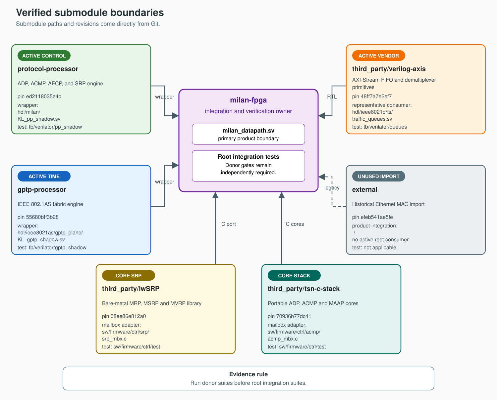

# Submodule integration map

Gitlinks define accepted revisions.

Detached submodule heads are normal.

Dirty submodules invalidate local evidence.



## Contents

- **[Pinned dependencies](#pinned-dependencies)** -- Identify every imported repository.
- **[Initialize safely](#initialize-safely)** -- Populate exact recorded revisions.
- **[Respect ownership](#respect-ownership)** -- Separate donor and root responsibilities.
- **[Known documentation conflicts](#known-documentation-conflicts)** -- Avoid stale donor claims.

## Pinned dependencies

<!-- submodule-pins:start -->
| Path | Pin | Purpose | Root integration |
|---|---|---|---|
| `external` | `efeb541ae5fe1e078332d8462dca2fc2d9cb8db5` | Historical Ethernet MAC RTL | No active product consumer |
| `gptp-processor` | `135afd043309369a87ddbc8d6550aff8ec52a157` | Fabric gPTP engine | `KL_gptp_shadow.sv` |
| `protocol-processor` | `a9e84b66d4cd0c331c8d6f2c1a71a62fcc824645` | ADP, ACMP, AECP, and SRP | `KL_pp_shadow.sv` |
| `third_party/lwSRP` | `08ee86e812a0eb5e1dc6cd61b494d8baf3491348` | Bare-metal MRP, MSRP and MVRP | `sw/firmware/ctrl/srp/srp_mbx.c` |
| `third_party/tsn-c-stack` | `70936b77dc41981e192438388cd0aced69954f18` | Portable ADP, ACMP and MAAP cores | `sw/firmware/ctrl` mailbox adapters |
| `third_party/verilog-axis` | `48ff7a7e2ef782cf778d47910cf85835c64b1bce` | AXI-Stream primitives | Multiple RTL consumers |
<!-- submodule-pins:end -->

Issue #508 adopted these processor changes.

| Processor issues | Merged PR | Adopted behavior |
|---|---|---|
| [92](https://github.com/Mister-M-alt/protocol-processor-control-plane-avb-milan/issues/92), [93](https://github.com/Mister-M-alt/protocol-processor-control-plane-avb-milan/issues/93) | [109](https://github.com/Mister-M-alt/protocol-processor-control-plane-avb-milan/pull/109) | Saved-binding restore, bounded walk, listener boot hold |
| [94](https://github.com/Mister-M-alt/protocol-processor-control-plane-avb-milan/issues/94) | [110](https://github.com/Mister-M-alt/protocol-processor-control-plane-avb-milan/pull/110) | Descriptor-memory guard; no external port change |
| [43](https://github.com/Mister-M-alt/protocol-processor-control-plane-avb-milan/issues/43), [49](https://github.com/Mister-M-alt/protocol-processor-control-plane-avb-milan/issues/49) | [111](https://github.com/Mister-M-alt/protocol-processor-control-plane-avb-milan/pull/111) | Processor-owned input probing, ACMP status and failure fields |
| [112](https://github.com/Mister-M-alt/protocol-processor-control-plane-avb-milan/issues/112) | [114](https://github.com/Mister-M-alt/protocol-processor-control-plane-avb-milan/pull/114) | Admission grants wait for the current declaration's evaluation |
| [116](https://github.com/Mister-M-alt/protocol-processor-control-plane-avb-milan/issues/116) | [117](https://github.com/Mister-M-alt/protocol-processor-control-plane-avb-milan/pull/117) | Parent-gate fixes; no behavior or external port change |
| [113](https://github.com/Mister-M-alt/protocol-processor-control-plane-avb-milan/issues/113) | [115](https://github.com/Mister-M-alt/protocol-processor-control-plane-avb-milan/pull/115) | Latency-only GET_STREAM_INFO notification; no external port change |

PR 117 merged as `265d6762`.

PR 115 then merged as `990f9652`.

Issue #567 adopted processor pin `0922e434`.

| Merged processor PR | Adopted change |
|---|---|
| [118](https://github.com/Mister-M-alt/protocol-processor-control-plane-avb-milan/pull/118) | October MVU waiver and unsupported-command response tests |
| [119](https://github.com/Mister-M-alt/protocol-processor-control-plane-avb-milan/pull/119) | Complete integration parameter inventory and its checker |

That adoption left processor HDL and ROM generators unchanged.

The repository tool recorded ROM digest rows for `0922e434`.

Their digests match the `990f9652` rows.

Issue #502 adopted processor pin `870ff88a`.

- PR 121 exports each accepted live name write.
- `KL_pp_shadow` connects that pulse to saved-state pending.
- The parent's actual-write enable supplies the map trigger.
- Later marks retain their command-completion meaning.

Issue #580 adopted processor pin `16be6768`.

- [Processor PR 124](https://github.com/Mister-M-alt/protocol-processor-control-plane-avb-milan/pull/124) rejects body/key type and index mismatches.
- [Processor PR 126](https://github.com/Mister-M-alt/protocol-processor-control-plane-avb-milan/pull/126) documents descriptor ownership.
- [Processor #122](https://github.com/Mister-M-alt/protocol-processor-control-plane-avb-milan/issues/122#issuecomment-5853884588) retains Milan 5.3.3.8's cluster minimum.
- The zero-cluster 8x8 input pools violate that minimum.
- Parent [#584](https://github.com/kebag-logic/milan-fpga/issues/584) owns the D8 product correction.
- All five configurations retain identical AEM images and builder outputs.

Issues #606 and #608 adopted processor pin `c951a9ff`.

- [Processor PR 129](https://github.com/Mister-M-alt/protocol-processor-control-plane-avb-milan/pull/129) retries refused destination allocation every 100 ms.
- Every enabled source acquires independently of its first probe.
- [Processor PR 130](https://github.com/Mister-M-alt/protocol-processor-control-plane-avb-milan/pull/130) defers own LeaveAll aging until transmit acceptance.
- Listener withdrawal before that action still clears IN.
- Existing LV withdrawal semantics remain unchanged.
- Parent regressions exercise MAAP acquisition and CRF STREAM_STOP.
- Bench re-measurement follows on the next image.

Issue #70 lane 2 adopted processor pin `b2db3a97`.

- [Processor PR 132](https://github.com/Mister-M-alt/protocol-processor-control-plane-avb-milan/pull/132) adds the scalar-record D3 writer (`d352bbaa`).
- It holds AECP until the D3 restore's terminal.
- `KL_pp_shadow` connects the combined restore status and the D3 pending.
- [Processor PR 133](https://github.com/Mister-M-alt/protocol-processor-control-plane-avb-milan/pull/133) restarts the leavealltimer on a received LeaveAll.
- Its talker licence waits for the stream VID's MVRP join.
- It changes no port or parameter of the processor top.
- The ROM generators' outputs match the `c951a9ff` rows.

Issue #635 adopts processor pin `631eeb34`.

| Processor lane | Merged PR | `main` after merge |
|---|---|---|
| C3, ADP | [136](https://github.com/Mister-M-alt/protocol-processor-control-plane-avb-milan/pull/136) | `0451d83d` |
| C2, MAAP | [135](https://github.com/Mister-M-alt/protocol-processor-control-plane-avb-milan/pull/135) | `d5f73bac` |
| C4, ACMP | [137](https://github.com/Mister-M-alt/protocol-processor-control-plane-avb-milan/pull/137) | `3f3ea56b` |
| C5b, AECP dispatch and responses | [138](https://github.com/Mister-M-alt/protocol-processor-control-plane-avb-milan/pull/138) | `16ea10ac` |
| C5a, AECP deadlines and hazards | [140](https://github.com/Mister-M-alt/protocol-processor-control-plane-avb-milan/pull/140) | `03c842a7` |
| C6, notifications and Identify | [139](https://github.com/Mister-M-alt/protocol-processor-control-plane-avb-milan/pull/139) | `2ebd4fe8` |
| P141, clock sources for #629 | [142](https://github.com/Mister-M-alt/protocol-processor-control-plane-avb-milan/pull/142) | `631eeb34` |

- `ltn_rom.hex` matches the `b2db3a97` row.
- The `ucode.hex` digest changes.

The parent can observe these processor changes.

| Processor change | Parent position |
|---|---|
| C6 adds input `identify_button_i` and parameter `EN_IDENTIFY_NOTIF_P`, default 0 | `KL_pp_shadow` ties both to 0 until a board button exists |
| C6 draws that input in processor diagram 21 | The parent keeps no copy of that diagram |
| C5a answers an AECP command still running 100 ms after reception | No top port or parameter; its kill ports stay inside the processor, and the three scoreboard kill tie-offs left the processor top |
| C5a answers a non-AEM command whose response memory fails NOT_IMPLEMENTED, with the command echoed ([processor PR 140](https://github.com/Mister-M-alt/protocol-processor-control-plane-avb-milan/pull/140); Milan v1.2 Section 5.4.3.3, Table 5.19) | No top port or parameter; GET_MILAN_INFO is such a command, and at `b2db3a97` the same fault answered ENTITY_MISBEHAVING |
| C5a serializes AECP and ACMP work by hazard class | No top port or parameter |
| C5b accepts `DESC_LINE_BYTES_P` from 576 to 1008, in steps of 8 | The parent binds 576, the floor |
| C3 carries a SET_CONFIGURATION index in the ADPDU | The parent image declares one configuration; the wire is unchanged while `ADP_IDX0` is 0 |
| C2 fixes the internal MAAP engine | The parent ties `cfg_maap_internal_i` to 0, so it stays inactive |
| P141 grades SET/GET_CLOCK_SOURCE over ten sources | [Media-clock following](../design/MEDIA_CLOCK_FOLLOWING.md#protocol-processor-changes) records it as landed |

Issue #661 adopts processor pin `ead80360`.

| Processor lane | Merged PR | `main` after merge |
|---|---|---|
| C8, descriptor model lint | [144](https://github.com/Mister-M-alt/protocol-processor-control-plane-avb-milan/pull/144) | `88969246` |
| #143, campaign jobs | [146](https://github.com/Mister-M-alt/protocol-processor-control-plane-avb-milan/pull/146) | `c74711d4` |
| P2, NVM port deadline | [145](https://github.com/Mister-M-alt/protocol-processor-control-plane-avb-milan/pull/145) | `ddb3119d` |
| C7, counters face | [147](https://github.com/Mister-M-alt/protocol-processor-control-plane-avb-milan/pull/147) | `f4167536` |
| P1, persistence beyond BINDING | [150](https://github.com/Mister-M-alt/protocol-processor-control-plane-avb-milan/pull/150) | `c4cb84ff` |
| C10, Yosys tops and declarations | [149](https://github.com/Mister-M-alt/protocol-processor-control-plane-avb-milan/pull/149) | `5c71928a` |
| #85, ADP matrix walk | [152](https://github.com/Mister-M-alt/protocol-processor-control-plane-avb-milan/pull/152) | `83999eba` |
| #232, notification registry RAM | [153](https://github.com/Mister-M-alt/protocol-processor-control-plane-avb-milan/pull/153) | `c050d971` |
| #230, SRP area | [154](https://github.com/Mister-M-alt/protocol-processor-control-plane-avb-milan/pull/154) | `07b1469d` |
| #81 and #84, scoreboard faces | [157](https://github.com/Mister-M-alt/protocol-processor-control-plane-avb-milan/pull/157) | `b0a74196` |
| #639, arm queues and listener records | [155](https://github.com/Mister-M-alt/protocol-processor-control-plane-avb-milan/pull/155) | `ead80360` |

- `ltn_rom.hex` and `ucode.hex` match the `631eeb34` rows.
- The top gains one parameter and no port.

The parent can observe these processor changes.

| Processor change | Parent position |
|---|---|
| P2 adds parameter `NVM_MEM_TMO_CYC_P`, default `CLK_HZ_P` (1,000 ms) | `KL_pp_shadow` keeps the default |
| P2 answers a silent NVM device at that deadline: err, cause DEADLINE | Three failed attempts raise `nvm_alarm`; the [D3 contract](../design/SAVED_STATE_MATERIALIZATION.md) is amended (W13, section 8.8, section 15 item 4) |
| P1 adds the name stage; the channel maps are the parent's ([processor #83 ruling](https://github.com/Mister-M-alt/protocol-processor-control-plane-avb-milan/issues/83#issuecomment-5967611704)) | The D3 contract is amended; the map writer, restore and roll-back are #637's |
| P1 keeps `pend_i`'s sticky live-name term | A parent lane transfers names to `d3_unflushed_o` |
| C8 lints the descriptor model inside `build()` by default | Both image emitters run it; the 8x8 configuration carries its #584 waiver; the parent's duplicate L6/L10 checker is retired |
| C10 names six modules as Yosys tops and declares before use | `processor_yosys_tops.budget` is empty and the xvlog ratchet banks the fix |
| #232 drops the `pd_ix_w` use-before-declaration | The xvlog ratchet banks it |
| #85 resets `available_index` to 0 after ENTITY_DEPARTING (IEEE 1722.1-2021 Section 6.2.2.15) | The [register map](REGISTER_MAP.md) `0x644` note says so |
| #157 serializes GET_DYNAMIC_INFO against an in-flight ACMP stream step | No top port or parameter |
| #230, #232 and #639 move storage into distributed RAM | No top port or parameter; the [resource gate](../design/AREA_BUDGET.md#the-resource-gate) is re-baselined |
| C7 documents the integrator-owned `ctr_*` counters face | `milan_datapath` already meets it |
| #143 adds `--jobs` to the processor's mutation campaigns | No parent change |

Issue #682 adopts processor pin `2ad2f845`.

| Processor lane | Merged PR | Parent-visible result |
|---|---|---|
| #148, counter notification spacing | [159](https://github.com/Mister-M-alt/protocol-processor-control-plane-avb-milan/pull/159) | The spacing stamp follows each waiting job through grant; the parent harness completes frames crossing an observation boundary |
| C11, interface documentation | [156](https://github.com/Mister-M-alt/protocol-processor-control-plane-avb-milan/pull/156) | Documents the landed byte interfaces, TX backpressure and complete FCS-good RX frames |
| #134, SRP registrar expiry | [160](https://github.com/Mister-M-alt/protocol-processor-control-plane-avb-milan/pull/160) | Expiry precedes reception on a simultaneous event; Lv and LeaveAll finish MT, while New and Join renew IN |
| #158, mid-round DEREGISTER | [161](https://github.com/Mister-M-alt/protocol-processor-control-plane-avb-milan/pull/161) | A held DEREGISTER waits for the round boundary, preserving subsequent controllers' notifications |
| #22, declaration order | [162](https://github.com/Mister-M-alt/protocol-processor-control-plane-avb-milan/pull/162) | Existing declarations precede use; the parent analysis budget has zero processor findings |
| #42, Domain notifications | [164](https://github.com/Mister-M-alt/protocol-processor-control-plane-avb-milan/pull/164) | Tests Domain and link-edge notification triggers; the parent still owns the mapping words |

The processor top is byte-identical to the previous pin.

No port, parameter or register changes require parent adaptation.

Both processor ROM digests match the `ead80360` rows.

Counter spacing is measured at grant.

Later MAC stalls remain a wire-gap limitation.

The held DEREGISTER retains its contents but can arrive later.

After merge, the manager repeats #608 withdrawal cycles.

The manager also reads #658's default map.

This adoption checks the resource baseline and capture receipt.

Issue #708 adopts processor pin `2cbed0a9`.

The range also carries processor PRs 165 and 166.
The issue's list does not name them.

| Processor issue | Merged PR | Parent-visible result |
|---|---|---|
| #69, AVB interface count | [165](https://github.com/Mister-M-alt/protocol-processor-control-plane-avb-milan/pull/165) | The top gains parameter `N_AVB_IF_P`, default 1, and input `rx_if_index_i`, default 0; `KL_pp_shadow` keeps both defaults, so one interface changes no cell |
| #163, transmit-arbiter cone | [166](https://github.com/Mister-M-alt/protocol-processor-control-plane-avb-milan/pull/166) | The withdraw mask is registered, so a cancellation reaches the arbiter one clock later; no port, parameter or register change |
| #167, coincident cancellations | [169](https://github.com/Mister-M-alt/protocol-processor-control-plane-avb-milan/pull/169) | A probe cancellation that coincides with a TIME_LIMITED drain is sent on the next idle cycle rather than dropped; no port, parameter or register change |
| #168, ACMP response fields | [171](https://github.com/Mister-M-alt/protocol-processor-control-plane-avb-milan/pull/171) | UNBIND_RX_RESPONSE carries zero talker identifiers (Milan v1.2 Table 5.36), status survives retries (5.5.3.5.30 step 2), lock refusals are 16 (IEEE 1722.1-2021 Table 8-3), an invalid DISCONNECT_TX source is TALKER_UNKNOWN_ID (Milan v1.2 5.5.4.2, Table 5.44), and the processor serves the full 16-bit received VLAN in STREAM_INPUT GET_STREAM_INFO selector 6 and in GET_RX_STATE_RESPONSE; the [firmware ACMP walk](../design/MAILBOX_SPLIT.md#differences-from-the-processor) now compares raw bytes |
| #170, saved names | [172](https://github.com/Mister-M-alt/protocol-processor-control-plane-avb-milan/pull/172) | Tests and documentation only; the parent's test-evidence readers classify the processor's new name-state mutation driver |

Both processor ROM digests match the `2ad2f845` rows.

The [resource gate](../design/AREA_BUDGET.md#the-resource-gate) is re-baselined at this pin.

Its shipping route keeps +0.215 ns WNS.

The processor now serves STREAM_INPUT GET_STREAM_INFO selector 6's `stream_vlan_id`.

A settled input reports all 16 received bits.

An unsettled input reports 0.

GET_RX_STATE_RESPONSE also carries the full 16 bits.

The parent's selector-6 input VLAN halfword is no longer used.

The parent's `acmp_bound_vlan_o` keeps 12 bits per sink.

Issue #771 adopts processor pin `93fb0b2d` and gPTP pin `55680bff`.

| Processor issue | Merged PR | Parent-visible result |
|---|---|---|
| #72, traceability | [173](https://github.com/Mister-M-alt/protocol-processor-control-plane-avb-milan/pull/173) | Tests and documentation only; the parent's gates that read processor files count three more files |
| #151, elaboration guards | [175](https://github.com/Mister-M-alt/protocol-processor-control-plane-avb-milan/pull/175) | Every guard is a `$fatal`, so a violating parameter stops Verilator, sv2v with Yosys, and xvlog; the parent's test-evidence readers classify the guard bench and its campaign |
| #73, AECP command model | [174](https://github.com/Mister-M-alt/protocol-processor-control-plane-avb-milan/pull/174) | `protocol-processor/hdl/aecp/ucode/aecp_commands.json` and `aecp_fields.json` generate F06.14 and the microcode's dispatch data; the test-evidence readers classify the command campaign |
| #178 and #179, SET_CONFIGURATION | [180](https://github.com/Mister-M-alt/protocol-processor-control-plane-avb-milan/pull/180) | An unchanged configuration index pushes no notification (Milan v1.2 Section 5.4.5.2); a missing index answers NO_SUCH_DESCRIPTOR (IEEE 1722.1-2021 Table 7-141) |
| #177, GET_AVB_INFO | [182](https://github.com/Mister-M-alt/protocol-processor-control-plane-avb-milan/pull/182) | A descriptor other than AVB_INTERFACE answers NOT_IMPLEMENTED with the command echoed, where it answered NOT_SUPPORTED |
| #176, SET_STREAM_INFO body | [183](https://github.com/Mister-M-alt/protocol-processor-control-plane-avb-milan/pull/183) | The IEEE 1722.1-2013 48-byte body (cdl 60) is accepted beside the 2021 body and answered in the 2021 form; any other length is BAD_ARGUMENTS; the milan_dp #67 rows expect SUCCESS |
| #181, notification-router cut | [187](https://github.com/Mister-M-alt/protocol-processor-control-plane-avb-milan/pull/187) | The notification queue's occupancy is a register, and the event router's scan reads registers only; no port, parameter or cycle change |
| #184, MSRP Domain re-declaration | [191](https://github.com/Mister-M-alt/protocol-processor-control-plane-avb-milan/pull/191) | JoinIn only while a peer Domain is registered, JoinMt otherwise (IEEE 802.1Q-2018 Section 10.7.6.3) |
| #190, per-source TSpec | [194](https://github.com/Mister-M-alt/protocol-processor-control-plane-avb-milan/pull/194) | `cfg_tspec_max_frame_i` widens to `[N_STREAM_OUT_P*16-1:0]`, one MaxFrameSize per source; `KL_pp_shadow` drove every slot with its one 16-bit value at this adoption, so every declaration was unchanged; since #774 it takes one value per source and the CRF slot declares its own |
| #185 and #186, CONTROL and UNLOCK | [196](https://github.com/Mister-M-alt/protocol-processor-control-plane-avb-milan/pull/196) | READ_DESCRIPTOR CONTROL serves the IDENTIFY control's current value; both unlock notifications carry flags UNLOCK |
| #188 and #189, Listener registration | [195](https://github.com/Mister-M-alt/protocol-processor-control-plane-avb-milan/pull/195) | A rebind keeps the owed Listener Leave; GET_RX_STATE REGISTERING_FAILED follows the registered type on every change |
| #192, started/stopped notification | [197](https://github.com/Mister-M-alt/protocol-processor-control-plane-avb-milan/pull/197) | Every started/stopped change of a Stream Input pushes GET_STREAM_INFO to every registered controller, a START/STOP_STREAMING requester included (Milan v1.2 Section 5.4.5.1); the milan_dp G9 rows expect it |
| milan-fpga #632, SET_STREAM_INFO change gate | [199](https://github.com/Mister-M-alt/protocol-processor-control-plane-avb-milan/pull/199) | The notification compare reads the stored offset once a controller set it, the integrator's factory word before |
| #193, one Listener declaration per StreamID | [198](https://github.com/Mister-M-alt/protocol-processor-control-plane-avb-milan/pull/198) | Sinks settled on one `stream_id` share one declaring applicant (IEEE 802.1Q-2018 Section 10.7.7 and the Section 35.2.6 NOTE); no port, parameter or register change |

| gPTP issue | Merged PR | Parent-visible result |
|---|---|---|
| #640 M7, timer deadlines | [78](https://github.com/Mister-M-alt/FPGA-gPTP/pull/78) | None in this adoption: the merge's tree is the previous pin's |
| #82, boot grandmaster | [83](https://github.com/Mister-M-alt/FPGA-gPTP/pull/83) | From reset release the engine publishes thisClock as grandmaster and `{thisClock}` as the path (IEEE 802.1AS-2011 Section 10.3.12.1.4 b) and i), with Cor1-2013); `0x624`/`0x628` and GET_AVB_INFO read thisClock before any peer, and that first identity arms the Milan v1.2 Annex B.1.1 holdover |
| #84, the grandmaster role is synchronised | [86](https://github.com/Mister-M-alt/FPGA-gPTP/pull/86) | While this station is grandmaster, sync-ok is set, so `tu` reads 0 once the holdover a grandmaster change arms has run |
| #85, pathTrace | [86](https://github.com/Mister-M-alt/FPGA-gPTP/pull/86) | The published path is the received pathSequence with thisClock appended (IEEE 802.1AS-2011 Section 10.3.10.2.1 d)): up to seven received entries, each count gains one entry and each GET_AS_PATH response eight bytes. The eight-identity publication bounds the append: at eight or more received entries the path is the first eight received entries, the count stays 8 and thisClock is not appended (widening it would be a port change) |

The [resource gate](../design/AREA_BUDGET.md#the-resource-gate) is re-baselined under an [owner exception](https://github.com/kebag-logic/milan-fpga/issues/771#issuecomment-6333175429).

This adoption adds 770 LUTs to dev's shipping route. Its tolerance is 500 LUTs.

Mark II ([#640](https://github.com/kebag-logic/milan-fpga/issues/640)) addresses that growth.

Its shipping route keeps +0.291 ns WNS.

The processor top changes one port, the TSpec width.

The gPTP engine's ports and parameters are unchanged.

`ucode.hex` and `gptp_ucode.hex` change; `ltn_rom.hex` does not.

Issue #780 adopts processor pin `ed211803`.

FPGA-gPTP stays at `55680bff`.

| Processor issue | Merged PR | Parent-visible result |
|---|---|---|
| #200, GET_AVB_INFO status | [201](https://github.com/Mister-M-alt/protocol-processor-control-plane-avb-milan/pull/201) | A descriptor other than AVB_INTERFACE answers NOT_SUPPORTED (IEEE 1722.1-2021 Table 7-141 status 11, the command is implemented but its target is not supported) with the command echoed at its own length, where #177 answered NOT_IMPLEMENTED (status 1); an absent AVB_INTERFACE index still answers NO_SUCH_DESCRIPTOR and a command under cdl 16 BAD_ARGUMENTS |

The engine change is one dispatch constant.

No port, parameter or register changes.

`ucode.hex` and `ltn_rom.hex` are unchanged; both digests match the `93fb0b2d` rows.

No parent test, model or document expected status 1 here.

Issue #799 adopts processor pin `f65c8ff7`.

FPGA-gPTP stays at `55680bff`.

| Processor issue | Merged PR | Parent-visible result |
|---|---|---|
| #202, Stream ID after a MAAP conflict | [204](https://github.com/Mister-M-alt/protocol-processor-control-plane-avb-milan/pull/204) | After a MAAP conflict a declared source moves to a new Stream ID with the same upper 48 bits at its next grant, and declares it at once: IEEE 802.1Q-2018 Section 35.2.2.8 asks for two LeaveAllTime periods only before the same StreamID returns with another FirstValue, and Milan v1.2 Table 5.3 lets the PAAD use another Stream ID. The top gains the output `src_stream_id_o`, each source's current ID; `KL_pp_shadow` passes it out, and `milan_datapath` stamps it on the AAF and CRF frames (IEEE 1722-2016 Section 4.4.4.8) and answers an output's GET_STREAM_INFO stream_id with it (IEEE 1722.1-2021 Section 7.4.16.2). A TCTX unique ID no longer reaches the wire. The milan_dp `sidmove` and `sidmove8` legs drive a real conflict |
| #205, GET_TX_STATE refusal | [207](https://github.com/Mister-M-alt/protocol-processor-control-plane-avb-milan/pull/207) | A GET_TX_STATE whose talker_unique_id names no valid source answers TALKER_UNKNOWN_ID with the command's listener_entity_id and listener_unique_id (Milan v1.2 Section 5.5.4.3 step 1, Table 5.46); SUCCESS keeps both 0 (Table 5.47) |
| #206, GET_STREAM_INFO while not settled | [208](https://github.com/Mister-M-alt/protocol-processor-control-plane-avb-milan/pull/208) | An input that is not settled reports stream_id, stream_dest_mac and stream_vlan_id as 0 with STREAM_ID_VALID, STREAM_DEST_MAC_VALID and STREAM_VLAN_ID_VALID clear (Milan v1.2 Section 5.4.2.10.1, Table 5.9): the processor gates the parent's selectors 0, 2 and 4 on its committed probing status. This closes #790; milan_dp `[GSI]` G11 and the `pp_shadow` `[GSI]` group grade its four cases, and `make gsi-mutants` plants the pass-through |

The top adds one output, `src_stream_id_o`; no parameter or register changes.

The parent's mailbox contract moves to 2.3.
Each source's current Stream ID gets a publication entry.

`KL_mbx` gains `pub_src_sid_o`, which the split datapath reads.
The split firmware's writer is #665's work.

The [publication census](../../sw/mailbox/publication_census.py) maps both stamps to `SRC_SID_LO`.

`ucode.hex` and `ltn_rom.hex` are unchanged; both digests match the `ed211803` rows.

STRMW talker SID words (`0x814`, `0x818`) keep a source's first ID.

The torture plan no longer expects a two-LeaveAll wait.

The [resource gate](../design/AREA_BUDGET.md#the-resource-gate) measured this adoption against the eleventh record.

| Endpoint | LUT | FF | Gate |
|---|---|---|---|
| `route-1x1` | +753 (+1.47 %) | +499 | refused: LUT tolerance 500 |
| `ooc-1x1` | +518 | +404 | refused: tolerances 250 and 250 |
| `ooc-8x8` | +1,689 | +1,562 | refused: tolerances 316 and 339 |

The [owner accepted](https://github.com/kebag-logic/milan-fpga/issues/799#issuecomment-6460917634) this growth on 2026-10-28.
The twelfth record is measured at `8b76de69`.

The mailbox change moved no figure.

Almost all growth is the processor's #202 logic.

The route keeps +0.440 ns WNS.

Slices fall by 55; block RAM and DSP hold.

Issue #803 adopts gPTP pin `f97c1803`.

The processor stays at `f65c8ff7`.

| gPTP issue | Merged PR | Parent-visible result |
|---|---|---|
| #89, Sync receipt timeout | [92](https://github.com/Mister-M-alt/FPGA-gPTP/pull/92) | A grandmaster whose Sync stops for 375 ms is aged while gmPresent holds (IEEE 802.1AS-2011 Section 10.3.11, Figure 10-13 with Cor1-2013); with no other peer this station becomes grandmaster at that timeout, and the Milan v1.2 Annex B.1.1 holdover arms; a priority1 255 grandmaster stays elected, and its timeout clears sync only |
| #90, lost responses | [92](https://github.com/Mister-M-alt/FPGA-gPTP/pull/92) | asCapable clears at the fifth consecutive lost Pdelay response, where it cleared at the fourth (Figure 11-8 RESET) |
| #91, duplicate responses | [92](https://github.com/Mister-M-alt/FPGA-gPTP/pull/92) | A second Pdelay_Resp for the outstanding request resets the exchange, and that interval counts as a lost response (Figure 11-8) |
| #88, Announce qualification | [93](https://github.com/Mister-M-alt/FPGA-gPTP/pull/93) | Only Section 10.3.10.2.1 a) to c) disqualify: a path count other than stepsRemoved+1 and a path head other than the grandmaster are accepted; d) copies the path as received, its head included, and appends thisClock, so an empty path trace TLV gives `{thisClock}` |
| #87, no path trace TLV | [93](https://github.com/Mister-M-alt/FPGA-gPTP/pull/93) | An Announce without the TLV writes no pathTrace, so the previous one stays: `{thisClock}` after reset or mastership, otherwise the last path copied, across a grandmaster change too |

The engine's one port change is `pub_path_o`.

It carries eight entries from entry 0.

It carried seven, after the grandmaster.

`KL_gptp_shadow` publishes all eight entries.

`milan_datapath` serves GET_AS_PATH entry 0 from that head.

Its clause is IEEE 1722.1-2021 7.4.41.2.

Entry 0 was the grandmaster identity.

It is now the received head or thisClock.

The AS_PATH notification compares entry 0, count and entries.

`milan_csr` keeps its seven-entry AS_PATH face.

Only its port comments change.

No top-level port, parameter or register changes.

`KL_gptp_shadow.pub_path_o` widens with the engine's: eight entries from entry 0.

Its test wrapper `gptp_shadow_wrap` adds `pub_path_head_o`.

`gptp_ucode.hex` changes; its ledger row matches the donor's tracked image.

The physical gPTP leg spans one more Pdelay interval.

It runs 17.992742740 simulated seconds.

Its nightly suite deadline rises to 6900 seconds.

Its job's timeout rises to 145 minutes.

Route-1x1 is 211 LUTs under the twelfth resource record.

Its tolerance is 500 LUTs, so the gate passes.

That record has dev `e78472ff`'s synthesis inputs.

This adoption adds 53 FFs and 54 slices.

Sixteen of 15,850 slices remain.

Its shipping route meets timing at +0.303 ns WNS.

Issue #806 adopts gPTP pin `135afd04`.

The processor stays at `f65c8ff7`.

| gPTP issue | Merged PR | Parent-visible result |
|---|---|---|
| #94, portEnabled | [95](https://github.com/Mister-M-alt/FPGA-gPTP/pull/95) | The engine takes portEnabled (IEEE 802.1AS-2011 Section 10.2.4.11) as `port_enabled_i`. While it is low the port starts no gPTP frame, withdraws a frame whose first byte is unaccepted and completes no Pdelay exchange. Each edge after the first sample since reset clears asCapable at once and ends the Milan v1.2 Section 4.2.6.2.5 Pdelay_Req cease, one retained across a warm reset included (Figure 11-8 NOT_ENABLED, with Cor1-2013 and Cor2-2015); a rise sends one Pdelay_Req at once. The 5-minute countdown exit is unchanged |

The engine's one port change is `port_enabled_i`.

`KL_gptp_shadow` adds the same input.

`milan_datapath` drives it from `eff_link_w`.

That is the PHY link and `LINK_CTRL[0]`.

The link guard's estimate is its third term.

The three plane test wrappers tie it enabled.

No top-level port, parameter or register changes.

`gptp_ucode.hex` changes; its ledger row matches the donor's tracked image.

The `milan_dp` gptp leg grades each term.

It also grades both cease exits.

Route-1x1 is 175 LUTs under the twelfth resource record.

Against dev's route it adds 36 LUTs and 28 FFs.

Slices fall by 11; 27 of 15,850 remain.

Every corner meets the build floor.

The slow corners meet it at +0.032 ns WNS.

That is 0.408 ns under the record.

The record holds +0.440 ns.

The tolerance is 0.25 ns.

Before #818 the gate refused that fall.

Under #818 the fall prints a WARNING and passes.

The slowest path is the SoC's bridge-to-flash path.

Timing recovery is ruled under #814/#818.

The best directive meets the build floor at every corner.

Both standalone endpoints equal the record in every figure.

Issue #787 adopts processor pin `a9e84b66`.

It is the merge commit of processor PR #209.

That PR carries processor issue #203.

It merged during the lane's second round.

Its tree, `b0f66acb`, is the reviewed head `013ee63f`'s.

The lane pinned `1be824fc`, then `013ee63f`.

Since `013ee63f`, every started frame leaves before the request.

That holds with or without an ENTITY_DEPARTING.

The top's ports and parameters match across all three pins.

FPGA-gPTP stays at `135afd04`.

| Processor issue | Merged PR | Parent-visible result |
|---|---|---|
| #203, AECP REBOOT | #209, merge commit `a9e84b66` | REBOOT of ENTITY 0 answers SUCCESS (IEEE 1722.1-2021 7.4.43, Figure 7-68) and notifies the other registered controllers (7.5.2). Where advertising, ENTITY_DEPARTING follows (Milan v1.2 5.6.3.3). Once every frame it started has left, the top holds the new output `reboot_req_o` and serves no further command. Another descriptor type answers NOT_SUPPORTED, a non-zero index NO_SUCH_DESCRIPTOR, a cdl below 16 BAD_ARGUMENTS and another controller's lock ENTITY_LOCKED |

The top adds one output, `reboot_req_o`.

No parameter or register changes.

`KL_pp_shadow` passes it to `milan_datapath`.

`KL_reboot_ctrl` resets the end station on it.

The request rises once frames leave the processor.

They may still be inside the MAC then.

So `KL_reboot_ctrl` first waits for the MAC to empty.

Only then does it hold the PHY in reset.

The [reset design](../design/REBOOT_RESET.md) records that decision.

`ucode.hex` changes; the ledger records its row.

`ltn_rom.hex` is unchanged.

The behave SERVED table lists REBOOT at cdl 16.

`a9e84b66` carries `1be824fc`'s two ROM images, byte for byte.

The route below was measured at `1be824fc` with FPGA-gPTP `f97c1803`.

Route-1x1 uses 51,828 LUTs, 184 under the record.

It adds 92 FFs and 13 slices.

57 of 15,850 slices remain.

WNS is +0.107 ns, over its floor.

Before #818 the gate refused its 0.333 ns fall.

The worst path is the SoC's SDRAM port arbitration.

That path lies outside this change.

Both standalone endpoints pass the gate.

`ooc-1x1` moves -53 LUTs and +7 FFs.

`ooc-8x8` moves +104 LUTs and +16 FFs.

The re-pin route carries the #814 cuts.

Its best directive has WNS +0.365 ns.

It uses 52,021 LUTs; 63 slices remain.

The #818 gate passes it.

The ROM ledger records current and earlier pins.

The boundary diagram follows the current pin.

OOC synthesis requires ledger rows for the pin of record.
Rows must match that exact pin.

The parent wrapper's parameter bindings match the documented inventory.

Run the inventory checker from the parent checkout:

```sh
python3 protocol-processor/scripts/check-integrator-params.py
```

The [datapath suite](../../tb/verilator/milan_dp/README.md#the-508-get_stream_info-seam-the-gsi-section-of-obj_notify) records notification coverage.

`traffic_queues.sv` is one representative consumer.

Other consumers exist throughout root RTL.

The pin checker reads Git index entries.

It does not trust checked-out heads.

Issue #665 adopts stack pin `70936b77`.

| Stack PR | Parent-visible result |
|---|---|
| [19](https://github.com/kebag-logic/tsn-c-stack/pull/19) | ADP discovery rejects frames shorter than 82 bytes, unsupported versions and control-data lengths other than 56 |
| [20](https://github.com/kebag-logic/tsn-c-stack/pull/20) | Standalone entity generation; the parent retains its existing descriptor generator |
| [25](https://github.com/kebag-logic/tsn-c-stack/pull/25) | Valid talker destinations declare after a fresh probe or with a registered Listener |

Parent adapter tests exercise every ADP refusal and valid discovery.

The mailbox publishes the stack declaration predicate as `DA_GATE`.

## Initialize safely

Firmware and root gates use these five submodules.

```sh
git submodule update --init \
  third_party/verilog-axis \
  protocol-processor \
  gptp-processor \
  third_party/lwSRP \
  third_party/tsn-c-stack
```

lwSRP uses the HTTPS URL recorded in `.gitmodules`.
The repository is public; anonymous HTTPS fetch needs no credentials.

The pin is published on `main`.
It includes PR #12, PR #15 and PR #18.

The [SRP adapter](../../sw/firmware/ctrl/srp/README.md) documents compilation and ownership.

lwSRP is licensed under Apache-2.0.
Its pinned `LICENSE` and `NOTICE` retain dependency terms.

tsn-c-stack uses HTTPS and needs no credentials.

The pin is the merge of tsn-c-stack PR 25 on `main`.

The previous pin remains reachable through its publication tag.

The current pin includes #19's `src/adp.c` discovery refusals.

It holds the ADP, ACMP and MAAP cores.

The [control firmware](../../sw/firmware/ctrl/README.md) uses its public headers.

tsn-c-stack is licensed under [MIT](https://github.com/kebag-logic/tsn-c-stack/blob/70936b77dc41981e192438388cd0aced69954f18/LICENSE).

The unused external import uses SSH.

Initialize it only when needed.

```sh
git submodule update --init external
```

Compare every populated checkout revision.

```sh
git submodule status --recursive
```

- A leading space confirms the recorded revision.
- A leading dash means uninitialized content.
- A leading plus means revision mismatch.
- A leading `U` means unresolved content.

Revision agreement does not prove cleanliness.

```sh
git submodule foreach --quiet --recursive 'git status --short'
```

The cleanliness command must print nothing.

## Respect ownership

- Change donor behavior inside its repository.
- Land donor tests before changing pins.
- Move pins only after donor evidence.
- Run root integration after every pin.
- Root tests never replace donor suites.
- Root wrappers own adaptation logic.
- Root documentation owns integration behavior.

| Repository | Donor gate | Root gate |
|---|---|---|
| `protocol-processor` | `protocol-processor/scripts/run_suites.sh` | `make -C tb/verilator/pp_shadow` |
| `gptp-processor` | `make -C gptp-processor` | `make -C tb/verilator/gptp_shadow` |
| `third_party/verilog-axis` | Upstream evidence | `make -C tb/verilator/queues` |
| `third_party/lwSRP` | cgreen and behave | `python3 sw/firmware/ctrl/test/test_ctrl_firmware.py --require-rv32 --self-test --jobs 4` |
| `third_party/tsn-c-stack` | [Quality workflow](https://github.com/kebag-logic/tsn-c-stack/blob/70936b77dc41981e192438388cd0aced69954f18/.github/workflows/quality.yml) | `python3 sw/firmware/ctrl/test/test_ctrl_firmware.py --require-rv32 --self-test --jobs 4` |
| `external` | Upstream evidence | Not applicable; no active product consumer |

## Known documentation conflicts

The reviewed gPTP guides match root ownership.

The pinned engine exports `phc_slew_active_o` for policy correction.

The parent carries it to the CRF servo (#545).

Window overlap preserves lock until measured correction completes.

- [Manager guide](https://github.com/Mister-M-alt/FPGA-gPTP/blob/135afd043309369a87ddbc8d6550aff8ec52a157/docs/MANAGER.md)
- [Integration guide](https://github.com/Mister-M-alt/FPGA-gPTP/blob/135afd043309369a87ddbc8d6550aff8ec52a157/docs/INTEGRATION.md)
- [HDL guide](https://github.com/Mister-M-alt/FPGA-gPTP/blob/135afd043309369a87ddbc8d6550aff8ec52a157/docs/HDL_DEVELOPER.md)
- [Test guide](https://github.com/Mister-M-alt/FPGA-gPTP/blob/135afd043309369a87ddbc8d6550aff8ec52a157/docs/TEST_DEVELOPER.md)

Processor PR 156 resolves both former RX-interface contradictions.

The current guide describes byte-wide RX without a ready input.

Its historical word-stream contract remains linked from the donor documentation.

The integrator supplies complete, FCS-good frames.

Root RTL remains the authority for parent runtime wiring.

Historical audit exceptions remain open disclosures.
PR13/PR6 branch continuity is UNKNOWN.

PR13/PR9 retain the negative-merge baseline.
Parent integration does not clear these donor audit findings.
